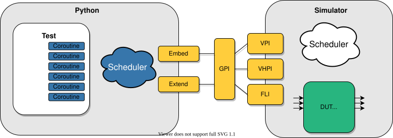
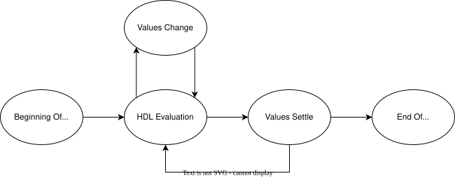
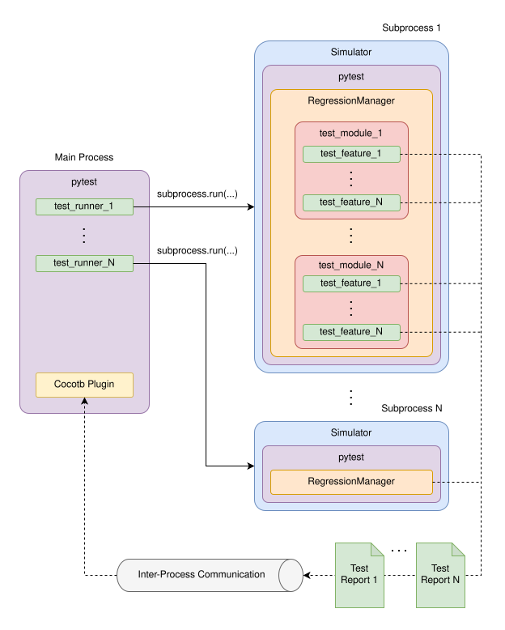
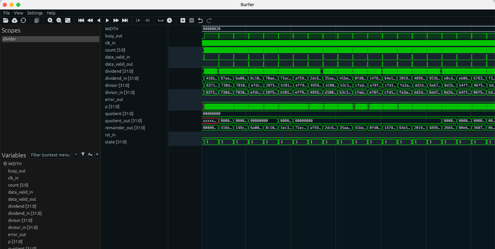

# cocotb visual reference

**cocotb** (COroutine-based COsimulation TestBench) lets you write HDL testbenches in **Python** instead of Verilog. The simulator (Icarus Verilog for us) still runs the RTL. cocotb loads into the simulator through VPI and drives and samples the DUT's ports from Python `async` coroutines. You get Python's whole ecosystem (numpy reference models, random stimulus, pytest, JUnit XML) for checking.

Status here: **cocotb 2.1.0** is installed (seen in `C:\Users\zubai\crusoe hackathon\.venv`, and the API notes below were checked against that copy), but the PlantForge pipeline testbenches are still plain Verilog. This guide covers what you need to try it, and how it would slot in.

> cocotb 2.x renamed several things from 1.x:
> - `TOPLEVEL` became `COCOTB_TOPLEVEL` and `MODULE` became `COCOTB_TEST_MODULES`.
> - `Timer(..., units=)` became `unit=`.
> - The runner moved from `cocotb.runner` to **`cocotb_tools.runner`**.
> - `Clock(...).start()` now returns a task directly.
>
> The old variable names still work but print deprecation warnings.

---

## 1. Minimal test with Icarus

### DUT (`counter.v`)

```verilog
`timescale 1ns/1ps
module counter (
    input  wire       clk,
    input  wire       rst,
    input  wire       ena,
    output reg  [7:0] count
);
    always @(posedge clk)
        if (rst)      count <= 8'd0;
        else if (ena) count <= count + 8'd1;
endmodule
```

### Test module (`test_counter.py`)

```python
import cocotb
from cocotb.clock import Clock
from cocotb.triggers import RisingEdge, ClockCycles, Timer
from cocotb.simtime import get_sim_time            # 2.x location (cocotb.utils re-exports it)


@cocotb.test()
async def counts_up(dut):
    """After reset, count increments once per enabled clock."""
    Clock(dut.clk, 10, unit="ns").start()        # 100 MHz; returns a Task in 2.x

    dut.rst.value = 1
    dut.ena.value = 0
    await ClockCycles(dut.clk, 2)
    dut.rst.value = 0
    dut.ena.value = 1

    for expected in range(1, 20):
        await RisingEdge(dut.clk)
        await Timer(1, unit="ns")                  # let the NBA settle before sampling
        got = dut.count.value.to_unsigned()        # LogicArray -> int (raises on X/Z)
        assert got == expected, f"count={got}, expected {expected} @ {get_sim_time('ns')} ns"


@cocotb.test()
async def hold_when_disabled(dut):
    Clock(dut.clk, 10, unit="ns").start()
    dut.rst.value = 1
    await ClockCycles(dut.clk, 2)
    dut.rst.value = 0
    dut.ena.value = 0
    await ClockCycles(dut.clk, 5)
    assert dut.count.value.to_unsigned() == 0
```


### Option A: Makefile (Linux, macOS, WSL, or Windows with GNU make)

```make
# Makefile
SIM            ?= icarus
TOPLEVEL_LANG  ?= verilog
VERILOG_SOURCES += $(PWD)/counter.v
COCOTB_TOPLEVEL     = counter          # HDL module name
COCOTB_TEST_MODULES = test_counter     # Python module (file name without .py)
# WAVES = 1                            # dump sim_build/counter.fst for GTKWave

include $(shell cocotb-config --makefiles)/Makefile.sim
```

Run it with `make` (or `make WAVES=1`). Rerun a single test with `make COCOTB_TEST_FILTER=counts_up`.

### Option B: Python runner (`cocotb_tools.runner`), recommended on Windows

```python
# run_tests.py   ->   python run_tests.py   (or: pytest run_tests.py)
from pathlib import Path
from cocotb_tools.runner import get_runner

HERE = Path(__file__).parent

def test_counter():
    runner = get_runner("icarus")
    runner.build(
        sources=[HERE / "counter.v"],
        hdl_toplevel="counter",
        always=True,               # rebuild every run
        waves=True,                # Icarus: must be set at build time to get waves
        timescale=("1ns", "1ps"),
    )
    results_xml = runner.test(
        hdl_toplevel="counter",
        test_module="test_counter",
        waves=True,                # writes sim_build/counter.fst
    )
    print("results:", results_xml)

if __name__ == "__main__":
    test_counter()
```

What the runner does with Icarus (from `cocotb_tools/runner.py` in 2.1.0):

- It compiles with `iverilog -g2012 …`.
- With `waves=True` it generates `sim_build/cocotb_iverilog_dump.v`, a helper module that runs `$dumpfile("<build>/counter.fst"); $dumpvars(0, counter);`, and passes `-fst` to `vvp`.
- **Icarus waves from cocotb are FST, not VCD.** GTKWave opens them directly: `gtkwave sim_build/counter.fst`.
- `test(..., gui=True)` under pytest launches `$COCOTB_WAVEFORM_VIEWER`, falling back to `surfer` and then to `gtkwave` on `PATH`.
- `iverilog` must be on `PATH`, or it stops with "iverilog executable not found!". On Windows, run OSS CAD Suite's `environment.bat` / `environment.ps1` first.

---

## 2. How results appear

### The terminal results table

When the regression finishes, cocotb prints a boxed summary through the `cocotb.regression` logger. The column headers come from `cocotb/regression.py` in 2.1.0: `TEST`, `STATUS`, `SIM TIME (ns)`, `REAL TIME (s)`, `RATIO (ns/s)`, followed by a totals row `TESTS=<n> PASS=<n> FAIL=<n> SKIP=<n>`. The layout looks like this (the values are illustrative):

```text
******************************************************************************************
** TEST                              STATUS  SIM TIME (ns)  REAL TIME (s)  RATIO (ns/s) **
******************************************************************************************
** test_counter.counts_up             PASS         210.00           0.01      21000.00  **
** test_counter.hold_when_disabled    FAIL          70.00           0.00      35000.00  **
******************************************************************************************
** TESTS=2 PASS=1 FAIL=1 SKIP=0                    280.00           0.05       5600.00  **
******************************************************************************************
```

- Each row is named `<python_module>.<test_function>`. **STATUS** is `PASS`, `FAIL` or `SKIP`, and `XFAIL` when that preview feature is enabled.
- **SIM TIME** is simulated nanoseconds. **REAL TIME** is wall-clock seconds. **RATIO** is simulation speed.
- When an `assert` fails, cocotb logs the assertion line with the evaluated operands (pytest-style assertion rewriting) *above* the table, at the simulation time it happened, for example `… FAIL … AssertionError: count=0, expected 1 @ 25.0 ns`.
- A real published transcript of this table (passing and failing runs with Icarus) is on the MIT 6.S965 cocotb lab page: <https://rfsoc.mit.edu/6S965/F24/assignments/week01/cocotb_01>. One example totals line there is `TESTS=1 PASS=1 FAIL=0 SKIP=0`.

### `results.xml` (JUnit / xUnit)

- The Makefile flow writes `results.xml` in the working directory (override with `COCOTB_RESULTS_FILE`). The runner writes `<test_dir>/results.xml`, or the path given by `results_xml=`, and `runner.test()` **returns that path**.
- The structure is `<testsuites name=…><testsuite name=… tests= failures= errors= skipped= time=><testcase classname="test_counter" name="counts_up" time="0.010">`, with `<failure …/>`, `<error …/>` or `<skipped …/>` children on non-passing cases. CI systems such as GitHub Actions and Jenkins render it natively.
- Machine check: `python -m cocotb_tools.check_results results.xml` exits non-zero on any failure. From Python, use `from cocotb_tools.check_results import get_results`, then `get_results(path)`, which returns `(num_tests, num_failed)` (errors count as failures).
- `make` runs that check automatically at the end. **Under pytest**, `runner.test()` calls `sys.exit(1)` when any test failed, so pytest marks it as failed. Outside pytest it just returns the path, so call `get_results` yourself.

That is the key difference from our current plain-Verilog flow, where pass/fail is something we grep out of `$display` text. With cocotb, an agent or MCP tool parses one small XML file.

---

## 3. Images

### 3.1 Architecture: cocotb ↔ simulator via GPI / VPI



Source: <https://docs.cocotb.org/en/stable/_images/cocotb_overview.svg> (repo: `docs/source/diagrams/svg/cocotb_overview.svg`, shown on the cocotb docs home and "Introduction" pages)

- **Left box, "Python":** a **Test** panel containing six blue **Coroutine** blocks. Your `@cocotb.test()` function and anything you `start_soon()` (clock drivers, monitors, scoreboards) are all coroutines. Next to it is a blue cloud labelled **Scheduler**. That is cocotb's own scheduler, which resumes coroutines when the trigger they `await` fires (`RisingEdge`, `Timer`, `ReadOnly` …).
- **Middle, yellow blocks:**
  - **Embed** and **Extend** connect the Python side to **GPI**, cocotb's Generic Procedural Interface (a C++ shim). *Embed* means the simulator hosts an embedded Python interpreter. *Extend* means Python calls back into the simulator.
  - GPI fans out to three simulator-standard C interfaces: **VPI** (Verilog: Icarus, Verilator, VCS …), **VHPI** (VHDL) and **FLI** (Questa/ModelSim's foreign language interface).
  - **Icarus uses the VPI path.** cocotb's `libcocotbvpi_icarus.vpl` is loaded with `vvp -M … -m …`.
- **Right box, "Simulator":** a white cloud labelled **Scheduler** (the simulator's own event scheduler) and a green **DUT (Verilog / VHDL)** block with three input and three output arrows.
- **The takeaway:** there is **no Verilog testbench module**. The DUT is the top level, and Python reads and writes its ports through VPI handles (`dut.clk`, `dut.count`), so simulation time advances only when Python awaits a trigger.

### 3.2 Timing model: what one time step looks like



Source: <https://docs.cocotb.org/en/stable/_images/timing_model.svg> (repo: `docs/source/diagrams/svg/timing_model.svg`, from the "Timing Model" docs section)

The diagram is drawn as white outlines on a dark background. It shows five ovals connected left to right:

1. **Beginning Of Time Step**
2. **HDL Evaluation** (the simulator runs `always` blocks and assignments)
3. **Values Change**, an oval above HDL Evaluation with arrows going up and back down. Evaluation causes value changes, which trigger more evaluation (delta cycles).
4. **Values Settle**, with a feedback arrow along the bottom back to HDL Evaluation. That loop continues until nothing changes in the current time step.
5. **End Of Time Step**

Why it matters for writing tests:

- `await RisingEdge(dut.clk)` resumes you inside the *HDL Evaluation / Values Change* phase, where non-blocking assignments may not have landed yet.
- `await ReadOnly()` resumes you at *Values Settle*, where sampling is safe but writing isn't.
- A small `Timer` or `ReadWrite` moves you to a point where writes are safe.
- That is the reason for the `Timer(1, unit="ns")` before sampling in the example above.

### 3.3 Runner + pytest plugin: how tests fan out to simulator processes



Source: <https://docs.cocotb.org/en/stable/_images/pytest_plugin_overview.svg> (repo: `docs/source/diagrams/svg/pytest_plugin_overview.svg`)

- **Left, "Main Process":** a **pytest** box with `test_runner_1 … test_runner_N`. These are your `run_tests.py`-style functions. At the bottom is a **Cocotb Plugin** box.
- **Arrows labelled `subprocess.run(...)`:** each runner launches a separate **Subprocess** (1 … N).
- **"Subprocess 1":** a nested stack of **Simulator > pytest > RegressionManager**, which contains `test_module_1` (with `test_feature_1 … test_feature_N`) through `test_module_N`. The cocotb tests run *inside* the simulator process, under a pytest instance embedded in the simulator's Python interpreter. "Subprocess N" shows the same stack, collapsed.
- **Dashed lines on the right:** each test feature reports to a **Test Report 1 … Test Report N** document icon (the per-run results).
- **Bottom:** the reports flow through an **Inter-Process Communication** cylinder back to the **Cocotb Plugin** in the main process, so the main pytest session shows one pass/fail per cocotb test.
- **In practice:** `pytest run_tests.py` gives normal pytest output and exit codes, while each HDL build and simulation is isolated in its own `vvp` process.

### 3.4 Waveform from a cocotb test (Icarus FST)



Source: <https://rfsoc.mit.edu/6S965/_static/F24/assignments/week01/cocotb_01/divider_waves.png> (MIT 6.S965 Fall 2024, "cocotb 01" lab, caption "Divider waveform")

This shows the dump produced by a cocotb test of a 32-bit sequential divider, `test_divider.divider_basic_test`. The page's transcript shows it passed at 33070 ns. **The viewer here is Surfer, not GTKWave.** The same `.fst` opens in GTKWave with `gtkwave sim_build/divider.fst`, and the layout maps one-to-one onto GTKWave's SST, Signals and Waves panes.

- **Title bar:** "Surfer" (macOS window). Below it are the menu bar (`File View Settings Help`) and a toolbar with open/reload, zoom in/out/fit, jump to start/end, step, play, the cursor/marker tools, and add/remove/undo/redo.
- **Top-left, "Scopes":** a single scope, `divider`. This is the HDL toplevel itself, because cocotb has no wrapper testbench module. That is a visible difference from our plain-Verilog dumps, which have a `tb` scope above the DUT.
- **Bottom-left, "Variables":** a filterable list (`Filter (context menu)` box with filter and case icons) containing `WIDTH`, `busy_out`, `clk_in`, `count [5:0]`, `data_valid_in`, `data_valid_out`, `dividend [31:0]`, `dividend_in [31:0]`, `divisor [31:0]`, `divisor_in [31:0]`, `error_out`, `p [31:0]`, `quotient …`
- **Centre, names column:** the displayed signals, in the order `WIDTH`, `busy_out`, `clk_in`, `count [5:0]`, `data_valid_in`, `data_valid_out`, `dividend [31:0]`, `dividend_in [31:0]`, `divisor [31:0]`, `divisor_in [31:0]`, `error_out`, `p [31:0]`, `quotient [31:0]`, `quotient_out [31:0]`, `remainder_out [31:0]`, `rst_in`, `state [31:0]`.
- **Right, waves (green on dark):**
  - `WIDTH` is the constant `00000020` (= 32, a parameter).
  - `clk_in` and `count` are dense solid bands at this zoom level.
  - `busy_out`, `data_valid_in` and `data_valid_out` pulse regularly, once per division.
  - The bus rows show **random stimulus values** that cocotb drove from Python: `dividend_in` = `416b…`, `87aa…`, `6a00…`, `8c10…`, … and `divisor_in` = `8371…`, `730d…`, `7010…`, `efdc…` …
  - `quotient_out` starts as `xxxxx…` (red, X before the first result) and then changes to computed values. `remainder_out` follows the dividend sequence. `state` toggles to `1` for each operation.
- This is the typical look of a cocotb-driven dump: no testbench clutter, and stimulus that comes from Python's `random` rather than a `$readmemh` vector file.

---

## 4. How cocotb could replace or augment our plain-Verilog testbenches

| Today (plain Verilog TB + Icarus) | With cocotb |
|---|---|
| A `tb_*.v` module instantiates the DUT, generates clocks with `always #5`, and loads vectors with `$readmemh` | No TB module. Python drives `dut.*` ports, and `Clock(dut.clk, 10, unit="ns").start()` makes the clock |
| The golden model is precomputed into a vector file (or written in Verilog) | The golden model is **Python/numpy** (for example `np.convolve` for a FIR), computed live per sample |
| Pass/fail is `$display("FAIL …")`, and we grep a long transcript | **`results.xml`** (JUnit), plus a summary table and an `assert` message with the sim time |
| `$dumpfile("dump.vcd")` in the TB | `WAVES=1` / `waves=True` gives `sim_build/<top>.fst`, which GTKWave opens unchanged |
| The first mismatch is found by scrolling in GTKWave | The assert fires at the first mismatch and logs its time. Feed that time into a generated `.gtkw` marker (see the GTKWave guide, section 5) |

Suggested incremental path:

1. **Keep the Verilog TBs** and add cocotb **beside** them. Run the same DUT with `get_runner("icarus")`, so the two flows can be compared on the same RTL.
2. For a datapath block (for example `fir8`), write one cocotb test that streams random samples, computes the expected output with numpy, and asserts sample-by-sample. Record the first failing time with `cocotb.simtime.get_sim_time('ns')`.
3. Have the pipeline's simulate step call `runner.test(...)`, read `get_results(results_xml)`, and on failure emit `{failed, first_ns}`. That replaces transcript scraping. The waveform step then writes a `.gtkw` with `[dumpfile] "sim_build/fir8.fst"` and the marker at `first_ns`.
4. You can also go the other way: keep a thin Verilog wrapper as the toplevel (cocotb can drive any toplevel, including an existing `tb_*.v` with its ports exposed or internal signals reachable through `dut.u_dut.sig`). Then cocotb only adds checking and scoreboarding on top of the existing stimulus.
5. Note AGENTS.md: business rules (pass/fail policy) stay in our backend and edge functions. cocotb only produces the `results.xml` evidence.

---

## 5. Gaps (images not found)

- **Terminal PASS/FAIL results table as an image:** no screenshot was found on docs.cocotb.org, GitHub READMEs or the tutorials checked. Section 2 reproduces the table's exact column format from the cocotb 2.1.0 source, and links to the MIT lab page that has real transcripts as text.
- **cocotb waveform shown in GTKWave specifically:** the only cocotb-test waveform image with a clear source uses **Surfer** (image 3.4). There is no GTKWave screenshot of a cocotb dump.
- **Not kept:** the cocotb docs also contain `counter.svg` (a schematic of the counter example), the mixed-signal plots `rescap.png` / `regulator.png` (matplotlib, not waveform viewers) and the MIT `waveform1/2/3.png` (more Surfer views). They were left out to keep this to four relevant images.
- The `.svg` diagrams were viewed by rendering them from docs.cocotb.org in the browser pane, because the Read tool shows only raster images. The local copies were downloaded from the GitHub `master` sources (`docs/source/diagrams/svg/`).
