# Freerouting: visual reference

Freerouting is an open-source (GPL-3.0), Java-based autorouter for printed circuit boards. It does not read KiCad files directly. It reads a **Specctra DSN** design file (board outline, layers, footprints/pads, nets, net classes, clearance rules, existing copper) and writes a **Specctra SES** session file containing only the routing result (wires and vias). Any EDA tool that speaks Specctra can use it. KiCad, Autodesk Eagle/Fusion, Target 3001!, EasyEDA and others are documented integrations.

- Repo: https://github.com/freerouting/freerouting (latest release when this was written: **v2.5.0**, 2026-10-05)
- Website: https://www.freerouting.app/
- CLI docs: https://github.com/freerouting/freerouting/blob/master/docs/command_line_arguments.md
- Settings docs: https://github.com/freerouting/freerouting/blob/master/docs/settings.md
- Scoring docs: https://github.com/freerouting/freerouting/blob/master/docs/scoring.md

## The round trip

```
KiCad PCB editor                Freerouting                       KiCad PCB editor
board.kicad_pcb  --export-->  board.dsn  --autoroute+optimize-->  board.ses  --import-->  routed board.kicad_pcb
 File > Export >                 File > Open / -de                 File > Save as / -do     File > Import >
 Specctra DSN...                                                                            Specctra Session...
```

1. In KiCad, place all footprints, set the board outline (Edge.Cuts) and define net classes, track widths and clearances. Freerouting routes using the rules exported in the DSN.
2. **File > Export > Specctra DSN...** writes `board.dsn` (image 07).
3. Open `board.dsn` in Freerouting (GUI: File > Open, image 02; CLI: `-de board.dsn`).
4. Run the autorouter (GUI: magic-wand button, image 03; CLI: runs automatically when `-de` and `-do` are both given).
5. Save the session (GUI: File > Save as..., choose `.ses`, image 06; CLI: `-do board.ses`).
6. In KiCad, **File > Import > Specctra Session...** and pick `board.ses` (image 10). The tracks and vias are added to the board (image 11).
7. Refill zones and **run DRC in KiCad**. The SES only carries copper; KiCad stays the source of truth.

---

## Images

All images are in [`images/`](images/). Images 01 to 06 are from the official repo and show the current v2.x Swing GUI. Images 07 to 11 come from a KiCad 5 tutorial and show the older KiCad menus and the legacy Freerouting 1.x window. They are still useful because the menu paths are the same in KiCad 6 to 9.

### 01: Main window, nothing loaded (v2.0.0)

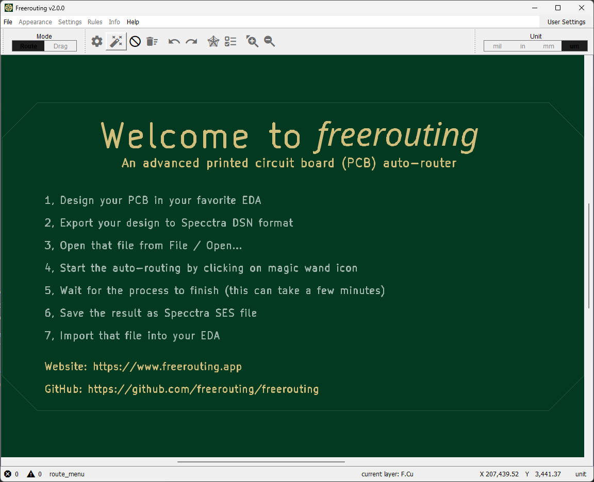

Source: https://github.com/user-attachments/assets/4086cd74-313e-4d17-8e25-5e006497e566 (embedded in the repo README, step 1 "Launch Freerouting")

- **Title bar:** "Freerouting v2.0.0". Once a design is loaded, the file name is shown in front of it (see image 05).
- **Menu bar:** `File`, `Appearance`, `Settings`, `Rules`, `Info`, `Help`, plus a `User Settings` button on the far right. `Appearance`, `Settings` and `Rules` are greyed out because no board is loaded.
  - `Settings` holds the autorouter and optimizer settings (passes, via costs, ripup costs, per-layer preferred direction, and so on).
  - `Rules` holds clearance matrix, net classes and via rules taken from the DSN.
  - `Info` holds packages/components/nets/incomplete-connections/violations listings.
- **Toolbar, left:** a **Mode** toggle, `Route` (selected, dark) or `Drag`. To its right are icon buttons:
  - gear: autorouter settings
  - **magic wand: start the autorouter**
  - circle-slash: cancel/stop
  - trash-with-lines: delete all tracks and vias
  - undo and redo arrows
  - star/network icon: incompletes/ratsnest
  - list icon: violations/DRC list
  - zoom in and zoom out
- **Toolbar, right:** **Unit** selector with `mil`, `in`, `mm`, `um`. `um` is selected.
- **Canvas (dark green):** a welcome panel. "Welcome to freerouting / An advanced printed circuit board (PCB) auto-router", followed by the 7-step workflow: design in your EDA, export Specctra DSN, File / Open, click the magic wand, wait, save as Specctra SES, import into your EDA. The website and GitHub links are below.
- **Status bar (bottom):** red (x) error counter `0`, yellow warning-triangle counter `0`, the current mode/menu name `route_menu`, `current layer: F.Cu`, cursor coordinates `X 207,439.52 Y 3,441.37`, and `unit`.

### 02: File menu, board loaded but not yet routed

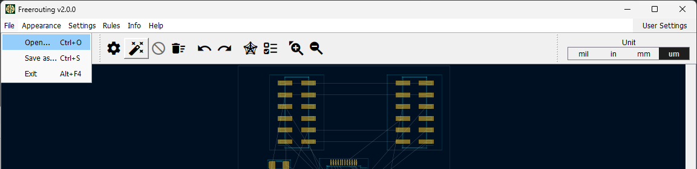

Source: https://github.com/user-attachments/assets/25907be1-fde9-44b1-addf-510f30b3ff89 (README step 2 "Open Your Design")

- **File menu open:** `Open... Ctrl+O` (highlighted), `Save as... Ctrl+S`, `Exit Alt+F4`. These are the only file actions in v2.x. Saving to `.ses` happens through Save as.
- **Menus** `Appearance`, `Settings`, `Rules`, `Info` are now active because a board is loaded.
- **Canvas (dark navy) shows the board before routing:**
  - two 2x6 SMD connector footprints at the top (gold pads with teal courtyard outlines);
  - a fine-pitch QFP/connector row and small 2-pad parts at the bottom edge;
  - **thin grey straight lines are the ratsnest** (airwires, unrouted connections). No coloured tracks exist yet.
- The cancel (circle-slash) button is greyed out because nothing is running.

### 03: Starting the autorouter (magic wand)

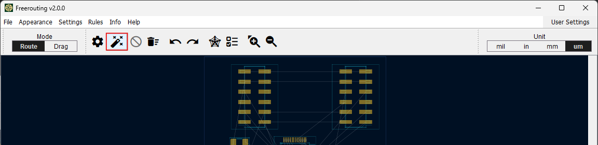

Source: https://github.com/user-attachments/assets/e104cd3a-00b9-49a5-8f28-3b803e79d973 (README step 3 "Start Autorouting")

- Same window as 02. **The magic-wand button is outlined in red.** This is the button that starts the batch autorouter followed by the optimizer.
- Mode is `Route` and units are `um`. The canvas still shows only ratsnest lines.
- In older 1.x builds the same action is `Routing > Autorouting` (image 08).

### 04: Autorouter progress in the status bar

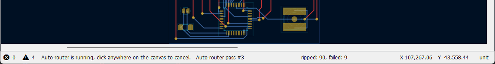

Source: https://github.com/user-attachments/assets/e553f98c-143d-46ea-8cc1-90348c9cc379 (README step 4 "Monitor Progress")

- **Canvas strip (top):** partly routed board. **Red traces are on the top copper layer (F.Cu)** and **blue traces are on the bottom layer (B.Cu)**. **Gold dots are vias**. A QFP with routed fan-out and a large 2-pad part (right) are visible.
- **Status bar, left to right:**
  - `(x) 0`: error count.
  - `/!\ 4`: warning count.
  - `Auto-router is running, click anywhere on the canvas to cancel.`: run state. **Clicking the canvas stops the run**, so don't click while it works.
  - `Auto-router pass #3`: the current **autorouter pass number**. It counts up to the max-passes limit (`-mp` / `router.autorouter.max_passes`).
  - `ripped: 90, failed: 9`: in this pass, 90 existing connections were ripped up and rerouted to make room, and 9 connections could not be routed. When `failed` stays above 0 pass after pass, the board probably has unroutable connections.
  - `X 107,267.06 Y 43,558.44 unit`: cursor coordinates.
- When the run finishes, this area changes to a summary message. During the optimizer phase it reports optimizer passes instead of "Auto-router pass".

### 05: Board window after a routing run (official screenshot)

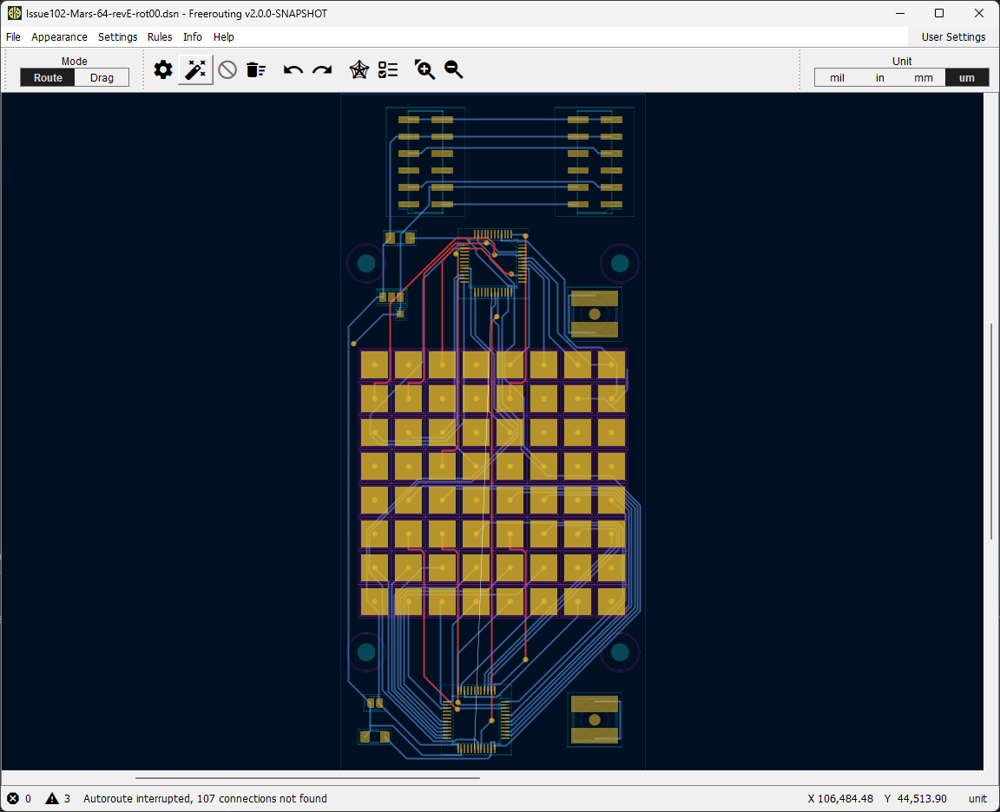

Source: https://raw.githubusercontent.com/freerouting/freerouting/master/assets/GUI_screenshot.png (also used on freerouting.app)

- **Title bar:** `Issue102-Mars-64-revE-rot00.dsn - Freerouting v2.0.0-SNAPSHOT`. The loaded DSN is a test fixture from the repo.
- **Toolbar and units:** same as image 01. Mode `Route`, unit `um`.
- **Canvas, top:** the two 2x6 connectors from images 02 and 03, now joined by **blue (B.Cu) parallel buses**.
- **Canvas, middle:**
  - four mounting holes (teal circles with dark-purple keep-out rings) at the corners;
  - an **8x8 grid of large square gold pads** (a 64-key / LED-matrix style footprint);
  - many blue traces running between pad rows and around the edges in tightly packed parallel bundles;
  - a few **red (F.Cu) vertical traces** crossing the matrix;
  - gold via dots where traces change layer.
- **Canvas, bottom:** an IC with routing fanned out on both layers, and a few small 2-pad parts.
- **Thin white/grey lines** still visible inside the matrix are **remaining ratsnest (unrouted) connections**.
- **Status bar:** `(x) 0`, `/!\ 3`, **`Autoroute interrupted, 107 connections not found`**. This board is **not** complete: the run was stopped (by a click or a limit) with 107 connections still open. A finished board reports zero not-found/incomplete connections.

> "Before vs. after": images 02/03 (ratsnest only) are the same board as 04 (mid-run). Image 05 shows a larger board after a run. Images 08 and 09 show one board before and after a completed legacy run.

### 06: Saving the routed result as .ses

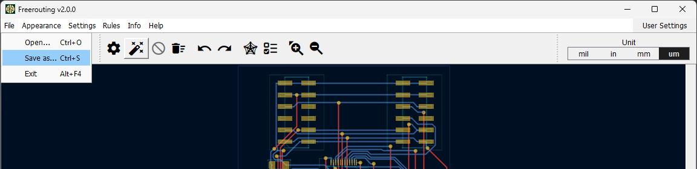

Source: https://github.com/user-attachments/assets/355a1cb2-b2e8-46b5-aec0-4979748bd57a (README step 6 "Save Your Routed Board")

- **File menu:** `Save as... Ctrl+S` is highlighted. In the save dialog, choose the `.ses` (Specctra session) type and file name. v2.x picks the format from the extension: `.ses`, `.dsn`, or `.scr` (Eagle/Fusion script).
- **Canvas:** the same board as image 02, now routed. The top connectors are joined by blue B.Cu buses, red F.Cu traces drop vertically, and gold vias sit where layers change. No grey ratsnest lines are visible in this crop.

### 07: KiCad, File > Export > Specctra DSN...

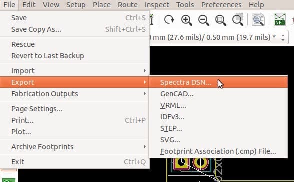

Source: https://techexplorations.com/wp-content/uploads/2019/01/P5_export_DSN.jpg (Tech Explorations, "KiCad Like a Pro 2nd ed.: how to automatically route a PCB using KiCad and Freerouting", Figure 2)

- KiCad 5 Pcbnew on Linux. The menu bar shows `File Edit View Setup Place Route Inspect Tools Preferences Help`.
- **File menu:** Save, Save Copy As, Rescue, Revert to Last Backup, Import, **Export (highlighted)**, Fabrication Outputs, Page Settings, Print, Plot, Archive Footprints, Exit.
- **Export submenu:** **`Specctra DSN...` (highlighted, cursor on it)**, GenCAD, VRML, IDFv3, STEP, SVG, Footprint Association (.cmp) File.
- Behind the menu, the track-width/via-size dropdown reads `... mm (27.6 mils)/ 0.50 mm (19.7 mils)`. Part of a through-hole footprint is visible on the black canvas.
- In KiCad 6 to 9 the path is the same: **File > Export > Specctra DSN...**. A file-save dialog follows. There is no options dialog.

### 08: Legacy Freerouting 1.x, unrouted board, Routing > Autorouting

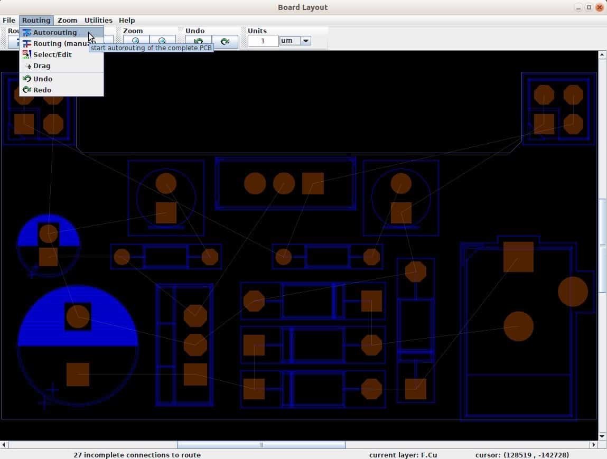

Source: https://techexplorations.com/wp-content/uploads/2019/01/P5_freeRouting_start.jpg (same tutorial, Figure 3)

- **Title bar:** `Board Layout`. This is the old 1.x Swing window.
- **Menus:** `File`, `Routing`, `Zoom`, `Utilities`, `Help`. **`Routing` is open:** **`Autorouting` (highlighted)**, `Routing (manual)`, `Select/Edit`, `Drag`, `Undo`, `Redo`. The tooltip says "start autorouting of the complete PCB".
- **Toolbar groups:** `Zoom` (two buttons), `Undo` (undo/redo), `Units` (`1` `um`).
- **Canvas (black):** through-hole parts with brown pads (round = normal pin, square = pin 1) and dark-blue outlines. Two electrolytic capacitor footprints have a blue half-filled silkscreen. **Thin grey diagonal lines are the ratsnest.**
- **Status bar:** **`27 incomplete connections to route`**, `current layer: F.Cu`, `cursor: (128519 , -142728)`. The "incomplete connections" figure is the number to watch.

### 09: Legacy Freerouting 1.x, routed board, File > Export > Export Specctra Session File

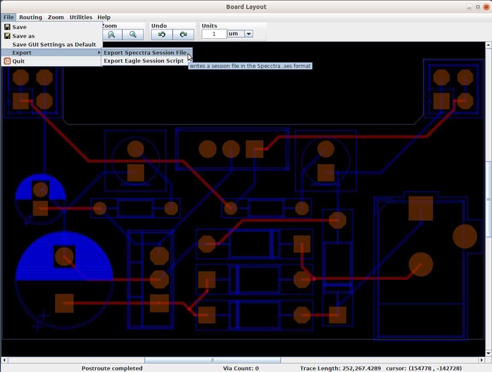

Source: https://techexplorations.com/wp-content/uploads/2019/01/P5_freeRouting_end.jpg (same tutorial, Figure 4)

- **File menu:** Save, Save as, Save GUI Settings as Default, **Export**, Quit. The **Export submenu** has **`Export Specctra Session File` (highlighted)** and `Export Eagle Session Script`. The tooltip says "writes a session file in the Specctra .ses format".
- **Canvas:** the same board as image 08, **fully routed**. Red traces are F.Cu and translucent blue traces are B.Cu. No grey ratsnest remains.
- **Status bar:** **`Postroute completed`** (the optimizer finished), **`Via Count: 0`**, `Trace Length: 252,267.4289`, and the cursor position. The "Postroute completed" message plus no incomplete connections means the legacy run finished.
- In v2.x this menu was replaced by `File > Save as...` (image 06).

### 10: KiCad, File > Import > Specctra Session...

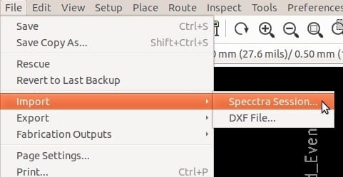

Source: https://techexplorations.com/wp-content/uploads/2019/01/P5_import_SES.jpg (same tutorial, Figure 5)

- **File menu:** **Import (highlighted)**. The **Import submenu** has **`Specctra Session...` (highlighted, cursor on it)** and `DXF File...`.
- In KiCad 6 to 9 the path is the same: **File > Import > Specctra Session...**. Pick the `.ses` file. KiCad replaces the board's tracks and vias with the session's routing. Footprints are left alone (do not move footprints between export and import).

### 11: KiCad, the board after importing the SES

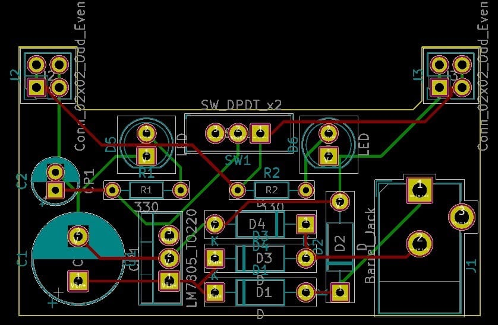

Source: https://techexplorations.com/wp-content/uploads/2019/01/P5_board_autorouted.jpg (same tutorial, Figure 6)

- KiCad 5 Pcbnew canvas showing the same board as images 08 and 09. **Dark-red tracks are F.Cu** and **green tracks are B.Cu** (KiCad 5 default colours).
- **Reference designators:** J2 and J3 (`Conn_02x02_Odd_Even`, top corners), D5 and D6 (`LED`), SW1 (`SW_DPDT_x2`), R1 and R2 (`330`), C1 and C2 (electrolytics, teal silkscreen), a TO-220 regulator (`LM7805_TO220`), D1 to D4 (a diode bridge), D2, and J1 (`Barrel_Jack`, right).
- The yellow board outline (Edge.Cuts) surrounds everything. No ratsnest lines remain. The next steps are fill zones, then DRC.

---

## Autorouter passes vs. optimizer passes

A Freerouting run has two phases:

| | Autorouter (batch router) | Optimizer (post-route / "pull tight") |
|---|---|---|
| Goal | **Connectivity**: route every open connection. Reroute ("rip up") existing traces when needed. | **Quality**: shorten traces, remove vias, reduce bends without breaking connectivity or adding clearance violations. |
| Progress shown as | `Auto-router pass #N`, `ripped: X, failed: Y` (image 04) | optimizer pass messages. Legacy builds end with `Postroute completed` (image 09). |
| Limit | `-mp N` / `--router.autorouter.max_passes=N` (`0` = no limit) | stops when the relative gain per pass falls below `--router.optimizer.improvement_threshold` (default **2.5 %**). `-mt 0` turns the optimizer off. |
| Threads | `--router.autorouter.max_threads` | `-mt N` / `--router.optimizer.max_threads` (default: logical CPUs minus 1) |
| Score (v2.x) | **router score `V2_CONTINUOUS`**: 1000 means every connection is closed and there are 0 clearance violations | **optimizer score `V2_LOWER_BOUND`**: copper efficiency compared with lower bounds. A candidate is rejected if it increases incomplete connections (`CONNECTIVITY_REGRESSION`) or clearance-violation count (`DRC_COUNT_REGRESSION`). |

Each autorouter pass tries all still-open connections. Early passes allow a lot of rip-up. Later passes raise ripup costs (`router.start_ripup_costs`, default 100) so the result settles. Once a pass finishes with nothing left to route, the router moves on to the optimizer.

**How to tell routing is complete**

- GUI: no grey ratsnest lines remain, and the status bar shows no "N connections not found" / "N incomplete connections". `Info > Incompletes` (the star/network toolbar icon) is empty.
- Score/API: `connections.incomplete_count == 0` and router score `== 1000`. If the incomplete count is 0 but the score is below 1000, connectivity is done but **clearance violations remain**.
- A high optimizer score alone does **not** mean the board is complete.
- Image 05's `Autoroute interrupted, 107 connections not found` is an **incomplete** result. Image 09's `Postroute completed` with no ratsnest is a complete one.

---

## Headless CLI (v2.x)

Basic (from the README):

```bash
java -jar freerouting-2.5.0.jar -de board.dsn -do board.ses -mp 100
```

When both `-de` and `-do` are given, Freerouting loads, routes, optimizes, writes the output and exits. On a machine with no display, also pass `--gui.enabled=false`. Many older guides add `-Djava.awt.headless=true` as well.

```bash
java -Djava.awt.headless=true -jar freerouting-2.5.0.jar \
  -de board.dsn -do board.ses \
  -mp 100 -mt 4 \
  --gui.enabled=false \
  --router.optimizer.improvement_threshold=2.5 \
  --router.result_json=board.result.json \
  -drc board.drc.json \
  -da
```

| Flag | Meaning |
|---|---|
| `-de <file>` | Input design. `.dsn`, optionally `+` with a `.ses`/`.rules` file |
| `-do <file>` | Output. Format chosen by extension: `.ses`, `.dsn`, `.scr` (Eagle/Fusion) |
| `-dr <file>` | Explicit `.rules` file (net classes, clearances, vias, `(autoroute_settings ...)`, `(layer_rule ...)`) |
| `-drc <file>` | Write a DRC report in **KiCad JSON DRC schema** |
| `-mp <n>` | Max autorouter passes |
| `-mt <n>` | Optimizer threads (`0` disables the optimizer) |
| `-inc <a,b>` | Skip these net classes (e.g. `GND,VCC` when they go on planes/pours) |
| `-us greedy\|global\|hybrid`, `-hr m:n` | Optimizer board update strategy / hybrid ratio |
| `-is sequential\|random\|prioritized` | Item selection strategy |
| `-im` | Save intermediate state so an interrupted optimization can resume |
| `-l en\|de\|zh` | UI language |
| `-dct <s>` | Dialog auto-confirm timeout (default 20 s). Matters if a dialog pops up unattended |
| `-da` | Disable anonymous analytics |
| `--user_data_path=<dir>` | Where settings, jobs and logs live |
| `--logging.console.level=...`, `--logging.file.*` | Logging |
| `-help` | Help |
| `-oit` | **Deprecated, no longer supported.** Use `--router.optimizer.improvement_threshold` |

Any internal setting can be passed as `--<dotted.key>=value`, or as an environment variable `FREEROUTING__<KEY>__<SUBKEY>`. Examples:

- `--router.via_costs=150`: higher means fewer vias. Default 50.
- `--router.plane_via_costs=5`
- `--router.start_ripup_costs=100`
- `--router.layers.routable=false,true`: list values go top to bottom. This example routes on the bottom layer only.
- `--router.layers.preferred_direction_horizontal=true,false`: top horizontal, bottom vertical.
- `--router.default_preferred_direction_trace_cost` (1.0) and `--router.default_undesired_direction_trace_cost` (2.5).

Settings precedence, lowest to highest: defaults < `freerouting.json` < DSN < SES < `.rules` < env vars < CLI `--` args < GUI changes < REST API caller. On Windows, `freerouting.json` lives in `%APPDATA%\freerouting` (Linux: `~/.config/freerouting`, macOS: `~/Library/Application Support/freerouting`).

Other ways to drive it: a built-in REST API server (`--api_server.enabled=true`, default `http://127.0.0.1:37864`), the public API at `https://api.freerouting.app/v1`, the Python client (`pip install freerouting-client`), an MCP server (`npx -y @freerouting/freerouting-mcp-server`), and a Docker image on GHCR.

## Java requirements

- Freerouting 2.x needs a **modern JRE**. The current README recommends **Eclipse Temurin JRE 25** (adoptium.net). Old Java 8 or 11 runtimes fail with `UnsupportedClassVersionError` ("compiled by a more recent version of the Java Runtime").
- The Windows x64, Linux x64 and macOS installers bundle their own runtime. The platform-independent `freerouting-<version>.jar` needs `java` on PATH. Check with `java -version`.
- macOS: launch from Terminal. Launching from Finder is not supported.
- Big boards benefit from more heap, e.g. `java -Xmx4g -jar ...`.

## Common failures

| Symptom | Likely cause / fix |
|---|---|
| `failed: N` stays above 0 across passes, ends with "N connections not found" | Unroutable nets. Common causes: parts too dense, too few layers, clearance/track width too large for the pad pitch (fine-pitch QFN/BGA), a pad buried in a keep-out, or a net with only one pad. Fix the placement or rules, add a layer, route the hard nets by hand first (Freerouting keeps existing copper), or exclude power with `-inc` and use zones. |
| DSN parse error on open / immediate exit | Usually a KiCad DSN that Freerouting does not understand: unusual pad shapes (custom/complex pads, rounded-rect variants on old builds), footprints with no courtyard/holes in odd places, non-ASCII or quoted net names, a board outline that is not closed in Edge.Cuts. Update to the latest Freerouting, close the outline, simplify the custom pads, then re-export. |
| KiCad won't export DSN | KiCad refuses when the board outline is missing or broken, or when footprints have duplicate references. Run DRC with "Test footprints against schematic" and fix the outline. |
| `.ses` is 0 bytes / "Board may be corrupted" on import | The run crashed or was killed before writing. Look at the Freerouting log, update Freerouting, and re-run. |
| SES imports but tracks are offset / missing | The board was edited (footprints moved, nets renamed) between DSN export and SES import. Always re-export the DSN after any change. |
| Hangs "forever" | No pass limit and a board that can't converge. Set `-mp`. A higher `--router.optimizer.improvement_threshold`, or `-mt 0`, shortens the optimizer phase. |
| Run stops on its own in GUI | A click on the canvas cancels the autorouter (image 04 message). |

## Tips for an AI agent driving Freerouting headlessly

1. **Export DSN without the GUI.** KiCad's Python module provides `pcbnew.ExportSpecctraDSN(board, "board.dsn")` and `pcbnew.ImportSpecctraSES(board, "board.ses")`. Run them with KiCad's bundled Python, then `board.Save(...)`. Check the exact names against your KiCad version's `pcbnew` API. `kicad-cli` does not provide a DSN export in most versions.
2. **Pin the version** (`freerouting-2.5.0.jar`) and check it at the top of every run with `java -version` and `java -jar freerouting.jar -help`. Flags have changed between 1.x and 2.x (for example, `-oit` was removed).
3. **Always bound the run:** `-mp` (e.g. 50 to 200), a wall-clock timeout in the caller, and `--gui.enabled=false -da`. Choose `-mt` based on the CPUs available.
4. **Don't trust the exit code or the existence of `.ses` alone.** Check, in order:
   - the `.ses` file exists and is non-empty, and contains `(session` and `(routes`;
   - the `--router.result_json` manifest and/or logs: **`connections.incomplete_count == 0`** (or no "connections not found"/"incomplete" message), and router score 1000 / `clearance_violations.total_count == 0`;
   - the optional `-drc board.drc.json` report (KiCad DRC JSON schema) has no violations.
5. **Then verify in KiCad, which has the final say:** import the SES, refill zones (`pcbnew.ZONE_FILLER(board).Fill(board.Zones())`), save, and run `kicad-cli pcb drc --format json --severity-error --exit-code-violations -o drc.json board.kicad_pcb`. Treat **unconnected items > 0** or any error as a failed route. KiCad's DRC checks things Freerouting doesn't model (zones, silk, courtyards, hole-to-hole, and so on).
6. **If the board is incomplete,** don't loop with the same inputs. Change something and re-run: more passes, a lower `--router.via_costs`, other preferred directions per layer, `-inc GND,VCC` with pours, or relaxed rules or extra layers in KiCad. Report the remaining net names (from Info/DRC "unconnected") rather than claiming success.
7. Keep business rules such as track widths and clearances in the KiCad net classes so they flow through the DSN. Don't override them ad hoc on the Freerouting command line unless the change is meant.

---

## Gaps (images not found)

- **Settings dialogs:** no public screenshot of Freerouting's `Settings > Autorouter` dialog (passes, via costs, ripup costs, per-layer preferred direction), the `Rules` dialogs (clearance matrix, net classes, vias), or `User Settings` turned up in the repo (`assets/`, `docs/`), freerouting.app, Wikimedia Commons (0 results) or the tutorials searched. The settings are documented in text above from `docs/settings.md` and `docs/command_line_arguments.md` only.
- **v2.x completion message:** no official screenshot shows the v2.x status bar at the end of a successful run (0 incomplete). Image 05 shows an interrupted run; image 09 (legacy 1.x) shows "Postroute completed".
- **Optimizer-phase status bar (v2.x):** not pictured.
- **KiCad 6 to 9 dialogs:** only KiCad 5 menu screenshots were found (images 07 and 10). The menu paths are unchanged, but the visuals differ. The KiCad DSN export/SES import file-save dialogs themselves are not pictured.
- The original Tech Explorations KiCad 5 article images (filepicker.io links) are dead. The working copies above come from the same publisher's 2nd-edition article.
