# GTKWave visual reference

GTKWave is a free (GPL-2.0) waveform viewer for digital simulation dumps. It reads **VCD** (the plain-text Value Change Dump that Icarus Verilog writes with `$dumpfile`/`$dumpvars`), **FST** (GTKWave's compressed, indexed format, which loads much faster), LXT/LXT2/VZT and GHW (GHDL). It doesn't simulate anything; it only displays signal values over time.

In our pipeline, Icarus (`iverilog` + `vvp`) runs a plain-Verilog testbench, which writes `dump.vcd`. GTKWave then opens that file, both in the demo and in the tool-stream view. The pipeline mock-up in `fpga-flow/fpga-mcp-pipeline.html` draws a window titled `GTKWave - dump.vcd` for the "Waveforms" stage.

> **Two UI generations.** Every screenshot below comes from the current GTKWave documentation at <https://gtkwave.github.io/gtkwave/>. That is the GTKWave 4 / GTK3+ UI, which has a hamburger menu button (☰) instead of a menu bar and shows the marker and cursor times in the title bar. The long-standing **3.3.x** release (which many distributions and older OSS CAD Suite builds ship) has a classic `File Edit Search Time Markers View Help` menu bar and a separate toolbar, but it uses the **same three-pane layout, the same mouse behaviour, the same `.gtkw` format and the same Tcl API**. The keyboard shortcuts in this guide come from the 3.3 source (`gtkwave3-gtk3/src/menu.c`, `lts` branch). Run `gtkwave --version` to see which one you have.

---

## 1. Opening a dump from the command line

```bash
# Just the dump. Nothing is displayed until you add signals.
gtkwave dump.vcd

# Dump plus a saved view (.gtkw), which restores signals, radix, zoom and markers
gtkwave dump.vcd view.gtkw

# A .gtkw that contains a [dumpfile] line can be opened on its own
gtkwave view.gtkw

# Convert VCD -> FST on load (much faster for large dumps), via vcd2fst
gtkwave -o dump.vcd view.gtkw

# Run a Tcl script after loading (see section 6)
gtkwave -S view.tcl dump.vcd

# Other useful flags
#   -a / --save FILE       savefile name        -A / --autosavename  use dump.gtkw automatically
#   -6 / --dark            dark GTK theme       -7 / --saveonexit    prompt to write a .gtkw at exit
#   -M / --nomenus         hide the menu bar    -N / --nowm          no window-manager decorations
#   -O / --output FILE     redirect stdout/stderr (e.g. NUL / /dev/null)
#   -t FILE                Verilog stems file, which enables the RTL browser (image 9)
#   -x / --exit            exit right after loading (useful as a "does it parse?" check)
```

Synopsis from `man gtkwave`: `gtkwave [option]... [DUMPFILE] [SAVEFILE] [RCFILE]`.

Icarus side, for reference:

```verilog
initial begin
  $dumpfile("dump.vcd");
  $dumpvars(0, tb);      // 0 = all levels below tb
end
```

To get FST straight from Icarus, without converting the VCD, run `vvp sim.vvp -fst` (keep `$dumpfile`; Icarus switches the format).

---

## 2. The images, region by region

All images are from the GTKWave documentation site (GPL project docs), downloaded unmodified. The example design throughout is the DES encryption core from GTKWave's own quick-start (`des.v`, `des.vcd`/`des.fst`).

### 2.1 Overall window

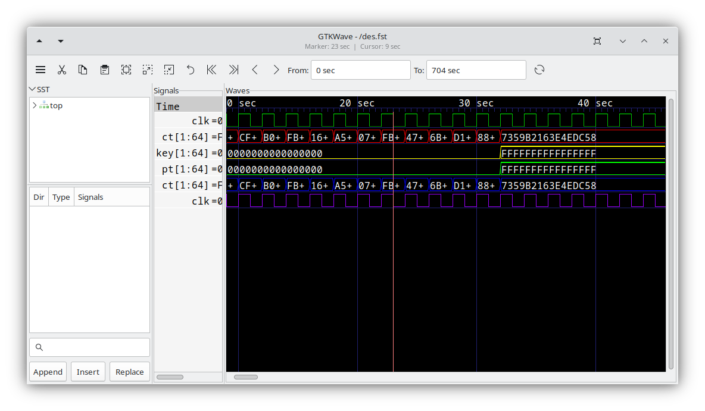

Source: <https://gtkwave.github.io/gtkwave/_images/gtkwave.png> (shown on the docs home page)

- **Title bar (top centre):** `GTKWave - /des.fst`, the loaded dump. Under it, `Marker: 23 sec | Cursor: 9 sec`. The *marker* is the primary (red) marker you dropped. The *cursor* is the current mouse time position.
- **Toolbar row (left to right):** ☰ menu, cut / copy / paste traces, the three zoom buttons (fit, in, out), zoom undo, zoom to start `|<<`, zoom to end `>>|`, previous edge `<`, next edge `>`, the **From:** `0 sec` and **To:** `704 sec` time-range boxes, and the reload button (circular arrow). Section 2.4 has the details.
- **SST pane (left, top):** the hierarchy tree. Only `top` is visible here, collapsed.
- **SST signal list (left, middle):** the `Dir | Type | Signals` table is empty because no scope is selected.
- **SST search box + `Append` / `Insert` / `Replace` (left, bottom):** a filter field, plus buttons that push the selected signals into the display.
- **Signals pane (centre column):** `Time`, then `clk=0`, `ct[1:64]=F…`, `key[1:64]=0…`, `pt[1:64]=0…`, a second `ct[1:64]` and a second `clk`. Each row shows the signal's value **at the primary marker**.
- **Waves pane (right, black):** the timeline ruler (`0 sec`, `20 sec`, `30 sec`, `40 sec`) and one row per signal:
  - The `clk` rows are drawn as single-bit square waves, one green and one purple. Trace colours are set per trace with *Edit > Color Format*.
  - `ct[1:64]` is drawn as a **bus**: hexagon-shaped value boxes (`CF+`, `B0+`, `FB+`, `16+` …). A trailing `+` means the value was truncated to fit the box. Once the boxes are wide enough, the full value `7359B2163E4EDC58` shows.
  - `key` and `pt` hold `0000000000000000` (shown with yellow and green outlines) until about 33 s, where they change to `FFFFFFFFFFFFFFFF`.
- **Vertical lines in the waves pane:** the thin blue lines are the major grid/tick lines. The single **red** line at about 23 s is the primary marker.

### 2.2 Main window with the hierarchy expanded

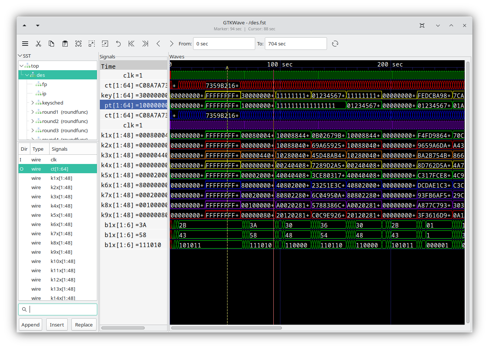

Source: <https://gtkwave.github.io/gtkwave/_images/main-window.png> (from *User Interface > Overview*)

- **SST tree:** `top > des` is expanded and highlighted (teal), showing the child scopes `fp`, `ip`, `keysched`, `round1 (roundfunc)`, `round2 (roundfunc)`, `round3 (roundfunc)` … The text in parentheses is the **module type** of each instance.
- **SST signal list for `des`:** the columns are `Dir` (`I` = input, `O` = output, blank = internal), `Type` (`wire`) and `Signals` (`clk`, `ct[1:64]`, `k1x[1:48]` … `k14x[1:48]`). `ct[1:64]` is selected (teal), and its direction is `O`.
- **Search box:** it has a text cursor in it and is empty.
- **Signals pane:** many more traces have been added: `clk`, `ct`, `key`, `pt` (highlighted in **blue**, meaning it is selected for the next Edit/Data Format operation), `ct`, `clk`, `k1x` … `k9x[1:48]`, then three rows of `b1x[1:6]` with values `=3A`, `=58` and `=111010`. That is **the same 6-bit signal shown three times in different radices** (hex, hex/decimal, and binary).
- **Waves pane:** zoomed out to about 0–260 s, so the clocks have become dense solid bands. Bus rows show long values such as `00000000+`, `FFFFFFFF+` and `30000000+`. Each bus row has its own colour (red, yellow, green, blue, purple, orange).
- **Marker `A` (yellow dashed vertical line at about 55 s):** this is a **named marker**, labelled `A` at the top of the ruler. The solid white/grey line at about 94 s is the primary marker. The title bar reads `Marker: 94 sec | Cursor: 88 sec`.

### 2.3 Signal Search Tree (SST)

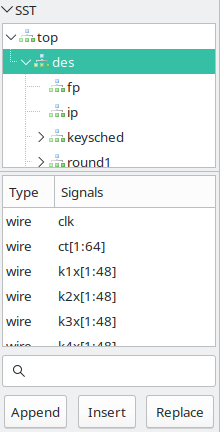

Source: <https://gtkwave.github.io/gtkwave/_images/quickstart-SST.png> (from *Quick Start > Launching* and *User Interface > Main Window*)

- **Top half:** the scope tree, with `top` expanded and `des` selected. `fp` and `ip` are leaf scopes (no arrow). `keysched` and `round1` can be expanded (`>` arrow).
- **Bottom half:** the `Type | Signals` list for the selected scope: `wire clk`, `wire ct[1:64]`, `wire k1x[1:48]` …
- **Search field (magnifier icon):** a POSIX regex filter over the list.
- **Buttons:** **Append** adds the selected signals at the end of the Signals pane. **Insert** adds them after the last highlighted trace. **Replace** replaces the highlighted traces. You can also **drag** rows from this list into the Signals pane.

### 2.4 SST direction filter

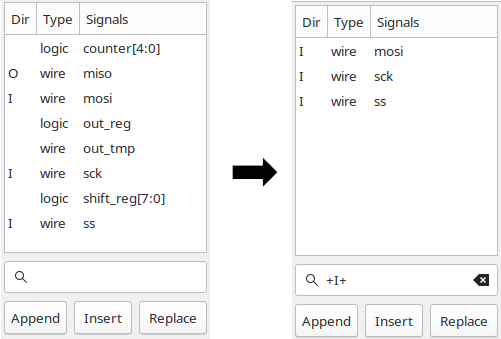

Source: <https://gtkwave.github.io/gtkwave/_images/SST-filter.png> (from *User Interface > Main Window*)

- **Left:** an unfiltered list for an SPI module: `logic counter[4:0]`, `O wire miso`, `I wire mosi`, `logic out_reg`, `wire out_tmp`, `I wire sck`, `logic shift_reg[7:0]`, `I wire ss`.
- **Right:** after typing `+I+` in the filter box, only the inputs (`mosi`, `sck`, `ss`) remain.
- **Filter prefixes** (case-insensitive): `+I+` inputs, `+O+` outputs, `+IO+` inouts, `+L+` linkage, `+B+` buffer (both VHDL), `--` only I/O ports, `-I-` exclude inputs, `-O-` exclude outputs, `++` exclude all ports. The rest of the text is a regex, for example `+O+ ^data`.

### 2.5 Signals pane: three states

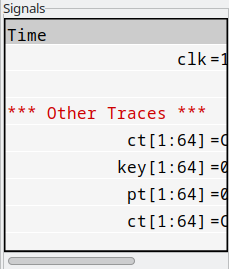
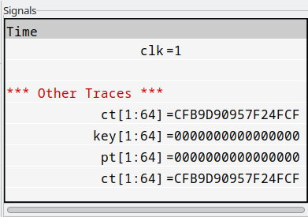
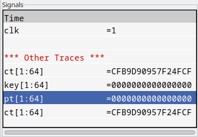

Sources: <https://gtkwave.github.io/gtkwave/_images/signals1.png>, `signals2.png`, `signals3.png` (from *User Interface > Main Window*)

- **Image 4 (narrow pane):** `Time` header, `clk=1`, a **blank trace** (empty row inserted with *Edit > Insert Blank*, `Ctrl+B`), then a **comment trace** `*** Other Traces ***` in red (*Edit > Insert Comment*), then `ct`, `key`, `pt`, `ct`. The values are cut off at the right edge, and the horizontal scrollbar at the bottom reveals them.
- **Image 5 (pane widened):** the full values are visible: `ct[1:64]=CFB9D90957F24FCF`, `key[1:64]=0000000000000000`. Names are **right-justified** against the `=` (the default), and values are always left-justified after `=`.
- **Image 6 (left-justified):** `Shift+Home` (*View > Left Justified Signals*) moves names to the left edge, which makes hierarchy prefixes easier to compare. `Shift+End` restores right justification. `pt[1:64]` is highlighted in blue: click selects, Ctrl+click toggles, and Shift+click selects a range.
- The values in this pane are always **the value at the primary marker**. With no marker placed, the value column is empty.

### 2.6 Waves pane: markers, cursors, bit and bus rendering

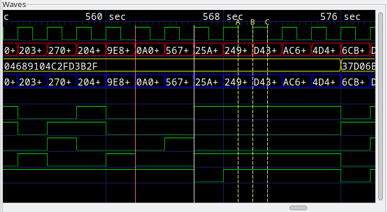

Source: <https://gtkwave.github.io/gtkwave/_images/wave.png> (from *User Interface > Main Window*)

- **Ruler:** `560 sec`, `568 sec`, `576 sec`, with minor tick marks between them.
- **Rows 1–4:** a green clock; a red-outlined bus (`203+ 270+ 204+ 9E8+ 0A0+ 567+ 25A+ 249+ D43+ AC6+ 4D4+ 6CB+`); a yellow bus showing `04689104C2FD3B2F` that changes to `37D06B…` at about 576 s; and a blue bus that repeats the red one.
- **Lower rows:** single-bit signals drawn as green high/low levels. The flat grey line at the bottom is a signal held at one value. An **X** (unknown) value would appear as a filled box, and **Z** as a line at mid-height.
- **Red vertical line (about 562 s):** the **primary marker**, set with a left click. The Signals pane shows values at this time.
- **White vertical line (about 566 s):** the **baseline marker**, set with a middle click. The time difference between the baseline and the primary marker is shown (in 3.3, in the info area at the top of the window), which you can use to measure periods and latencies.
- **Yellow/white dashed lines labelled `A`, `B`, `C` (about 570–573 s):** **named markers**, dropped with *Markers > Drop Named Marker* (`Alt+N`) at the primary marker's position. There are up to 26 (A–Z). `Shift+Alt+N` collects (removes) one, and `Shift+Ctrl+Alt+N` collects all of them. Named markers can be typed into the From/To boxes as `MA`, `MB` …
- **Mouse:**
  - Left click places the primary marker.
  - Middle click places the baseline marker.
  - **Right-button drag** zooms into the dragged region.
  - Left-drag (outside the Signals frame) scrolls the data.
  - The vertical scrollbar scrolls the Signals and Waves panes together, and the horizontal scrollbar scrolls time.

### 2.7 Toolbar and title bar

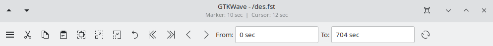

Source: <https://gtkwave.github.io/gtkwave/_images/navigation.png> (from *User Interface > Toolbar*)

The icons from left to right:

| # | Icon | Action |
|---|------|--------|
| 1 | ☰ | Main menu (File / Edit / Search / Time / Markers / View / Help) |
| 2 | scissors | **Cut** highlighted traces into the paste buffer |
| 3 | two sheets | **Copy** highlighted traces |
| 4 | clipboard | **Paste** after the last highlighted trace (or at the end) |
| 5 | box with corners | **Zoom Fit**: the whole dump, or the baseline-to-primary range if a baseline marker is set |
| 6 | dashed box with arrow out | **Zoom In** around the marker |
| 7 | dashed box with arrow in | **Zoom Out** |
| 8 | curved arrow | **Zoom Undo** (one level only) |
| 9 | `|<<` | Zoom to start |
| 10 | `>>|` | Zoom to end |
| 11 | `<` | **Find Previous Edge** on the last highlighted trace (moves the primary marker) |
| 12 | `>` | **Find Next Edge** |
| 13 | `From:` `0 sec` / `To:` `704 sec` | Visible time window. Accepts units (`120ns`, `5 us`) and named markers (`MA`) |
| 14 | circular arrow | **Reload** the dump from disk (`Shift+Ctrl+R`). Use it after re-running the simulation. |

The title bar shows `GTKWave - /des.fst` and `Marker: 10 sec | Cursor: 12 sec`.

### 2.8 Signal Search (regex) dialog

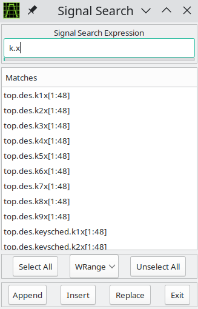

Source: <https://gtkwave.github.io/gtkwave/_images/quickstart2.png> (from *Quick Start > Launching*)

- **Signal Search Expression:** `k.x`, a POSIX regex.
- **Matches:** `top.des.k1x[1:48]` … `top.des.k9x[1:48]`, `top.des.keysched.k1x[1:48]`, `top.des.keysched.k2x[1:48]` … The full hierarchical names are listed.
- **Select All / Unselect All**, plus a modifier drop-down set to **WRange**. The other options are `WStrand`, `Range`, `Strand` and `None`, and they control how the regex is anchored (whole range or substring).
- **Append / Insert / Replace / Exit:** the same semantics as in the SST.
- Open it with *Search > Signal Search Regexp* (`Alt+S` in 3.3). *Search > Signal Search Hierarchy* is `Alt+T`, and the floating SST window is `Shift+Alt+T`.

### 2.9 Main window with a save file loaded, plus RTL Design Hierarchy (rtlbrowse)

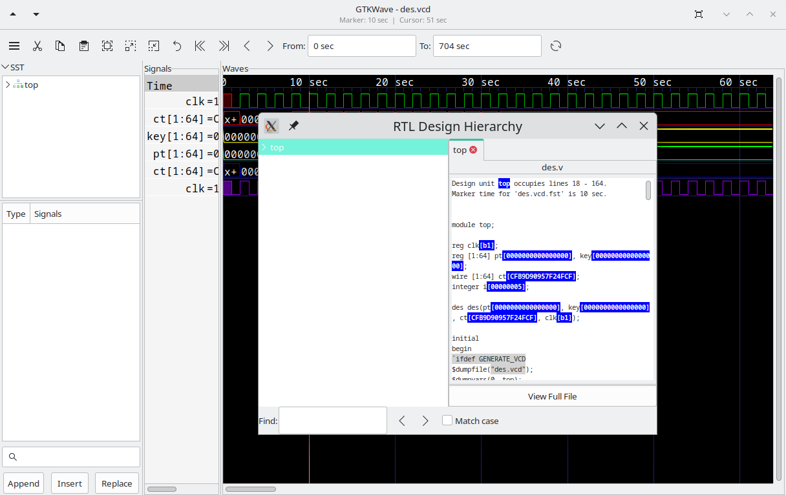

Source: <https://gtkwave.github.io/gtkwave/_images/quickstart1.png> (from *Quick Start > Launching*, produced by `gtkwave -o -t des.stems des.vcd des.gtkw`)

- **Behind:** the main window, with `clk`, `ct`, `key`, `pt`, `ct` and `clk` already in the Signals pane. They were restored from `des.gtkw`. The title is `GTKWave - des.vcd` and the ruler runs from 0 to 60 s.
- **In front: the "RTL Design Hierarchy" window** (rtlbrowse, launched because `-t des.stems` was given). The left tree has `top` selected. The right tab `top` shows `des.v` source with **live values annotated inline** at the marker time, for example `reg clk[b1];`, `reg [1:64] pt[0000000000000000]` and `wire [1:64] ct[CFB9D90957F24FCF]`. The header says "Design unit top occupies lines 18 - 164. Marker time for 'des.vcd.fst' is 10 sec." At the bottom are a **Find:** box with `<`/`>` buttons, a **Match case** checkbox and **View Full File**.
- You generate a stems file with `vermin`/`xml2stems`. It is optional and we don't need it for the pipeline.

### 2.10 Saving the view (.gtkw)

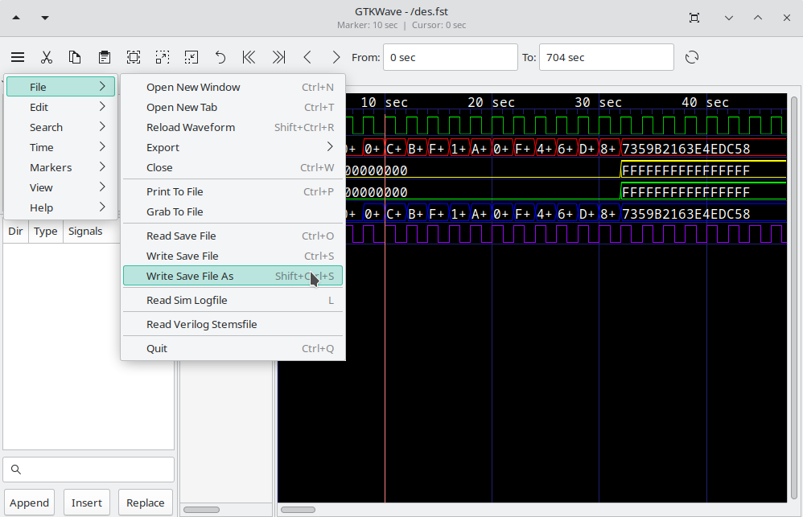

Source: <https://gtkwave.github.io/gtkwave/_images/file-save.png> (from *Quick Start > Launching*)

The ☰ menu is open on **File**. The submenu lists:

- Open New Window `Ctrl+N`
- Open New Tab `Ctrl+T`
- Reload Waveform `Shift+Ctrl+R`
- Export >
- Close `Ctrl+W`
- Print To File `Ctrl+P`
- **Grab To File** (PNG screenshot of the window)
- Read Save File `Ctrl+O`
- Write Save File `Ctrl+S`
- **Write Save File As** `Shift+Ctrl+S` (highlighted, with the mouse pointer on it)
- Read Sim Logfile `L`
- Read Verilog Stemsfile
- Quit `Ctrl+Q`

Behind the menu, the waves pane shows the DES buses at a 10–40 s zoom.

### 2.11 Time-shifting a trace

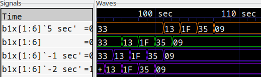

Source: <https://gtkwave.github.io/gtkwave/_images/wave-timeshift.png> (from *User Interface > Main Window*)

The bus `b1x[1:6]` is shown four times. The names in the Signals pane carry the shift in back-quotes:

- ``b1x[1:6]`5 sec'`` (orange, delayed by +5 s)
- `b1x[1:6]` (green, original)
- ``b1x[1:6]`-1 sec'`` (blue)
- ``b1x[1:6]`-2 sec'`` (purple)

The values `33 13 1F 35 09` therefore line up at different times. To do this, highlight a trace, press the left button in the waves pane, hold **Ctrl** and drag, then release the **mouse button before Ctrl**. Releasing Ctrl first cancels the shift. This is handy for comparing a DUT output with a reference model that has a known latency.

---

## 3. Everyday tasks

### Add signals

1. In the SST, click a scope (for example `tb > dut`).
2. In the signal list, select one or more rows (Shift- or Ctrl-click). Optionally type a regex or a `+O+` filter first.
3. Click **Append** (or **Insert**, or drag the rows into the Signals pane).
4. Alternatively, use *Search > Signal Search Regexp* (`Alt+S`), type for example `dut\..*_out`, then **Select All** and **Append**.
5. Organise the display with `Ctrl+B` (blank row), *Edit > Insert Comment* (section header) and *Edit > Create Group* (collapsible group, toggled with `T`).

### Zoom to fit, and navigate

- **Zoom Full / Fit:** the toolbar fit button, or *Time > Zoom > Zoom Full* (`Ctrl+0` in 3.3). *Zoom Best Fit* is `Shift+Alt+F`.
- Zoom in and out with `Ctrl+plus` / `Ctrl+minus` (bound as `<Control>plus` / `<Control>minus` in 3.3, so the numpad keys work too). The undo zoom key is `Alt+U`.
- Alt + mouse wheel zooms, Ctrl + wheel shifts in time, and the plain wheel pages.
- Right-drag a region to zoom straight to it.
- To jump to a time, type it into **From:** / **To:**, or use `gtkwave::setZoomRangeTimes` from Tcl.

### Place markers and measure

- **Left click** places the primary marker (red). The Signals pane values update to that time.
- **Middle click** places the baseline marker (white). The delta between the two is your measurement.
- Highlight a trace and use **Find Next / Previous Edge** to step the marker transition by transition. That is the fastest way to find the first bad sample.
- `Alt+N` drops a named marker (A–Z) at the primary marker. `Alt+M` (*Show-Change Marker Data*) lists the marker times. `Shift+Alt+M` deletes the primary marker.

### Change radix / data format

Highlight one or more traces in the Signals pane, then use *Edit > Data Format*, or right-click the trace for the same menu:

| Format | 3.3 shortcut | `.gtkw` flag bit |
|--------|--------------|------------------|
| Hex | `Alt+X` | `0x2` |
| Decimal (unsigned) | `Alt+D` | `0x4` |
| Binary | `Alt+B` | `0x8` |
| Octal | `Alt+O` | `0x10` |
| Signed Decimal | (menu) | `0x400` |
| ASCII | (menu) | `0x800` |
| Analog > Step | (menu) | `0x8000` |
| Analog > Interpolated | (menu) | `0x10000` |
| Invert on / off | `Alt+I` / `Shift+Alt+I` | `0x40` |
| Reverse bits on / off | `Alt+V` / `Shift+Alt+V` | `0x80` |
| Right-justify on / off | `Alt+J` / `Shift+Alt+J` | `0x20` |

The **analog view** (*Data Format > Analog > Step / Interpolated*) draws a multi-bit bus as a line plot, which is ideal for DSP outputs such as a FIR filter's `y`. Combine it with *Signed Decimal* for two's-complement data. Add *Edit > Insert Analog Height Extension* rows below the trace to make the plot taller. *Analog > Resizing > All Data / Screen Data* picks the vertical scaling. **No screenshot of the analog view was available** (see Gaps).

Other useful Edit operations:

- *Expand* (`F3`) splits a bus into its bits.
- *Combine Down / Up* (`F4` / `F5`) merges highlighted bits into a bus.
- *Alias Highlighted Trace* (`Alt+A`) renames the displayed trace.
- *Color Format* recolours the highlighted traces.
- *Highlight Regexp* (`Alt+R`) selects traces by name.
- `Ctrl+A` / `Shift+Ctrl+A` highlight and unhighlight all traces.
- `Ctrl+Delete` deletes the highlighted traces.

### Save the view as `.gtkw`

Use *File > Write Save File* (`Ctrl+S`) or *Write Save File As* (`Shift+Ctrl+S`), or start with `-7` to be prompted at exit. Reopen the view with `gtkwave dump.vcd view.gtkw` or *File > Read Save File* (`Ctrl+O`). After re-simulating, `Shift+Ctrl+R` reloads the dump and keeps the view.

---

## 4. Keyboard shortcuts (GTKWave 3.3.x, from `menu.c` on the `lts` branch)

| Key | Action | Key | Action |
|-----|--------|-----|--------|
| `Ctrl+N` / `Ctrl+T` | New window / tab | `Ctrl+O` | Read save file |
| `Shift+Ctrl+R` | Reload waveform | `Ctrl+S` / `Shift+Ctrl+S` | Write save file / as |
| `Ctrl+P` | Print to file (PS/PDF) | `Ctrl+W` / `Ctrl+Q` | Close / quit |
| `Ctrl+B` | Insert blank trace | `Ctrl+X` `Ctrl+C` `Ctrl+V` | Cut / copy / paste traces |
| `Ctrl+Delete` | Delete highlighted traces | `Ctrl+A` / `Shift+Ctrl+A` | Highlight / unhighlight all |
| `Alt+X` `Alt+D` `Alt+B` `Alt+O` | Hex / Dec / Bin / Oct | `Alt+A` / `Shift+Alt+A` | Alias / remove alias |
| `F3` / `F4` / `F5` | Expand / Combine down / up | `T` | Toggle group open/closed |
| `Alt+R` / `Shift+Alt+R` | Highlight / unhighlight regexp | `Ctrl+F` | Show-change of first highlighted |
| `Alt+S` | Signal Search Regexp | `Alt+T` / `Shift+Alt+T` | Hierarchy search / SST window |
| `Ctrl+0` | Zoom Full | `Shift+Alt+F` | Zoom Best Fit |
| `Ctrl+plus` / `Ctrl+minus` | Zoom in / out | `Alt+U` / `Shift+F2` | Undo zoom / zoom base |
| `Alt+7` / `Alt+8` | Page left / right | `Alt+5` / `Alt+6` | Shift left / right |
| `Alt+N` | Drop named marker | `Shift+Alt+N` / `Shift+Ctrl+Alt+N` | Collect one / all named markers |
| `Alt+M` | Show marker data | `Shift+Alt+M` | Delete primary marker |
| `Alt+G` | Toggle grid | `Shift+Home` / `Shift+End` | Left / right justify names |
| `Ctrl+H` | Wave help | `L` | Read sim logfile |

In GTKWave 4 most of these items still exist under the ☰ menu. Its documentation doesn't list accelerators, so check the menu labels in your build (image 11 shows the File accelerators are unchanged).

---

## 5. The `.gtkw` save file (and generating it programmatically)

A `.gtkw` file is plain text, so an agent can write one before GTKWave is ever opened. Here is a hand-written example for a FIR testbench:

```text
[*] GTKWave Analyzer v3.3.x  (generated by pipeline)
[dumpfile] "dump.vcd"
[timestart] 0
[size] 1400 700
[pos] -1 -1
*-24.000000 1240000 -1 -1 -1 -1 -1 -1 -1 -1 -1 -1 -1 -1 -1 -1 -1 -1 -1 -1 -1 -1 -1 -1 -1 -1 -1 -1
[treeopen] tb.
[treeopen] tb.dut.
[sst_width] 220
[signals_width] 180
[sst_expanded] 1
@28
tb.clk
tb.rst
@200
-Datapath
@420
tb.dut.x[15:0]
@8420
tb.dut.y[15:0]
@420
tb.y_ref[15:0]
@200
-
@22
tb.dut.state[2:0]
[pattern_trace] 1
[pattern_trace] 0
```

How to read it:

- `[dumpfile]` names the dump. `[timestart]` is the left edge of the window. `[size]` and `[pos]` set the window geometry.
- `*<zoom> <primary-marker> <A> <B> … <Z>`: the zoom is a log-scale factor, and the times are in **dump time units** (the `timescale` precision). `-1` means unset. In the example the primary marker is at 1240000 (1240 ns with 1 ps precision).
- `[treeopen]` lists the expanded SST scopes.
- `@<hex flags>` applies to every following signal line until the next `@`. The flags are the bits from the radix table above, ORed together:
  - `@28` = binary + right-justify (the usual single-bit setting)
  - `@22` = hex + right-justify (the default for buses)
  - `@420` = signed decimal + right-justify
  - `@8420` = signed + analog step + right-justify
  - `@200` = blank/comment row. A line starting with `-` is the comment text, and `-` alone is a blank row.
  - Groups use `@800200` (begin) and `@1000200` (end), each followed by `-GroupName`.
- `[color] N` before a signal sets its colour (0–7).

**Python, with `pyvcd` (`pip install pyvcd`)**, has a writer for this format (`vcd.gtkw.GTKWSave`):

```python
from vcd.gtkw import GTKWSave, GTKWFlag, GTKWColor

with open("view.gtkw", "w") as f:
    g = GTKWSave(f)
    g.dumpfile("dump.vcd", abspath=False)
    g.zoom_markers(zoom=-24.0, marker=1240000)   # marker in dump time units
    g.treeopen("tb.dut")
    g.signals_width(180)
    g.trace("tb.clk", datafmt="bin")
    g.trace("tb.rst", datafmt="bin")
    with g.group("Datapath"):
        g.trace("tb.dut.x[15:0]", datafmt="signed")
        g.trace("tb.dut.y[15:0]", datafmt="signed", extraflags=GTKWFlag.analog_step)
        g.trace("tb.y_ref[15:0]", datafmt="signed", color=GTKWColor.yellow)
    g.blank()
    g.trace("tb.dut.state[2:0]", datafmt="hex")
```

The `datafmt` values are `hex`, `dec`, `bin`, `oct`, `ascii`, `real` and `signed`. `spawn_gtkwave_interactive()` in the same module doesn't work on Windows. Without pyvcd, just write the text template above with an f-string. The only thing you need from the VCD is the exact hierarchical signal names, which come from its `$scope` / `$var` header.

---

## 6. Tcl scripting (`-S`) and options for an AI agent

GTKWave embeds Tcl. `gtkwave -S script.tcl dump.vcd` runs the script after the dump loads. Other entry points:

- `-T file`: a Tcl init script; implies `-W`.
- `-W` / `--wish`: a Tcl prompt on stdin/stdout. Pipe commands in and read the answers back.
- `-R file -P ms`: run a script periodically.

Two families of commands are available:

1. **API commands** (`gtkwave::<name>`, from *Tcl > Commands* in the docs):
   - `addSignalsFromList`, `deleteSignalsFromList`, `highlightSignalsFromList`, `unhighlightSignalsFromList`
   - `setMarker`, `setBaselineMarker`, `setNamedMarker which time [label]`, `getMarker`
   - `setZoomFactor`, `setZoomRangeTimes t1 t2`, `setWindowStartTime`
   - `getMinTime`, `getMaxTime`, `getNumFacs`, `getFacName n`, `getDisplayedSignals`
   - `getTraceValueAtMarkerFromName name`, `getTraceValueAtNamedMarkerFromName A name`
   - `signalChangeList name -start_time t -end_time t -max n`
   - `findNextEdge`, `findPrevEdge`, `loadFile`, `reLoadFile`, `presentWindow`, `nop`
2. **Every menu item** as a command, with the path's spaces turned into underscores, for example `gtkwave::/Time/Zoom/Zoom_Full`, `gtkwave::/Edit/Data_Format/Signed_Decimal`, `gtkwave::/File/Quit`. If you pass an argument to a menu command that would normally open a file dialog, the argument is used as the filename and **no dialog appears**. This comes from `menu_func()` in `tcl_helper.c` and `fileselbox()` in `file.c`.

Example script for an agent (`view.tcl`). Use **braces** around names that contain `[15:0]`, because Tcl would otherwise treat `[...]` as command substitution.

```tcl
# gtkwave -S view.tcl dump.vcd
set sigs {tb.clk tb.rst tb.dut.x[15:0] tb.dut.y[15:0] tb.y_ref[15:0]}
gtkwave::addSignalsFromList $sigs

# signed + analog display for the datapath
gtkwave::highlightSignalsFromList {tb.dut.x[15:0] tb.dut.y[15:0] tb.y_ref[15:0]}
gtkwave::/Edit/Data_Format/Signed_Decimal
gtkwave::highlightSignalsFromList {tb.dut.y[15:0]}
gtkwave::/Edit/Data_Format/Analog/Step
gtkwave::/Edit/UnHighlight_All

# zoom around the first mismatch and mark it (times are in dump units)
gtkwave::setZoomRangeTimes 1100000 1400000
gtkwave::setMarker 1240000
gtkwave::setNamedMarker A 1240000 "first_diff"

# report values to stdout for the agent
puts "y=[gtkwave::getTraceValueAtMarkerFromName {tb.dut.y[15:0]}]"
puts "y_ref=[gtkwave::getTraceValueAtMarkerFromName {tb.y_ref[15:0]}]"
puts [gtkwave::signalChangeList {tb.dut.y[15:0]} -start_time 1100000 -end_time 1400000 -max 20]

# persist the view and take a PNG screenshot, with no dialogs
gtkwave::/File/Write_Save_File_As view.gtkw
gtkwave::/File/Grab_To_File wave.png
gtkwave::/File/Quit
```

**Headless use and screenshots:**

- GTKWave is a GTK GUI app with no true headless mode. **Grab To File** captures the window with `gdk_pixbuf_get_from_window`, so the window has to exist on a display.
  - On Linux CI, run it under a virtual X server: `xvfb-run -s "-screen 0 1600x900x24" gtkwave -S view.tcl dump.vcd`.
  - On Windows a desktop session is always present, so the script above simply opens a window, grabs it and quits. Add `-O NUL` to silence the console.
- `Print To File` (`Ctrl+P`) renders PostScript/PDF instead of a bitmap.
- For the "find the first bad sample" step, an agent often **doesn't need the GUI at all**. It can parse the VCD in Python (`pyvcd`'s `vcd.reader.tokenize`, or `vcdvcd`), find the first time `y != y_ref`, and only then generate a `.gtkw` with the marker at that time for a human to open. Use GTKWave (and the Tcl `signalChangeList` / `getTraceValueAtMarkerFromName` calls) when you want the human-visible view and the machine answer to come from the same tool.
- `gtkwave -x dump.vcd` loads the file and exits. That gives a cheap check that the dump parses.
- Live viewing during simulation: on Linux, `shmidcat` plus `gtkwave -I`. This isn't available on Windows.

---

## 7. Windows notes (OSS CAD Suite)

- The YosysHQ **OSS CAD Suite** Windows build (`oss-cad-suite-windows-x64-<date>.exe`, a self-extracting archive from <https://github.com/YosysHQ/oss-cad-suite-build/releases>) bundles `iverilog`, `vvp`, `gtkwave`, `yosys`, `nextpnr-*`, `verilator` and more under `oss-cad-suite\bin`. Run `oss-cad-suite\environment.bat` (cmd) or `. oss-cad-suite\environment.ps1` (PowerShell) in each shell, or `start.bat` for a pre-configured prompt, to put them on `PATH`. The OSS CAD Suite README recommends **extracting to a path without spaces** (for example `C:\oss-cad-suite`), and suggests WSL plus the linux-x64 build "for best experience". On Windows, `environment.bat` is the only supported way to use the bundled `python3`. On this machine none of `iverilog`, `vvp` or `gtkwave` is currently on the Git-Bash `PATH`.
- Run `gtkwave --version` and `gtkwave --help` to see whether that build includes Tcl (`-S`, `-W` listed). Older Windows builds were sometimes compiled without it.
- Paths with spaces (our repo lives in `C:\Users\zubai\yc 2.0 hackathon`) must be quoted on the command line. In `.gtkw` files the `[dumpfile]` value is already quoted. Prefer forward slashes or relative paths, for example `[dumpfile] "dump.vcd"` with GTKWave started from the dump's directory.
- GTKWave writes the absolute dump path into `.gtkw` files it saves. If you commit `.gtkw` files, regenerate them, or strip the `[dumpfile]`, `[dumpfile_mtime]`, `[dumpfile_size]` and `[savefile]` lines.
- With cocotb + Icarus, `WAVES=1` / `waves=True` writes `sim_build/<toplevel>.fst` rather than a VCD. GTKWave opens it the same way (see `../cocotb/README.md`).

---

## 8. Gaps (images not found)

- **Analog view:** no real screenshot of *Data Format > Analog* (step or interpolated) was found in the official docs or on reputable tutorial pages. Section 3 describes it from the menu source.
- **GTKWave user guide PDF figures:** not extracted, because the task allowed only image-file downloads (no PDFs). The HTML docs at gtkwave.github.io carry the equivalent current screenshots, which are used here.
- **Wikimedia Commons:** no GTKWave screenshot was found there.
- **A `.gtkw` file "screenshot":** not applicable. Section 5 shows the actual text format instead.
- **Classic 3.3.x menu bar / toolbar screenshot:** the official site now shows only the GTKWave 4 UI. No authoritative 3.3 screenshot with a clear source was downloaded.
- **Not used:** `hierarchy-verilog.png`, `hierarchy-vhdl.png`, the filter-process diagrams, the pattern-search images, `twinwave.png`, `rtlbrowse1/2.png` and the macOS app image also exist on the docs site but weren't needed.
