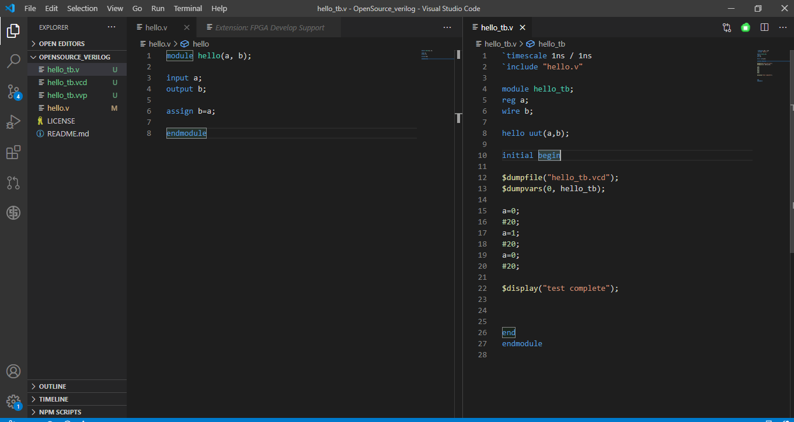
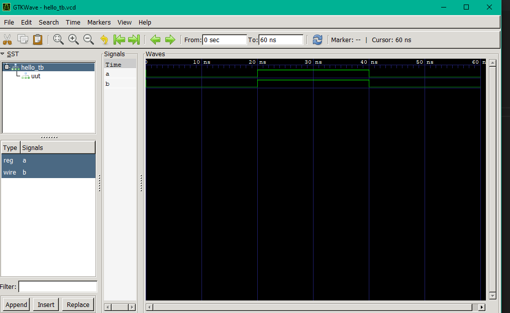
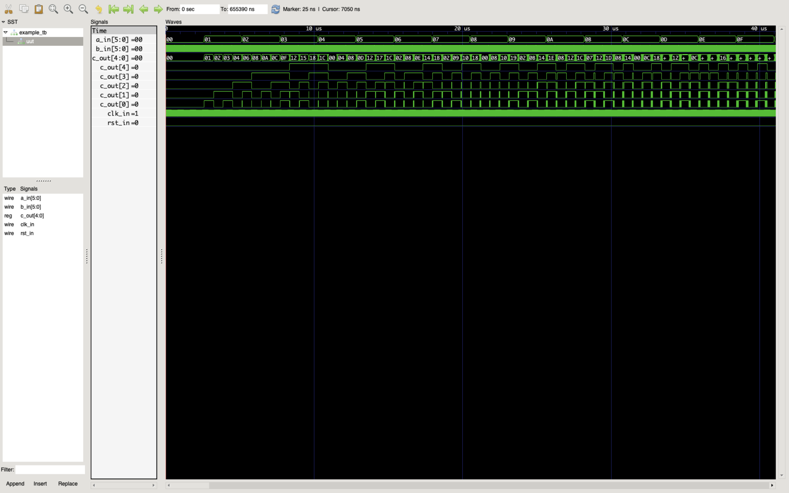

# Icarus Verilog (`iverilog` + `vvp`): visual reference

Icarus Verilog is an open-source Verilog/SystemVerilog **compiler plus event-driven simulator**. It works in two stages:

| Stage | Binary | Input | Output |
|---|---|---|---|
| Compile/elaborate | `iverilog` | `.v` / `.sv` sources | A text "vvp assembly" file (by convention `*.vvp`, default name `a.out`) |
| Simulate | `vvp` | The `.vvp` file | Whatever the testbench prints (`$display`, `$monitor` ...) on stdout, plus optional waveform files (VCD/FST/LXT) |

**Where it fits in our pipeline:** Icarus is the *functional simulator*. Each generated design is compiled together with its testbench, run, and judged PASS/FAIL from stdout. A second run dumps a VCD so that a human (or an agent) can look at waveforms in GTKWave or Surfer. Lint is a separate job done by Verilator (see [`../verilator/README.md`](../verilator/README.md)).

Official docs: <https://steveicarus.github.io/iverilog/> (sources in `Documentation/usage/` of <https://github.com/steveicarus/iverilog>).

---

## 1. Our exact pipeline usage

### 1.1 Compile

```bash
iverilog -g2012 -o sim.vvp tb.v design.v
```

| Part | Meaning |
|---|---|
| `-g2012` | Language generation IEEE 1800-2012 (SystemVerilog). It enables `logic`, `always_ff`/`always_comb`, `int`, `$fatal`, `++` and so on. Without it the default is Verilog-2005 plus Icarus extensions, and SV keywords become syntax errors. |
| `-o sim.vvp` | Output file. Without `-o` it writes `a.out`. |
| `tb.v design.v` | All sources in one command. Order rarely matters, because modules are resolved after parsing. The top level is any module that nobody instantiates (normally the testbench). |

**What success looks like:** *nothing at all*. A clean compile prints nothing on stdout or stderr and exits 0. Warnings may still appear on stderr with exit 0, for example port-width mismatch warnings.

**What failure looks like (stderr, exit code non-zero):**

```text
tb.v:10: syntax error
tb.v:15: error: invalid module item.
```

The first line is the exact format shown in the MIT 6.205 guide (<https://fpga.mit.edu/6205/F23/documentation/iVerilog>) for a missing semicolon. Note that **the reported line is often *after* the real mistake** (the missing `;` was on line 8 and the error says line 10). Other typical endings:

```text
design.v:17: syntax error
I give up.
```

```text
tb.v:12: error: Unknown module type: adder
2 error(s) during elaboration.
*** These modules were missing:
        adder referenced 1 times.
***
```

The general shape is always `<file>:<line>: <severity>: <message>`, where severity is `error`, `warning` or `sorry` (`sorry` means unsupported construct). A bare `syntax error` comes from the parser and has no severity word.

### 1.2 Run (PASS/FAIL)

```bash
vvp -n sim.vvp
```

* `-n` makes `$stop` (and Ctrl-C) behave like `$finish`. Without it a `$stop` in the testbench drops `vvp` into its **interactive debugger prompt and the process hangs waiting for stdin**. That is fatal for an unattended agent, so always pass `-n` (or `-N`, see exit codes).
* Flags go **before** the `.vvp` file. Plusargs such as `+DUMP` and extended args such as `-fst` go **after** it.

Typical stdout from a self-checking testbench:

```text
VCD info: dumpfile sim.vcd opened for output.
TEST 1: add 3 + 4 = 7 ... ok
TEST 2: add 255 + 1 = 0 (carry 1) ... ok
PASS: 2/2 tests passed
tb.v:58: $finish called at 120 (1ns)
```

Line by line:

1. `VCD info: dumpfile ... opened for output.` is printed by `vvp` itself, but only when the testbench calls `$dumpfile`/`$dumpvars`. Ignore it when parsing verdicts.
2. The lines in the middle are whatever the testbench `$display`s. `$display` output goes to **stdout** and also to the log file if `-l` was given.
3. `<file>:<line>: $finish called at <time> (<unit>)` is printed by `vvp` when `$finish` runs. **Its presence proves the simulation ended on purpose** rather than hanging or crashing. If the testbench never calls `$finish` and the clock is free-running, `vvp` runs forever (see the timeout tip below).

The PASS/FAIL format above is **our testbench convention, not something Icarus produces**. Icarus only relays `$display` text. Write testbenches so they print exactly one verdict line that a machine can read, for example:

```verilog
initial begin
  // ... drive stimulus, compare against expected ...
  if (errors == 0) $display("PASS: %0d/%0d tests passed", total, total);
  else             $display("FAIL: %0d/%0d tests failed", errors, total);
  $finish;
end
```

Recommended parser (Python-style pseudocode):

```python
import re, subprocess
r = subprocess.run(["vvp", "-n", "sim.vvp"], capture_output=True, text=True, timeout=60)
out = r.stdout
verdicts = re.findall(r"^(PASS|FAIL)\b.*$", out, re.M)
finished = re.search(r"\$finish called at (\d+)", out)
if r.returncode != 0 or not finished:   verdict = "ERROR"   # crash, $fatal, timeout, hang
elif any(v.startswith("FAIL") for v in verdicts) or not verdicts: verdict = "FAIL"
else: verdict = "PASS"
```

Rules of thumb:

* **FAIL wins.** If any `FAIL` line exists, the run failed, even if a `PASS` line was also printed.
* **No verdict line counts as FAIL (or ERROR), never PASS.** A testbench that silently does nothing must not pass.
* Anchor the regex at the start of a line (`^PASS`), so that a message such as `expected PASS got FAIL` cannot be misread.
* Also scan for `ERROR`/`Error`/`ASSERTION` lines if testbenches use `$error`. Icarus prints `ERROR: tb.v:40: <msg>` for `$error` and keeps running.

### 1.3 Second run: VCD waveform dump

Icarus writes waveforms from `vvp` at runtime. The testbench has to ask for them:

```verilog
initial begin
  $dumpfile("sim.vcd");     // file name (default dump.vcd if omitted)
  $dumpvars(0, tb);         // 0 = this scope and everything below it
end
```

To keep the PASS/FAIL run fast and dump only on the second run, gate it with a plusarg:

```verilog
initial if ($test$plusargs("DUMP")) begin
  $dumpfile("sim.vcd");
  $dumpvars(0, tb);
end
```

```bash
vvp -n sim.vvp            # run 1: verdict only
vvp -n sim.vvp +DUMP      # run 2: also writes sim.vcd
vvp -n sim.vvp -fst +DUMP # optional: FST instead of VCD (smaller and faster for GTKWave or Surfer)
vvp -n sim.vvp -none      # force no dump file even if the TB calls $dumpvars
```

Inside a `.vcd` file (plain text, IEEE 1364 format):

```text
$timescale 1ns $end
$scope module tb $end
$var reg 1 ! a $end
$var wire 1 " b $end
$upscope $end
$enddefinitions $end
#0
0!
0"
#20
1!
1"
```

A header declares each signal and gives it a short identifier code (`!`, `"`, ...). After `$enddefinitions` come `#<time>` markers, each followed by value changes. A minimal VCD parser only needs those three constructs. Multi-bit values look like `b1010 #`.

---

## 2. Exit codes

| Tool / situation | Exit code |
|---|---|
| `iverilog`, clean compile (warnings allowed) | `0` |
| `iverilog`, syntax or elaboration errors | non-zero (typically `1`), with messages on stderr and **no usable `.vvp` written** |
| `vvp`, testbench reached `$finish` | `0`, **even if the testbench printed FAIL** |
| `vvp -n`, testbench hit `$stop` | `0` (treated as `$finish`) |
| `vvp -N`, testbench hit `$stop` | `1`. Useful: make failing testbenches call `$stop` and run with `-N`. |
| `vvp`, testbench called `$fatal` | non-zero (`1`) in current Icarus releases |
| `vvp`, cannot open or parse the `.vvp` file | non-zero |

**Key point: exit code 0 from `vvp` does NOT mean the test passed.** Parse stdout. A verdict needs exit code 0, the `$finish called at` line, and a `PASS` line with no `FAIL`. If you want exit codes to carry the verdict as well, end failing testbenches with `$fatal(1, "FAIL ...")` or `$stop` under `-N`.

---

## 3. Images

> Only real, published images are included. None of them is a captured terminal session: no screenshot of `iverilog`/`vvp` console output with PASS/FAIL text could be found (see "Gaps" at the end). The terminal formats in section 1 are quoted from the official docs or MIT course pages, or are shown as clearly labelled examples.

### 3.1 Testbench with `$dumpfile`/`$dumpvars`, and the files the flow generates



Source: <https://github.com/vibsaa/OpenSource_verilog> (README image "Screenshot (217)", <https://user-images.githubusercontent.com/20024712/102868091-c1446900-445f-11eb-8f37-db3410f03c4e.png>). In that README it follows the `iverilog` and `vvp output_filename.vvp` steps, run "from the VS Code PowerShell terminal" on Windows. The terminal itself is **not** visible in the capture.

Region by region:

* **Left: Explorer (`OPENSOURCE_VERILOG`).** It lists `hello_tb.v` (the testbench), **`hello_tb.vcd`** (waveform written by `vvp` because of `$dumpfile`), **`hello_tb.vvp`** (the compiled output of `iverilog -o hello_tb.vvp ...`), `hello.v` (the design), `LICENSE` and `README.md`. The green `U` badges mean the files are untracked in git, so `.vvp` and `.vcd` are *generated artifacts*. Add `*.vvp` and `*.vcd` to `.gitignore`.
* **Middle editor: `hello.v`.** The design is `module hello(a, b); input a; output b; assign b=a; endmodule`, a 1-bit buffer written in Verilog-1995 port style.
* **Right editor: `hello_tb.v`.**
  * Line 1, `` `timescale 1ns / 1ns ``: delays such as `#20` are 20 ns. This unit is what appears later in `$finish called at ... (1ns)`.
  * Line 2, `` `include "hello.v" ``: the testbench textually includes the design, so this author could compile *only* the testbench. **Do not do this in our pipeline.** We pass `tb.v design.v` separately, and including the design as well would define `hello` twice (`error: ... already declared`).
  * Lines 4–8: the `hello_tb` module declares `reg a`, `wire b` and the instance `hello uut(a,b);`.
  * Lines 12–13, `$dumpfile("hello_tb.vcd"); $dumpvars(0, hello_tb);`: this is exactly the VCD mechanism our second run uses.
  * Lines 15–20: stimulus `a=0; #20; a=1; #20; a=0; #20;`, so 60 ns in total.
  * Line 22, `$display("test complete");`: the only stdout from this TB. **There is no self-check and no `$finish`.** It ends only because no events remain. Our testbenches must print a PASS/FAIL verdict and call `$finish` explicitly.

### 3.2 The VCD from 3.1 opened in GTKWave (Windows)



Source: <https://github.com/vibsaa/OpenSource_verilog> (README image "Screenshot (218)", <https://user-images.githubusercontent.com/20024712/102868088-c0abd280-445f-11eb-8002-49af83098f6c.png>), opened with `gtkwave output_filename.vcd`.

* **Title bar:** `GTKWave - hello_tb.vcd`, the file `vvp` wrote.
* **Toolbar:** `From: 0 sec`, `To: 60 ns` is the whole dump range, which matches the 3 × `#20` delays. `Cursor: 60 ns`.
* **SST (Signal Search Tree), top left:** the hierarchy `hello_tb` → `uut`. This mirrors `$dumpvars(0, hello_tb)`, which dumped the TB scope and everything below it.
* **Type/Signals list, bottom left:** `reg a` and `wire b`, the declared kinds from the TB.
* **Signals and Waves panes:** `a` and `b` are both low from 0–20 ns, high from 20–40 ns and low from 40–60 ns. `b` follows `a` with zero delay, so `assign b=a` works. Time ruler ticks run 0–60 ns.
* **Append / Insert / Replace buttons:** these add the selected signals to the wave view. Signals do not appear until you add them (or load a `.gtkw` save file).

### 3.3 Waveform of a multi-bit SystemVerilog design (MIT 6.205 guide)



Source: MIT 6.205 "iVerilog and GTKWave Setup", <https://fpga.mit.edu/6205/F23/documentation/iVerilog> (image <https://fpga.mit.edu/6205/_static/F23/documentation/iVerilog/waveform_viewer.png>, caption "The Waveform Viewer"). The same page uses our exact compile style, `iverilog -g2012 -o example.out example_tb.sv example.sv`, then `vvp example.out`, then `gtkwave example.vcd`.

* **Toolbar:** `From: 0 sec To: 655390 ns`, `Marker: 25 ns | Cursor: 7050 ns`. The ruler shows `10 us`, `20 us`, `30 us` and `40 us`. The dump is long, and the view is zoomed to the first ~40 µs.
* **SST:** `example_tb` → `uut`. The `uut` scope is selected, so the Type/Signals list shows the DUT ports: `wire a_in[5:0]`, `wire b_in[5:0]`, `reg c_out[4:0]`, `wire clk_in`, `wire rst_in`.
* **Signals pane:** each entry shows its **value at the marker**, for example `a_in[5:0] =00`, `c_out[4:0] =00`, `clk_in =1`, `rst_in =0`. `c_out` is also expanded into `c_out[4]` … `c_out[0]`.
* **Waves pane:**
  * `a_in` is a bus drawn as hexagon segments labelled `00, 01, 02 … 0F`. It counts up slowly.
  * `b_in` appears as a solid green band because it changes faster than the zoom level can resolve.
  * `c_out` is a bus with many short segments (`01 02 03 04 06 08 0A 0C 0F 12 15 18 1C …`), and its individual bits toggle below it. `+` marks segments too narrow to label.
  * `clk_in` is also a solid band at this zoom.
  * `rst_in` stays low.
* Takeaway for agents: a bus is shown in hex by default. A solid band means "zoom in". Values in the Signals column are at the **marker**, not at the cursor.

### 3.4 Official Icarus docs: GTKWave example

![GTKWave showing example.vcd with data[7:0], data_valid, empty, en, rx_en, tx_en, underrun](images/official-docs-gtkwave-counter-example.png)

Source: Icarus Verilog documentation, "Viewing Waveforms" (<https://steveicarus.github.io/iverilog/usage/waveform_viewer.html>, file `Documentation/usage/GTKWave_Example2.png` in <https://github.com/steveicarus/iverilog>).

* **Title:** `GTKWave - example.vcd`. `From: 0 sec To: 2303 ps`, `Cursor: 2226 ps`, with a ruler label at `2200 ps`. A picosecond timescale shows the TB used a `ps` precision.
* **SST:** a single scope, `logic`.
* **Type/Signals:** `wire data[7:0]`, `wire data_valid`, `wire empty`, and more off-screen.
* **Signals/Waves:** `data[7:0]` holds hex `81`, drawn in red. `empty` is high. `tx_en` is high and falls at about 2.2 ns. `data_valid`, `en`, `rx_en` and `underrun` are low.
* **Red traces in GTKWave mean X or undefined** (or, on a bus, that some bits are X/Z). If a DUT output is red after reset, something is undriven or uninitialised. This is the visual counterpart of a `FAIL` caused by `x` values.

The same doc page gives the canonical flow (`iverilog -o dsn counter_tb.v counter.v`, `vvp dsn`, `gtkwave test.vcd &`) and the `$dumpfile("test.vcd"); $dumpvars(0,test);` pattern.

### 3.5 Wikimedia Commons: clocked 5-bit register waveform

![GTKWave showing tb/DUT with clk and q[4:0]](images/wikimedia-gtkwave-simple-verilog-example.png)

Source: Wikimedia Commons, "GTKWave simple verilog example.png" (public domain, by User:ReAl), <https://commons.wikimedia.org/wiki/File:GTKWave_simple_verilog_example.png>. Per its description, it shows the waveforms of the simple example from the Ukrainian Wikipedia article on Icarus Verilog.

* **Title:** `GTKWave - out.vcd`. `From: 0 sec To: 2050 ns`, `Marker: 900 ns | Cursor: 1050 ns`.
* **SST:** `tb` → `DUT`, with `DUT` highlighted in orange. **Type/Signals:** `wire clk`, `reg q[4:0]`.
* **Signals pane:** values at the marker: `clk =1`, `q[4:0] =11` (hex), `q[4]=1 q[3]=0 q[2]=0 q[1]=0 q[0]=1`, which is consistent with 0x11 = 10001b.
* **Waves:** `clk` is a regular square wave. `q[4:0]` steps through `0A 14 08 11 03 06 0C 18 11 …` and the sequence then repeats. This looks like an LFSR or shift-feedback register: each value is roughly the previous one shifted left with feedback. The **red block at t≈0 on every `q` bit is the X state before the first clock or reset**. The vertical red line is the marker at 900 ns.

### 3.6 Icarus used as a live syntax checker in VS Code

![Animated: VS Code Verilog-HDL extension showing "[iverilog] syntax error" on a missing semicolon](images/vscode-verilog-hdl-iverilog-syntax-error.gif)

Source: README of the VS Code "Verilog-HDL/SystemVerilog/Bluespec SystemVerilog" extension, <https://github.com/mshr-h/vscode-verilog-hdl-support> (`images/sample.gif`, <https://raw.githubusercontent.com/mshr-h/vscode-verilog-hdl-support/main/images/sample.gif>). The extension can run `iverilog` as its linter.

What the animation shows, frame by frame:

1. **Start:** file `a.v` is in folder `a folder`. Module `some_mod(input wire clk, rst, in, output reg out)` has `reg rand_reg;` and an `always@* begin out = ~in end`. **Line 11 has no semicolon.** The status bar shows `1 error, 0 warnings` (`ⓧ 1 ⚠ 0`). The explorer marks `a.v` and the outline entry `some_mod` with a red `1`.
2. **Hover:** a red squiggle appears under `end` on **line 12**, not on line 11 where the `;` is missing, and the tooltip reads **`[iverilog] syntax error [iverilog]`**. This is the same "error reported on the line after the real mistake" behaviour as in section 1.1.
3. **Fix:** the user types `;` to make `out = ~in;`. The file is saved, the squiggle disappears, and the status bar goes to `ⓧ 0 ⚠ 0`. The cursor ends at `Ln 11, Col 19`.

The status bar also shows `CRLF` line endings and language mode `Verilog`. Icarus accepts CRLF files without complaint.

---

## 4. Common flags

### `iverilog`

| Flag | Use |
|---|---|
| `-g2012` / `-g2009` / `-g2005` / `-g2001` | Language generation. **Always pass `-g2012`** for generated code that may contain SV. |
| `-o <file>` | Output `.vvp` path (default `a.out`). |
| `-s <top>` | Name the top module explicitly. Use it when the TB file contains helper modules, or several tops exist and the wrong one gets simulated. |
| `-I <dir>` | Include path for `` `include ``. |
| `-D NAME[=val]` | Define a macro, for example `-DSIM`. |
| `-c <file>` / `-f <file>` | Read source names and options from a command file. |
| `-y <dir>`, `-Y .sv` | Library directory and suffix for auto-finding modules. |
| `-Wall` | Enable all compile warnings (implicit nets, port widths, timescale, sensitivity lists ...). |
| `-Wimplicit`, `-Wportbind`, `-Wselect-range`, `-Wtimescale`, `-Winfloop` | Individual warning classes. |
| `-t null` | Parse and elaborate only, without writing output: a fast syntax check. |
| `-E` | Preprocess only. |
| `-v` | Verbose: prints each sub-step (preprocessor `ivlpp`, compiler `ivl`) and its timing. |
| `-V` | Print the version and exit. |
| `-pfileline=1` | Annotate the generated code with file/line info for better runtime messages. |

### `vvp`

| Flag (before the file) | Use |
|---|---|
| `-n` | `$stop` and Ctrl-C act as `$finish`. **Always use this in automation.** |
| `-N` | Like `-n`, but exits with code 1 if `$stop` was called. |
| `-l <log>` | Copy `$display` and other output to a log file (`-l -` sends it to stderr). |
| `-i` | Unbuffered stdout. Helps when streaming output through a pipe. |
| `-q` | Quiet: suppress `$display` to stdout. **Don't use it for verdict runs.** |
| `-v` | Verbose load and run statistics. |
| `-M <path>` / `-m <mod>` | VPI module search path and module to load. |

| Extended args (after the file) | Use |
|---|---|
| `-vcd` (default) / `-fst` / `-lxt` / `-lxt2` | Dump format. |
| `-none` | Disable dumping entirely. |
| `-dumpfile=<name>` | Default dump name when the TB omits `$dumpfile`. |
| `+ANYTHING`, `+KEY=val` | Plusargs read with `$test$plusargs` / `$value$plusargs`. |

---

## 5. Common errors and warnings

| Message (stderr) | Meaning and fix |
|---|---|
| `x.v:N: syntax error` | The parser failed at or near line N. Check the **previous** line for a missing `;`, `end`, `endmodule` or `)`. |
| `I give up.` | The parser cannot recover after a syntax error. Fix the first error only and recompile. |
| `x.v:N: error: invalid module item.` | A follow-on error after a syntax error, or a statement placed outside an `always`/`initial` block. |
| `error: Unknown module type: foo` plus `*** These modules were missing:` | An instance of a module whose source was not passed. Add the file, or fix the name. |
| `N error(s) during elaboration.` | A summary line. The real errors are above it. |
| `error: 'x' has already been declared in this scope.` | Duplicate declaration. Often caused by `` `include ``-ing a file that is also on the command line. |
| `error: Unable to bind wire/reg/memory 'x' in 'tb.uut'` | Use of an undeclared identifier, usually a typo. |
| `error: x is not a valid l-value in tb.` | Assigning to a `wire` inside `always`/`initial`. Declare it `reg`/`logic`, or use `assign`. |
| `warning: Port 1 (a) of foo expects 8 bits, got 4.` + `Padding 4 high bits of the port.` | Port width mismatch at an instance. It compiles but is usually a bug. |
| `warning: implicit definition of wire 'x'.` (with `-Wimplicit`/`-Wall`) | Used without a declaration. Usually a typo. Add `` `default_nettype none `` to make it an error. |
| `sorry: ... not currently supported.` | A valid SV construct that Icarus does not implement (some classes, interfaces with modports, assertions, `randomize` ...). Rewrite it in a simpler style. |
| `warning: Some modules have no timescale. ...` | Mixed `` `timescale `` usage. Put the same `` `timescale `` in both TB and design, or use `-Wno-timescale`. |
| `syntax error` on `logic`, `always_ff`, `int` | You forgot `-g2012`. |
| Runtime: `VCD info: dumpfile X opened for output.` | Informational only. |
| Runtime: `ERROR: tb.v:N: ...` | Printed by `$error`. Count it as a test failure. |
| Runtime: `FATAL: tb.v:N: ...` | Printed by `$fatal`. The simulation stops with a non-zero exit code. |
| Runtime: `WARNING: x.v:N: $readmemh(f.hex): Not enough words in the file for the requested range` | The memory init file is shorter than the array. Check the path and contents. |
| Runtime: `x.v:N: $finish called at T (unit)` | Normal end of simulation. |
| Runtime: no output and the process never exits | No `$finish`, and a free-running clock (`always #5 clk=~clk;`) keeps scheduling events. Add `$finish` and a watchdog. |

---

## 6. Windows gotchas

* **Installation sources.** Use OSS CAD Suite (YosysHQ), which bundles `iverilog.exe`, `vvp.exe`, `gtkwave` and Verilator, or the standalone Windows installer builds. With OSS CAD Suite, run its `environment.bat` / `start.bat` (or put `<suite>\bin` and `<suite>\lib` on `PATH`) before calling the tools from a fresh shell. Otherwise the process fails with "not recognized" or missing DLL errors.
* **Paths with spaces.** This repository lives in `C:\Users\zubai\yc 2.0 hackathon\`. **Quote every path**, or better, run the tools with `cwd` set to the job's work directory and pass bare relative file names (`tb.v design.v`). Pass an argument list (`subprocess.run([...])`), not a shell string.
* **`iverilog` is a driver** that calls `ivlpp` (preprocessor) and `ivl` (compiler) from its `lib\ivl` directory. If only `iverilog.exe` was copied somewhere, compiles fail with messages about not finding `ivl`/`ivlpp`, or about `.conf`/`.tgt` files. Keep the install tree intact.
* **The `.vvp` output is a text file, not a Windows executable.** Run it with `vvp sim.vvp`. On Unix-like systems the file has a `#!/.../vvp` shebang, but that does not work on Windows.
* **CRLF line endings are fine** (see the `CRLF` status bar in 3.6). Avoid a UTF-8 BOM at the start of `.v` files, because some tools choke on it.
* **File locking.** If GTKWave still has `sim.vcd` open, a re-run can fail to overwrite it, or GTKWave shows stale data. Close it, or use the File > Reload Waveform toolbar button.
* **PowerShell quoting.** Plusargs such as `+KEY=val` are fine. `$dumpfile` and similar strings belong in Verilog source, not on the command line, so PowerShell's `$` expansion is not an issue unless you build `-D` macros with `$` in them.
* **Output buffering.** When `vvp` writes to a pipe, stdout is block-buffered. If a run is killed by a timeout, the last lines may be lost. Pass `-i` (unbuffered) when you need partial logs from hung simulations.

---

## 7. Tips for an AI agent driving Icarus

1. **Always pass `-g2012` and `vvp -n`.** Without `-n`, a stray `$stop` blocks forever on the interactive prompt.
2. **Enforce a wall-clock timeout** (for example 30–60 s) on `vvp`, and also an in-TB watchdog, such as `initial begin #1_000_000; $display("FAIL: timeout"); $finish; end`. Treat a timeout as FAIL or ERROR, never PASS.
3. **Treat a compile failure as its own outcome** (`COMPILE_ERROR`), distinct from a functional FAIL. Feed the first 20–40 stderr lines back to the generator. **Only the first error is reliable**, because later ones cascade from it.
4. When reporting an error location, **show the reported line and the 2–3 lines before it.** Missing-`;` errors point one or more lines too late.
5. **Parse stdout, not the exit code.** Require all of: exit 0, a `$finish called at` line, at least one `^PASS` line, and no `^FAIL`/`^ERROR`/`^FATAL` lines.
6. **Make testbenches machine-friendly.** Print one final `PASS:`/`FAIL:` line with counts, print per-vector mismatches as `MISMATCH t=<time> in=<..> exp=<..> got=<..>`, and use `%0d`/`%h` formats with no padding.
7. **Watch for `x`/`z` in printed values.** A `got=x` usually means a missing reset or an undriven output. `!==`/`===` comparisons catch X, but `!=`/`==` do not: `x != 1` is `x`, which is false inside an `if`, so the test silently "passes". Prefer `!==` in self-checks.
8. **Don't `` `include `` the design in the TB** when both files are on the command line, because you get duplicate-declaration errors.
9. **Use `-s tb`** if the TB file contains more than one top-level module, so that you never simulate the wrong top.
10. **Keep VCD runs optional** (plusarg-gated). VCDs of long simulations grow to hundreds of MB. Prefer `-fst` for big runs and dump only the scopes you need (`$dumpvars(1, tb.uut)`).
11. **Use a fresh work directory per job** so that stale `sim.vvp`/`sim.vcd` from a previous design can never be mistaken for new results. Delete `sim.vvp` before compiling, and check that it exists afterwards.
12. **Quick syntax gate:** `iverilog -g2012 -t null design.v` checks a design without a testbench in milliseconds.

---

## 8. Gaps (images not found)

These images could not be found as real, published captures, so none are included. Do not assume their exact appearance beyond the text formats quoted above.

* **A terminal screenshot of `iverilog` + `vvp` output.** The vibsaa README's "after vvp" screenshot (3.1) shows only the editor. None of the official docs, the iverilog GitHub README (which has no images) or the tutorials searched had a real console capture.
* **A screenshot of a self-checking testbench printing PASS/FAIL.**
* **A screenshot of a terminal compile error** (`syntax error` / `I give up.`). Only the text is documented (MIT 6.205, GitHub issues), plus the VS Code tooltip in 3.6.
* **An Icarus flow diagram** (source → `ivlpp` → `ivl` → `.vvp` → `vvp` → stdout/VCD) from an official source. The repo contains no such figure.

The flow, in text:

```text
tb.v + design.v --> iverilog (ivlpp preprocess -> ivl parse/elaborate -> vvp codegen) --> sim.vvp
sim.vvp --> vvp -n --> stdout ($display: PASS/FAIL, "$finish called at ...")
                   \-> sim.vcd / .fst (only if $dumpfile/$dumpvars) --> GTKWave / Surfer
```
