# KiCad Visual Reference (v8 / v9)

KiCad is a free, open-source (GPL) suite for electronic design automation (EDA). It covers the whole job of designing a printed circuit board: you draw the schematic, check it, choose physical footprints, place parts and route copper, check the layout, look at it in 3D, and export manufacturing files such as Gerbers, drill files, a BOM and pick-and-place data. KiCad runs on Windows, macOS and Linux. Each part of the job has its own editor, and all of them are opened from one **Project Manager** window.

All screenshots below are from the official KiCad 9.0 documentation (docs.kicad.org). The UI in v8 is nearly identical. The images are stored in [`images/`](images/).

---

## 1. The workflow at a glance

```
 Project Manager (.kicad_pro)
        |
        v
 [1] Schematic Editor (.kicad_sch) -- place symbols (A), wire (W), power (P), labels (L)
        |   Annotate (assign R1, C1, ...)
        v
 [2] ERC  (Inspect > Electrical Rules Checker) -- fix errors, add PWR_FLAG etc.
        |
        v
 [3] Assign footprints (Tools > Assign Footprints / CvPcb, or per-symbol "Footprint" field)
        |   (create missing parts in Symbol Editor / Footprint Editor)
        v
 [4] Update PCB from Schematic (F8)  <-- replaces the old "netlist export/import" step
        |   (kicad-cli sch export netlist still exists for other tools)
        v
 [5] PCB Editor (.kicad_pcb) -- Board Setup (stackup, rules, net classes)
        |   draw board outline on Edge.Cuts, place footprints following the ratsnest
        v
 [6] Route tracks (X), vias (V), copper zones/pours (Ctrl+Shift+Z), refill zones (B)
        |   (optional: Specctra DSN -> Freerouting -> SES autoroute)
        v
 [7] DRC (Inspect > Design Rules Checker), with schematic-parity test
        |
        v
 [8] Fabrication outputs: File > Plot (Gerbers) + Generate Drill Files,
     BOM (Schematic: Tools > Generate BOM), pick-and-place (.pos), STEP, 3D view (Alt+3)
```

Since KiCad 6, the schematic and the board stay in sync through **Tools > Update PCB from Schematic** (F8) and **Update Schematic from PCB**. You no longer need to write out a netlist file and read it back in.

---

## 2. Screenshots, region by region

### 2.1 Project Manager

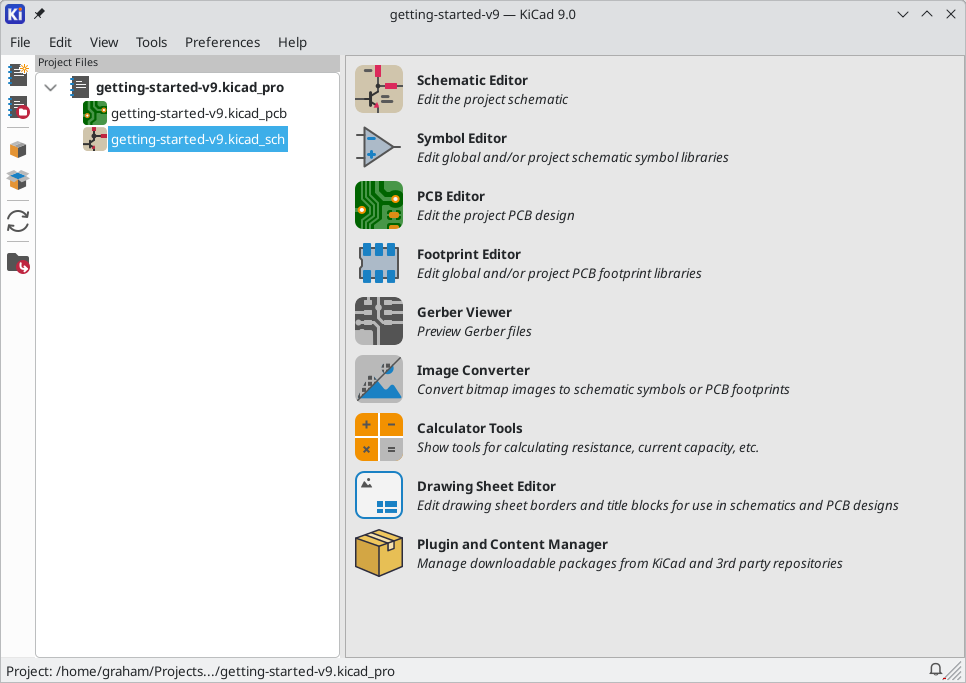

Source: https://docs.kicad.org/9.0/en/getting_started_in_kicad/images/project-manager-new-project.png

- **Title bar / menu bar (top):** shows `getting-started-v9 — KiCad 9.0`. The menus are File (New/Open/Archive/Unarchive project, Import non-KiCad projects), Edit, View, Tools, Preferences (library tables, paths, general settings) and Help.
- **Left vertical toolbar:** from top to bottom: *Create new project*, *Open existing project*, two archive/package buttons (*Archive project* / *Unarchive project*, shown as box icons), *Refresh project tree*, and *Open project directory* in the file browser.
- **Project Files tree (left pane):** the root `getting-started-v9.kicad_pro` with its `getting-started-v9.kicad_pcb` (board) and `getting-started-v9.kicad_sch` (root schematic, highlighted). Double-click a file to open it in its editor.
- **Launcher (right pane):** one tile per tool:
  - **Schematic Editor:** edit the project schematic.
  - **Symbol Editor:** edit global or project symbol libraries.
  - **PCB Editor:** edit the board.
  - **Footprint Editor:** edit global or project footprint libraries.
  - **Gerber Viewer:** check Gerber and drill files before you send them to a fab.
  - **Image Converter:** turn a bitmap (such as a logo) into a symbol or footprint.
  - **Calculator Tools:** track width, via, resistor, regulator and E-series calculators.
  - **Drawing Sheet Editor:** title blocks and borders (`.kicad_wks`).
  - **Plugin and Content Manager (PCM):** download libraries, plugins and colour themes.
- **Status bar (bottom):** the full path of the open project, plus a notifications bell on the right.

### 2.2 Schematic Editor: main window

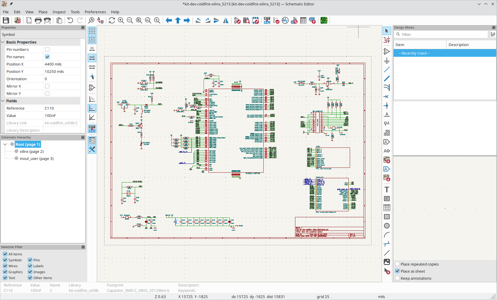

Source: https://docs.kicad.org/9.0/en/eeschema/images/en/commands_overview.png

- **Top toolbar (left to right):** Save; Schematic Setup; Page settings; Print; Plot; Paste; Undo/Redo; Find and Find & Replace; Refresh; Zoom in/out/fit/objects/selection; navigation arrows (back, up to parent sheet, forward); Rotate CCW/CW; Mirror vertical/horizontal; then the design tools: Symbol Editor, Symbol Library Browser, Footprint Library Browser, **Annotate** (the `R?? → R42` icon), **ERC** (red-check icon), **Assign Footprints**, Symbol Fields Table (the grid icon), **Generate BOM**, and **Switch to PCB Editor / Update PCB** (the green board icon on the far right).
- **Left vertical toolbar (display options):** toggle grid and grid overrides; units (in / **mil** active / mm); full-window crosshair; show hidden pins; wire angle modes (free angle, 90 degrees selected, 45 degrees); annotation display (`R?? R42`); and toggles for the Hierarchy panel and the Properties panel.
- **Properties panel (top left):** edits the selected item, here capacitor `C110`. *Basic Properties* covers pin numbers and names, Position X/Y in mils, Orientation and Mirror X/Y. *Fields* holds Reference `C110`, Value `100nF`, Library Link `kit-coldfire_schlib:C...` and Library Description.
- **Schematic Hierarchy (middle left):** the sheet tree. `Root (page 1)` is selected and has the sub-sheets `xilinx (page 2)` and `inout_user (page 3)`.
- **Selection Filter (bottom left):** checkboxes that limit what a click or drag can select: All items, Symbols, Pins, Wires, Labels, Graphics, Images, Text, Other items.
- **Canvas (centre):** an A-size sheet with the drawing frame and title block at bottom right. Symbols are red-brown, wires green and hierarchical sheets are the boxes at right.
- **Right vertical toolbar (drawing tools, top to bottom):** Select; Highlight net; Add symbol (A); Add power (P); Wire (W); Bus (B); Bus entry; No-connect flag (Q); Junction (J); Net label (L); Net class directive; Rule area; Global label (Ctrl+L); Hierarchical label (H); Hierarchical sheet (S); Import sheet pin; Text (T); Text box; Table; Rectangle; Circle; Arc; Bezier; Line; Image; Delete tool.
- **Design Blocks panel (right):** new in v9. It holds reusable schematic snippets, with a Filter box, a "Recently Used" list and options at the bottom: *Place repeated copies*, *Place as sheet* and *Keep annotations*.
- **Message panel and status bar (bottom):** details of the selected symbol (Reference C110, Value 100nF, Name C, Library, Footprint `Capacitor_SMD:C_0805_2012Metric`, Description and Keywords), then zoom `Z 0.63`, absolute cursor `X/Y`, relative `dx/dy/dist`, `grid 25` and units `mils`.

### 2.3 Schematic: symbols, wires, power and labels

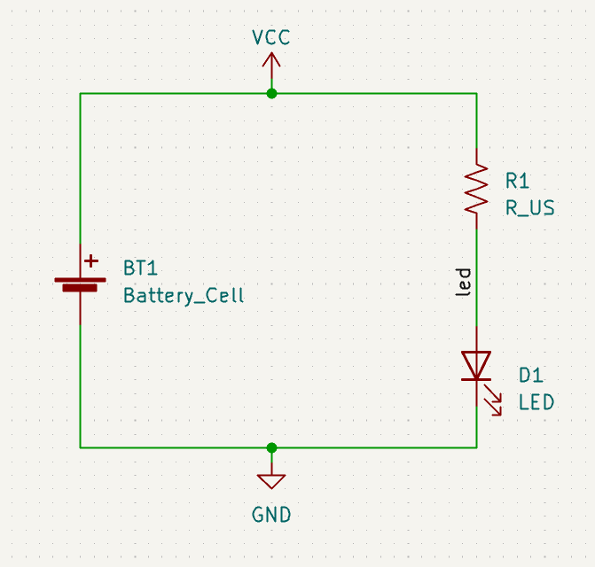

Source: https://docs.kicad.org/9.0/en/getting_started_in_kicad/images/symbols-labeled.png

This is the canvas from the Getting Started tutorial: a coin cell lighting an LED.
- **Symbols (dark red):** `BT1 Battery_Cell` (left), `R1 R_US` (US zig-zag resistor, top right) and `D1 LED` (bottom right). Each symbol shows its reference designator and value in teal.
- **Wires (green lines):** these carry the electrical connections. The **green dots** are junctions at T-connections, where the wire meets the VCC and GND power symbols.
- **Power symbols:** `VCC` (up arrow, top) and `GND` (bottom). Every power symbol with the same name joins the same global net.
- **Net label `led` (on the R1–D1 wire):** names that net. In the PCB it appears as `/led`, because local labels are prefixed with the sheet path.
- **Background:** the dotted grid. Wire ends must land on grid points to connect.

### 2.4 Electrical Rules Checker (ERC)

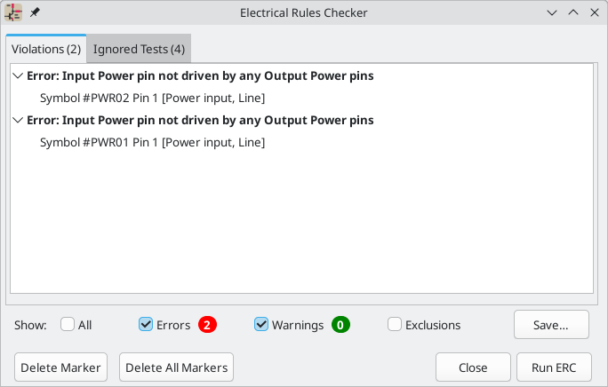

Source: https://docs.kicad.org/9.0/en/getting_started_in_kicad/images/erc-messages.png

- **Tabs:** *Violations (2)* lists the current problems. *Ignored Tests (4)* lists checks whose severity is set to "ignore" in Schematic Setup > Electrical Rules.
- **Violation tree:** each bold row is a violation type and severity, here two cases of `Error: Input Power pin not driven by any Output Power pins`. Each child row is an offending item (`Symbol #PWR02 Pin 1 [Power input, Line]`). Clicking an item centres the canvas on its marker. Right-click to exclude the violation or change its severity. The usual fix for this error is a `PWR_FLAG` symbol on the net, or a real power-output source.
- **Show filters:** All / Errors (red badge, 2) / Warnings (green badge, 0) / Exclusions.
- **Save...:** writes the report as a `.rpt` text file or as `.json`.
- **Bottom buttons:** *Delete Marker*, *Delete All Markers*, *Close*, *Run ERC*.

### 2.5 Symbol Editor

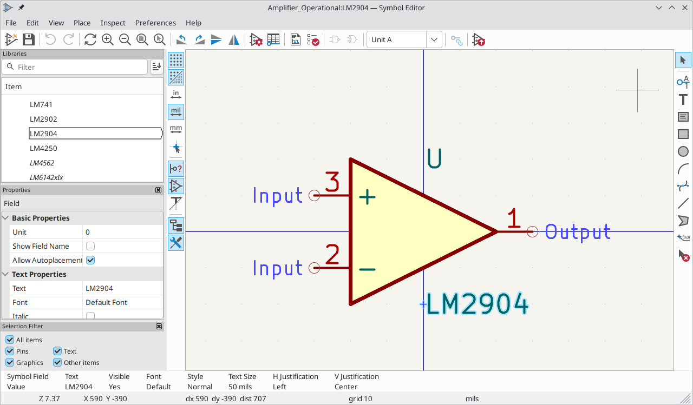

Source: https://docs.kicad.org/9.0/en/eeschema/images/libedit_main_window.png

- **Title:** `Amplifier_Operational:LM2904 — Symbol Editor`, written as `library:symbol`.
- **Top toolbar:** New symbol; Save; Undo/Redo; Refresh; Zoom; Rotate/Mirror; Symbol Properties; **Pin Table** (grid icon, for bulk-editing pins); Datasheet; **Symbol Checker** (the check icon, a per-symbol ERC); De Morgan standard/alternate body style (the two gate icons); **Unit selector** (`Unit A`, for multi-unit parts such as dual op-amps); Synchronise pins between units; Update symbol in schematic.
- **Libraries panel (top left):** a filterable tree of libraries and symbols, with LM2904 selected. Italic names (LM4562, LM6142xIx) are *derived* (alias) symbols that inherit from a parent.
- **Properties panel (middle left):** the selected item's fields. Here the Value field is selected: Unit 0, Show Field Name, Allow Autoplacement, Text, Font, Italic.
- **Selection Filter (bottom left):** All items, Pins, Graphics, Text, Other items.
- **Left vertical toolbar:** grid toggles, units (mil active), crosshair, show/hide electrical-type pin names, toggle hierarchy/library tree and the Properties panel.
- **Canvas:** the op-amp body (yellow-filled triangle) with pins 3 (`+`, Input), 2 (`−`, Input) and 1 (Output). The blue words beside the pins (`Input`, `Output`) are the pins' *electrical types*, which ERC uses, and are not drawn in the schematic. The small circles mark each pin's connection point. The blue crosshair lines through the centre mark the symbol origin. `U` is the reference prefix and `LM2904` is the value.
- **Right toolbar:** Select; **Add pin** (P); Text; Text box; Rectangle; Circle; Arc; Bezier; Polyline; Polygon; Anchor/origin (`(0,0)`); Delete tool.
- **Message panel (bottom):** the selected field's attributes (Text, Visible, Font, Style, Text Size 50 mils, H/V justification), with zoom and coordinates below.

### 2.6 Footprint Editor

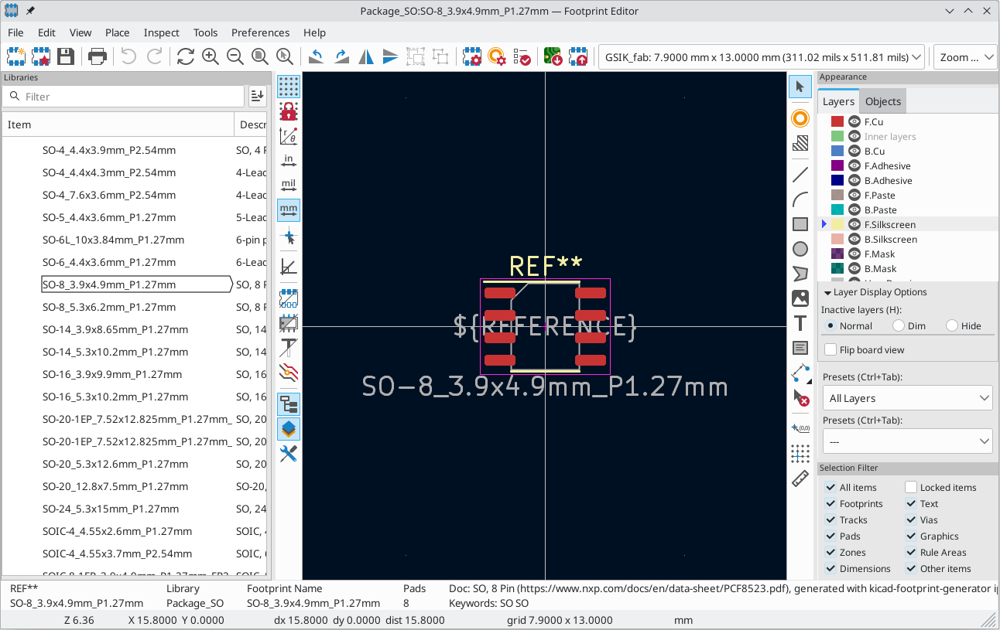

Source: https://docs.kicad.org/9.0/en/pcbnew/images/footprint_editor_overview.png

- **Title:** `Package_SO:SO-8_3.9x4.9mm_P1.27mm — Footprint Editor`, written as `library:footprint`.
- **Top toolbar:** New footprint; Create footprint with the wizard; Save; Print; Undo/Redo; Refresh; Zoom; Rotate/Mirror; Group/Ungroup; **Footprint Properties**; Pad defaults; **Footprint Checker**; Load from board / Insert into board (the green board icons); the **grid selector** (`GSIK_fab: 7.9000 mm x 13.0000 mm`, a grid override); and the zoom selector.
- **Libraries panel (left):** a filterable list of `Package_SO` footprints with descriptions. `SO-8_3.9x4.9mm_P1.27mm` is selected.
- **Left vertical toolbar:** grid toggle; lock/unlock; polar coordinates; units (in / mil / **mm** active); crosshair; free-angle mode; pad display modes (fill/outline); text and graphic outline modes; toggles for the library tree and the Appearance panel; Properties panel.
- **Canvas (dark blue):** eight red SMD pads on F.Cu, the yellow silkscreen body outline (F.SilkS), the magenta **courtyard** rectangle (F.CrtYd) and the texts `REF**` (reference), `${REFERENCE}` (fab-layer reference text) and the value text.
- **Right toolbar:** Select; **Add pad**; Add zone; Line; Arc; Rectangle; Circle; Polygon; Image; Text; Text box; Dimension; Delete; Anchor; Grid origin; Measure.
- **Appearance panel (right):** the **Layers** tab lists F.Cu, Inner layers, B.Cu, F/B.Adhesive, F/B.Paste, F/B.Silkscreen, F/B.Mask and so on. Each layer has a colour swatch and an eye icon for visibility, and the small triangle marks the active layer (F.Silkscreen). The **Objects** tab toggles object types. *Layer Display Options* sets inactive layers to Normal, Dim or Hide, and *Flip board view* shows the footprint from the bottom. *Presets* (Ctrl+Tab) holds layer-visibility presets, here `All Layers`.
- **Selection Filter (bottom right):** All items, Locked items, Footprints, Text, Tracks, Vias, Pads, Graphics, Zones, Rule Areas, Dimensions, Other items.
- **Message panel:** the reference, library, footprint name, pad count (8), doc link and keywords.

### 2.7 Footprint assignment (CvPcb, "Assign Footprints")

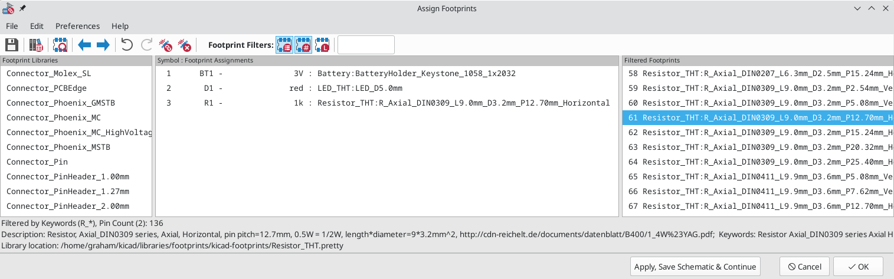

Source: https://docs.kicad.org/9.0/en/getting_started_in_kicad/images/footprint-assignment-tool.png

You open this from the Schematic Editor's **Tools > Assign Footprints** or its toolbar button.
- **Toolbar:** Save the assignments to the schematic; Footprint library table; **View selected footprint** (opens a preview); previous/next unassigned symbol (blue arrows); Undo/Redo; Auto-associate; Delete all associations. The **Footprint Filters** buttons narrow the right-hand list. From left: filter by the symbol's footprint filter keywords (on), filter by pin count (on), filter by the selected library. The text box filters by text.
- **Footprint Libraries (left):** all libraries in `fp-lib-table` (Connector_Molex_SL, Connector_PinHeader_2.54mm...).
- **Symbol : Footprint Assignments (centre):** each row reads *index, reference, value : library:footprint*. Here `BT1 3V → Battery:BatteryHolder_Keystone_1058_1x2032`, `D1 red → LED_THT:LED_D5.0mm` and `R1 1k → Resistor_THT:R_Axial_DIN0309_L9.0mm_D3.2mm_P12.70mm_Horizontal`.
- **Filtered Footprints (right):** the candidates that pass the active filters. Double-click one to assign it to the selected symbol.
- **Status lines:** the active filters (`Filtered by Keywords (R_*), Pin Count (2): 136`), the description of the highlighted footprint and the library path on disk.
- **Buttons:** *Apply, Save Schematic & Continue*, *Cancel*, *OK*.

### 2.8 Update PCB from Schematic (the netlist transfer)

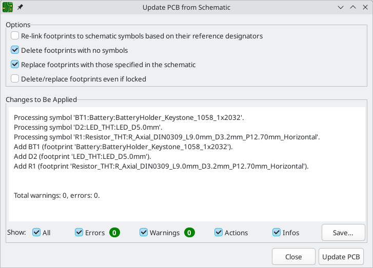

Source: https://docs.kicad.org/9.0/en/getting_started_in_kicad/images/update-pcb-from-schematic.png

You open this with **F8** or **Tools > Update PCB from Schematic** in either editor.
- **Options:**
  - *Re-link footprints to schematic symbols based on their reference designators* (off). Use it when the internal UUID links have been lost.
  - *Delete footprints with no symbols* (on).
  - *Replace footprints with those specified in the schematic* (on).
  - *Delete/replace footprints even if locked* (off).
- **Changes to Be Applied:** a dry-run log, for example `Processing symbol 'BT1:Battery:BatteryHolder_Keystone_1058_1x2032'` followed by `Add BT1 (footprint ...)`, ending with `Total warnings: 0, errors: 0`.
- **Show filters:** All / Errors / Warnings / Actions / Infos, plus *Save...* for the log.
- **Buttons:** *Close*, and **Update PCB**, which applies the changes. New footprints then stick to the cursor so you can place them.

### 2.9 PCB Editor: main window

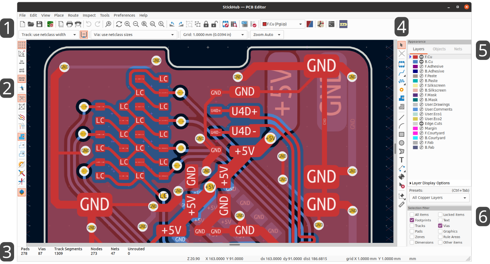

Source: https://docs.kicad.org/9.0/en/pcbnew/images/pcbnew_user_interface.png

The official image numbers six regions. The board shown is "StickHub", a 2-layer board with red F.Cu and blue B.Cu.
1. **Top toolbars.**
   - *First row:* New/Open/Save; Board Setup (green chip icon); Page settings; Print; Plot; Undo/Redo; Find; Refresh; Zoom; Rotate; Flip; Group/Ungroup; Lock/Unlock; **Update PCB from Schematic** and **Show schematic**; **Netlist/DRC buttons** (the DRC button is the red check icon); the **Active layer selector** (`F.Cu (PgUp)`); the layer pair indicator; Scripting console; Python plugins.
   - *Second row:* track width (`Track: use netclass width`), auto-width toggle, via size (`Via: use netclass sizes`), grid (`1.0000 mm (0.0394 in)`) and zoom (`Zoom Auto`).
2. **Left toolbar (display options):** grid on/off and polar coordinates; units (in, mil, **mm** active); crosshair; **ratsnest** display modes (show all, curved); pad, via and track fill/outline modes; zone display modes (filled, outline only, fractured); high-contrast mode (single-layer emphasis); Appearance panel toggle.
3. **Message panel (bottom):** board statistics: `Pads 278, Vias 87, Track Segments 1309, Nodes 273, Nets 47, Unrouted 0`. **Unrouted 0** means routing is complete. The status bar below shows zoom `Z 20.90`, X/Y, dx/dy/dist, grid and units.
4. **Right toolbar (drawing and routing tools):** Select; Local ratsnest; Place footprint; **Route single track (X)**; **Route differential pair (6)**; Tune length/skew (the meander icon); Add via; Add filled zone; Add rule area (the hatched icon); Line; Arc; Rectangle; Circle; Polygon; Text; Dimension; Place reference/drill origin; Delete; Grid origin; Measure.
5. **Appearance panel:** the **Layers** tab lists every layer with a colour swatch and visibility eye. F.Cu, B.Cu and Edge.Cuts are visible, and the triangle marks the active layer. The **Objects** tab toggles tracks, vias, pads, zones, ratsnest, footprint text and so on, with opacity sliders. The **Nets** tab colours and shows or hides nets and net classes. *Layer Display Options* and the **Presets** dropdown (`All Copper Layers`, Ctrl+Tab) sit below.
6. **Selection Filter:** All items, Locked items, Footprints (checked), Text, Tracks, Vias (checked), Pads, Graphics, Zones, Rule Areas, Dimensions, Other items. It limits what clicks and box-selections pick up.

The canvas shows red F.Cu tracks and pads with net names printed on them (GND, +5V, LC, U4D+, U4D−), blue B.Cu pours, yellow round vias and the light grey board outline (Edge.Cuts).

### 2.10 Footprints placed, with ratsnest

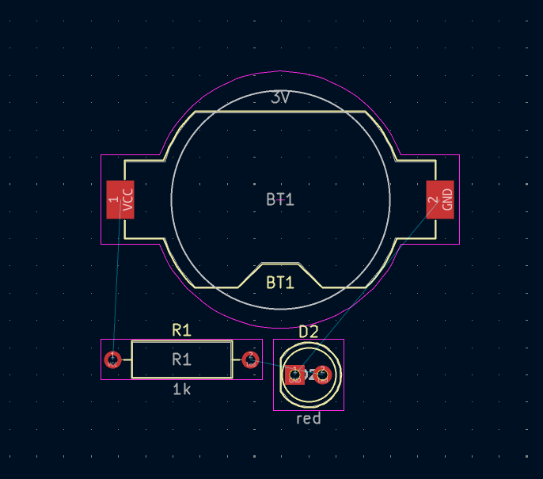

Source: https://docs.kicad.org/9.0/en/getting_started_in_kicad/images/footprints-added.png

This is the board straight after *Update PCB*.
- **Footprints:** `BT1` (coin-cell holder with SMD pads `1 VCC` and `2 GND`), `R1 1k` (axial resistor with through-hole pads) and `D2 red` (5 mm LED). Yellow outlines are the front silkscreen, magenta rectangles the courtyards, and the light circle the fab-layer body outline. Pads are red (front copper) and are labelled with pin number and net name.
- **Ratsnest (thin cyan lines):** the "airwires" for connections that are not yet routed. They run from BT1 pad 1 (VCC) to R1 and from BT1 pad 2 (GND) to D2. Place footprints so these lines are short and do not cross.

### 2.11 Routed tracks and a via

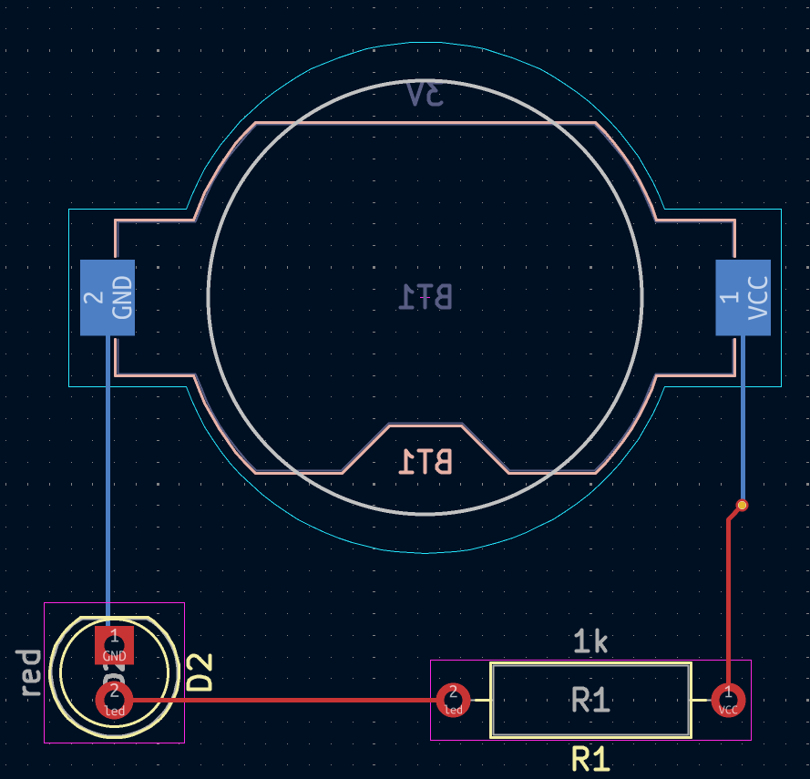

Source: https://docs.kicad.org/9.0/en/getting_started_in_kicad/images/routing-complete.png

- `BT1` has been **flipped to the back** (F key). Its text is mirrored, its pads are blue (B.Cu) and its silkscreen is pink (B.Silkscreen).
- **Blue tracks** run on B.Cu (the GND trace from BT1 pad 2 to D2 pad 1, and the VCC trace going down).
- **Red tracks** run on F.Cu (R1 pin 1 up to the via, and R1 pin 2 to D2 pin 2 on net `/led`).
- **Via (small yellow ring, right):** where the VCC track changes from B.Cu to F.Cu. While routing, press **V** to drop a via and switch layer.
- With no cyan ratsnest lines left, the board is fully routed.

### 2.12 Filled copper zone and board outline

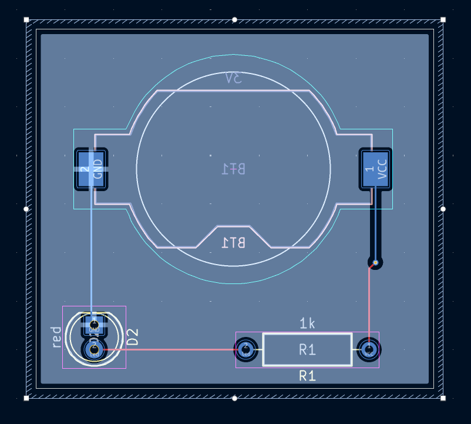

Source: https://docs.kicad.org/9.0/en/getting_started_in_kicad/images/zone-filled.png

- **Edge.Cuts outline:** the rectangle defining the board shape, with selection handles at the corners and midpoints because the zone is selected.
- **Zone (hatched border, light-blue fill):** a GND copper pour on B.Cu. The fill keeps the configured clearance around foreign-net copper (the dark halos around the VCC pad, VCC track and R1/D2 pads), and joins same-net pads with thermal reliefs (the GND pad of BT1 and D2 pin 1).
- Zones are drawn with **Add Filled Zone** (Ctrl+Shift+Z), filled or refilled with **B**, and unfilled with **Ctrl+B**. When a zone is not filled, only its outline appears.

### 2.13 Design Rules Checker (DRC)

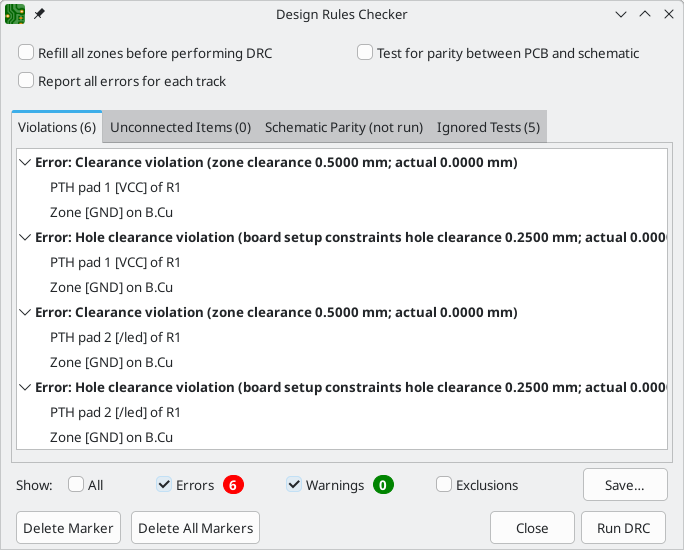

Source: https://docs.kicad.org/9.0/en/getting_started_in_kicad/images/drc-errors.png

- **Options (top):** *Refill all zones before performing DRC*, *Report all errors for each track* and **Test for parity between PCB and schematic**. The parity test catches missing or extra footprints and footprint or net mismatches.
- **Tabs:**
  - *Violations (6)* lists clearance, hole, track width, courtyard and silkscreen problems.
  - *Unconnected Items (0)* lists ratsnest connections that are still open.
  - *Schematic Parity (not run)*.
  - *Ignored Tests (5)*.
- **Violation entries:** for example `Error: Clearance violation (zone clearance 0.5000 mm; actual 0.0000 mm)` between `PTH pad 1 [VCC] of R1` and `Zone [GND] on B.Cu`, and `Error: Hole clearance violation (board setup constraints hole clearance 0.2500 mm; actual 0.0000...)`. Each message names the **rule source** (zone clearance, board setup constraints, net class, or a custom `.kicad_dru` rule), the **required** value and the **actual** value, followed by the two offending items. Click an item to jump to its marker.
- **Show filters / Save... / Delete Marker / Delete All Markers / Close / Run DRC:** as in the ERC dialog.

### 2.14 3D Viewer

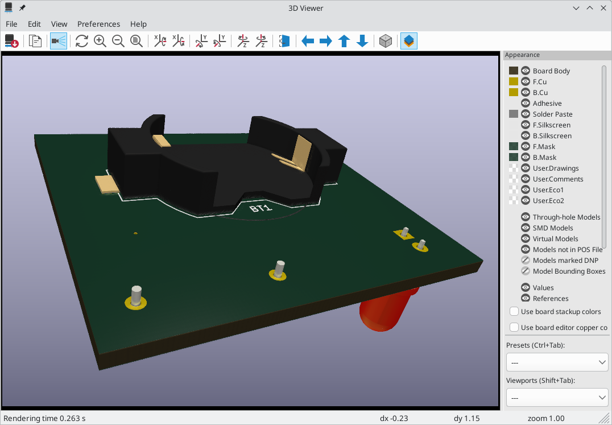

Source: https://docs.kicad.org/9.0/en/getting_started_in_kicad/images/raytracing.png

You open this from the PCB Editor with **View > 3D Viewer** (Alt+3).
- **Toolbar:** Export current view as image; Copy to clipboard; **Raytracing toggle** (on here, giving a photoreal render); Reload board; Zoom in/out/fit/redraw; rotate around X, Y and Z clockwise and anticlockwise; flip board; pan left/right/up/down (blue arrows); orthographic/perspective toggle; Appearance panel toggle.
- **Canvas:** green-soldermask board with the black Keystone coin-cell holder (BT1) and its gold SMD pads. You can see the white silkscreen `BT1` outline, the gold annular rings of through-hole parts with their pins poking through, and the red LED body hanging under the board. Drag to rotate, scroll to zoom and middle-drag to pan.
- **Appearance panel (right):** visibility and colour of Board Body, F/B.Cu, Adhesive, Solder Paste, Silkscreen, Mask and the User layers. Model categories are listed separately: Through-hole Models, SMD Models, Virtual Models, Models not in POS File, Models marked DNP and Model Bounding Boxes. Further options are *Values / References*, *Use board stackup colors* and *Use board editor copper colors*, and the **Presets** (Ctrl+Tab) and **Viewports** (Shift+Tab) dropdowns.
- **Status bar:** `Rendering time 0.263 s`, `dx/dy` and `zoom`.
- Export a STEP, VRML or GLB file from the PCB Editor with **File > Export**, or with `kicad-cli pcb export step`.

### 2.15 Plot dialog (Gerber output)

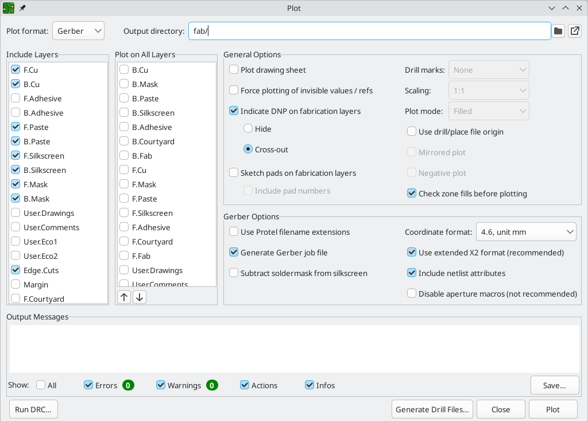

Source: https://docs.kicad.org/9.0/en/getting_started_in_kicad/images/fabrication-outputs.png

You open this from the PCB Editor with **File > Fabrication Outputs > Gerbers** or **File > Plot**.
- **Plot format:** `Gerber`. The other choices are PostScript, SVG, DXF, HPGL and PDF.
- **Output directory:** `fab/`, relative to the project. The folder icon browses and the arrow icon opens the folder.
- **Include Layers (left list):** the layers to plot. Checked are F.Cu, B.Cu, F/B.Paste, F/B.Silkscreen, F/B.Mask and **Edge.Cuts**, the standard 2-layer set. Unchecked are the adhesive, user, margin and courtyard layers.
- **Plot on All Layers (middle list):** layers merged into every output file. This is rarely used; one use is adding Edge.Cuts to every layer for registration. The up and down arrows reorder the list.
- **General Options:**
  - *Plot drawing sheet*
  - *Force plotting of invisible values / refs*
  - **Indicate DNP on fabrication layers** (Hide or Cross-out)
  - *Sketch pads on fabrication layers* and *Include pad numbers*
  - *Drill marks* (None), *Scaling* (1:1), *Plot mode* (Filled)
  - *Use drill/place file origin*, *Mirrored plot*, *Negative plot*
  - **Check zone fills before plotting**, which avoids sending out unfilled pours
- **Gerber Options:**
  - *Use Protel filename extensions* (.gtl/.gbl and so on; off, so `.gbr` is used)
  - **Generate Gerber job file** (`.gbrjob`)
  - *Subtract soldermask from silkscreen*
  - *Coordinate format* `4.6, unit mm`
  - **Use extended X2 format (recommended)**
  - **Include netlist attributes**
  - *Disable aperture macros*
- **Output Messages:** a log with Errors / Warnings / Actions / Infos filters.
- **Buttons:** *Run DRC...*, **Generate Drill Files...** (opens the dialog below), *Close*, **Plot**.

### 2.16 Generate Drill Files

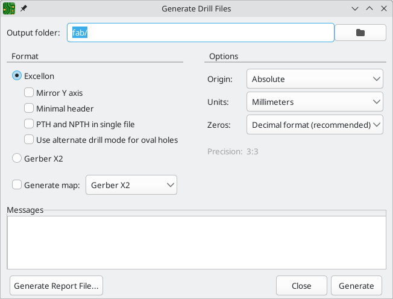

Source: https://docs.kicad.org/9.0/en/getting_started_in_kicad/images/generate-drill-files.png

- **Output folder:** `fab/`, the same folder as the Gerbers.
- **Format:**
  - **Excellon** (selected), with the sub-options *Mirror Y axis*, *Minimal header*, *PTH and NPTH in single file* (off, so separate `-PTH.drl` and `-NPTH.drl` files are written) and *Use alternate drill mode for oval holes*.
  - *Gerber X2* drill files are the alternative.
- **Generate map:** a drill map in Gerber X2, PostScript, SVG, DXF or PDF.
- **Options:** *Origin* (Absolute, or drill/place file origin), *Units* (Millimeters), *Zeros* (Decimal format, recommended) and *Precision 3:3*.
- **Messages log**, **Generate Report File...** (a text drill report), *Close* and **Generate**.

---

## 3. Key hotkeys (default bindings in v8/v9)

You can list and remap all hotkeys under **Preferences > Hotkeys**, and **Ctrl+F1** shows the hotkey list.

### Common to all editors
| Key | Action |
|---|---|
| F1 / F2 (or the mouse wheel) | Zoom in / out |
| Home | Zoom to fit |
| F3 | Redraw |
| Space | Reset the relative (dx/dy) origin |
| M | Move |
| G | Drag (keeps connections) |
| R | Rotate |
| E | Properties of the item under the cursor |
| Ctrl+D | Duplicate |
| Del | Delete |
| Esc | Cancel / back to the selection tool |
| Ctrl+F | Find |
| Ctrl+Z / Ctrl+Y | Undo / Redo |
| Ctrl+S | Save |

### Schematic Editor
| Key | Action |
|---|---|
| A | Add symbol |
| P | Add power symbol |
| W | Wire |
| B | Bus |
| L | Net label |
| Ctrl+L | Global label |
| H | Hierarchical label |
| S | Hierarchical sheet |
| Q | No-connect flag |
| J | Junction |
| T | Text |
| X / Y | Mirror horizontal / vertical |
| V / U / F | Edit Value / Reference / Footprint field |
| Insert | Repeat the last item (auto-increments labels) |
| `` ` `` (backtick) | Highlight net under the cursor |
| F8 | Update PCB from Schematic |

### PCB Editor
| Key | Action |
|---|---|
| X | Route single track |
| 6 | Route differential pair |
| 7 / 8 / 9 | Tune length: single track / diff-pair length / diff-pair skew (v8 bindings; v9 merges them into one tuning tool) |
| V (while routing) | Place a via and switch layer |
| / (while routing) | Switch track posture (corner direction) |
| W / Shift+W | Next / previous track width from the list |
| D | Drag track while keeping 45-degree angles |
| U | Select / expand the selection to the connected copper |
| F | Flip the footprint to the other side |
| T | Get-and-move footprint by reference |
| PgUp / PgDn | Switch active layer to F.Cu / B.Cu |
| + / − | Next / previous copper layer |
| Ctrl+Shift+Z | Add filled zone |
| B | Fill all zones |
| Ctrl+B | Unfill all zones |
| Alt+3 | 3D Viewer |
| H | High-contrast mode (layer emphasis) |

---

## 4. File types

| File | Contents |
|---|---|
| `name.kicad_pro` | Project file (JSON): net classes, ERC/DRC severities, text variables, board setup defaults, plot settings. Opening it opens the project. |
| `name.kicad_prl` | Local project state (JSON): open sheets, visible layers, UI state. It is not design data and can be git-ignored. |
| `name.kicad_sch` | Schematic sheet (S-expression text). The root sheet has the project's name. Sub-sheets are separate `.kicad_sch` files. |
| `name.kicad_pcb` | Board (S-expression text): footprints, which are copies of library footprints, tracks, vias, zones, stackup and design settings. |
| `*.kicad_sym` | Symbol library: one file holding many symbols. |
| `*.pretty/` with `*.kicad_mod` | Footprint library: a folder with one `.kicad_mod` file per footprint. |
| `sym-lib-table`, `fp-lib-table` | Library tables. The global ones live in the KiCad config directory; project ones sit next to the `.kicad_pro`. |
| `name.kicad_dru` | Custom design rules, written in the DRC rule language. |
| `*.kicad_wks` | Drawing sheet (title block) template. |
| `*.kicad_jobset` | (v9) Saved output jobs: Gerbers, drill, BOM, PDF and so on, run in one go. |
| `name-backups/`, `fp-info-cache`, `~*.lck` | Automatic backups, the footprint cache and lock files. Do not commit them. |
| `.net` | Netlist export (S-expression or XML) for other tools. |
| `.dsn` / `.ses` | Specctra design and session files for external autorouters. |
| `.gbr` (or `.gtl`/`.gbl`/`.gts`...), `.gbrjob` | Gerber layers and the Gerber job file. |
| `.drl` | Excellon drill files (PTH and NPTH). |
| `.pos` / `.csv` | Component placement (pick-and-place). |
| `.step` / `.wrl` / `.glb` | 3D board models. |
| `.rpt` / `.json` | ERC and DRC reports. |

All KiCad design files (6.0 and later) are human-readable S-expressions. They diff well in git, and a script can read them, but use the APIs below rather than editing the text by hand.

---

## 5. Autorouting with Freerouting (Specctra DSN / SES)

KiCad has no built-in autorouter. The standard round trip uses the free Java tool **Freerouting** (https://github.com/freerouting/freerouting). A KiCad Freerouting plugin is also available in the Plugin and Content Manager.

1. **Prepare the board.** Draw the Edge.Cuts outline, place all footprints, set net-class track widths and clearances in Board Setup, and route or lock any critical nets by hand. It is usually best to delete or unfill copper zones first and add them back after routing.
2. **Export the DSN.** In the PCB Editor, choose **File > Export > Specctra DSN...** and save `board.dsn`. The export fails if a footprint has a pad with no usable shape, or if the board outline is not closed. Fix these first.
3. **Route it in Freerouting.**
   - GUI: `java -jar freerouting-<ver>.jar`, then open `board.dsn`, run *Autorouter*, then *File > Export Specctra Session File*.
   - Headless: `java -jar freerouting-<ver>.jar -de board.dsn -do board.ses -mp 20`, where `-de` is the design input, `-do` the session output and `-mp` the maximum number of passes. Check `--help` for your version.
4. **Import the SES.** In the PCB Editor, choose **File > Import > Specctra Session...** and pick `board.ses`. Tracks and vias are replaced with the routed result.
5. Refill zones (**B**), run **DRC**, and fix anything left over.

Scripted version, run with the KiCad-bundled Python. Verify the function signatures with `help(pcbnew.ExportSpecctraDSN)` on your version:
```python
import pcbnew
board = pcbnew.LoadBoard("board.kicad_pcb")
pcbnew.ExportSpecctraDSN(board, "board.dsn")   # older builds: ExportSpecctraDSN("board.dsn") on the GUI board only
# ... run freerouting headless to produce board.ses ...
pcbnew.ImportSpecctraSES(board, "board.ses")
board.Save("board_routed.kicad_pcb")
```
`kicad-cli` (v9) has **no** DSN or SES subcommand, so use the GUI or the `pcbnew` module.

---

## 6. Tips for an AI agent

### 6.1 `kicad-cli` (headless, v8/v9)

`kicad-cli` is installed with KiCad: `C:\Program Files\KiCad\9.0\bin\kicad-cli.exe` on Windows, and `/Applications/KiCad/KiCad.app/Contents/MacOS/kicad-cli` on macOS. Run `kicad-cli <sch|pcb|fp|sym|jobset> --help` for the details of any command. The flags below come from the official v9 CLI manual (https://docs.kicad.org/9.0/en/cli/cli.html).

```bash
# ERC: JSON report; exit code 5 if any violations (0 if clean)
kicad-cli sch erc --format json --units mm --severity-error --severity-warning \
    --exit-code-violations -o out/erc.json project.kicad_sch

# DRC: include schematic parity (it looks for the .kicad_sch next to the board)
kicad-cli pcb drc --format json --units mm --schematic-parity --severity-all \
    --exit-code-violations -o out/drc.json project.kicad_pcb
#   DRC checks the zone fills saved in the file: refill (B) and save in the GUI,
#   or refill via pcbnew.ZONE_FILLER, before trusting zone-related results.

# Gerbers (one file per layer; v9 uses "gerbers", plural)
kicad-cli pcb export gerbers -o fab/ \
    -l F.Cu,B.Cu,F.Paste,B.Paste,F.Silkscreen,B.Silkscreen,F.Mask,B.Mask,Edge.Cuts \
    project.kicad_pcb
#   or reuse the settings saved in the Plot dialog:
kicad-cli pcb export gerbers --board-plot-params -o fab/ project.kicad_pcb

# Drill files (Excellon, mm, separate PTH/NPTH, PDF drill map)
kicad-cli pcb export drill -o fab/ --format excellon --excellon-units mm \
    --excellon-separate-th --generate-map --map-format pdf project.kicad_pcb

# Netlist (kicadsexpr | kicadxml | cadstar | orcadpcb2 | spice | spicemodel | pads | allegro)
kicad-cli sch export netlist --format kicadxml -o out/project.xml project.kicad_sch

# Schematic to PDF (one file, all sheets) or SVG (one file per sheet, -o is a dir)
kicad-cli sch export pdf -o out/schematic.pdf project.kicad_sch
kicad-cli sch export svg -o out/sch_svg/ project.kicad_sch

# PCB to SVG/PDF (--layers is required)
kicad-cli pcb export svg -l F.Cu,F.Silkscreen,Edge.Cuts --mode-single \
    --fit-page-to-board --exclude-drawing-sheet -o out/top.svg project.kicad_pcb
kicad-cli pcb export pdf -l F.Cu,B.Cu,Edge.Cuts --mode-multipage -o out/board.pdf project.kicad_pcb

# BOM (CSV), pick-and-place, STEP
kicad-cli sch export bom --fields 'Reference,Value,Footprint,${QUANTITY},${DNP}' \
    --group-by Value,Footprint -o out/bom.csv project.kicad_sch
kicad-cli pcb export pos --format csv --units mm --side both -o out/pos.csv project.kicad_pcb
kicad-cli pcb export step --subst-models -f -o out/board.step project.kicad_pcb

# v9: run every output defined in a jobset
kicad-cli jobset run -f outputs.kicad_jobset project.kicad_pro
```
Practical notes:
- Use `--exit-code-violations` so a CI or agent loop can branch on the exit code (0 = clean, 5 = violations).
- Paths that contain spaces must be quoted. On Windows, call `kicad-cli.exe` by its full path or add the `bin` directory to `PATH`.
- `kicad-cli` cannot edit designs. To change a design, use the `pcbnew` Python module, or in v9 the IPC API used by `kicad-python` (`pip install kicad-python`), which talks to a running KiCad.

### 6.2 Python `pcbnew` API

The module ships with KiCad. Use KiCad's own Python: on Windows that is `C:\Program Files\KiCad\9.0\bin\python.exe`, or run scripts from the **Scripting Console** in the PCB Editor. A system Python usually cannot `import pcbnew`.
```python
import pcbnew
b = pcbnew.LoadBoard("project.kicad_pcb")

# Inspect
for fp in b.GetFootprints():
    pos = fp.GetPosition()                         # VECTOR2I in nanometres
    print(fp.GetReference(), fp.GetValue(), fp.GetFPIDAsString(),
          pcbnew.ToMM(pos.x), pcbnew.ToMM(pos.y), fp.GetOrientationDegrees(),
          "back" if fp.IsFlipped() else "front")
for t in b.GetTracks():                            # PCB_TRACK, PCB_VIA, PCB_ARC
    print(type(t).__name__, t.GetNetname(), b.GetLayerName(t.GetLayer()), pcbnew.ToMM(t.GetWidth()))
print("nets:", b.GetNetCount())

# Modify
fp = b.FindFootprintByReference("R1")
fp.SetPosition(pcbnew.VECTOR2I(pcbnew.FromMM(20), pcbnew.FromMM(15)))
fp.SetOrientationDegrees(90)

# Refill zones, then save
pcbnew.ZONE_FILLER(b).Fill(b.Zones())
b.Save("project.kicad_pcb")      # close the board in the GUI first or your edits will be overwritten
```
- Internal units are **nanometres**. Convert with `pcbnew.FromMM()` / `ToMM()` (and `FromMils` / `ToMils`).
- Layer IDs are constants such as `pcbnew.F_Cu`, `pcbnew.B_Cu` and `pcbnew.Edge_Cuts`. Use `b.GetLayerID("F.Cu")` to look one up by name.
- The SWIG `pcbnew` API is not frozen: names changed between v6, v7 and v8 (for example `MODULE` became `FOOTPRINT`, and `wxPoint` became `VECTOR2I`). In v9, KiCad's long-term direction is the IPC API (`kicad-python`). Check `dir(obj)` on the installed version.
- There is no maintained Python API for schematics. Read `.kicad_sch` as an S-expression with a parser such as `sexpdata` or `kiutils`, or use the netlist or BOM exports.

### 6.3 Reading the ERC and DRC reports

**JSON (preferred):** produced with `--format json`, or with *Save...* in the dialog and a `.json` filename.
- ERC: `{ "source", "date", "kicad_version", "coordinate_units", "sheets": [ { "path": "/", "uuid_path", "violations": [ ... ] } ] }`.
- DRC: `{ ..., "violations": [...], "unconnected_items": [...], "schematic_parity": [...] }`.
- Each violation looks like:
  ```json
  { "type": "clearance", "severity": "error",
    "description": "Clearance violation (zone clearance 0.5000 mm; actual 0.0000 mm)",
    "items": [ { "description": "PTH pad 1 [VCC] of R1", "pos": {"x": 120.65, "y": 81.28}, "uuid": "..." },
               { "description": "Zone [GND] on B.Cu",    "pos": {"x": 118.0,  "y": 80.0},  "uuid": "..." } ] }
  ```
- `type` is a stable key, for example `clearance`, `hole_clearance`, `track_width`, `courtyards_overlap`, `unconnected_items`, `silk_over_copper` and `lib_footprint_mismatch` in DRC, or `pin_not_driven`, `power_pin_not_driven`, `pin_not_connected`, `label_dangling`, `wire_dangling`, `multiple_net_names` and `lib_symbol_mismatch` in ERC. Group by `type`, and use `pos` together with the item descriptions (reference and pad or pin) to find the culprit.

**Text `.rpt`:** blocks of the form `[type]: description`, then a `Rule: ...; Severity: error` line, then one `@(x mm, y mm): item` line per item, ending with a summary such as `** Found N DRC violations **` and `** Found N unconnected pads **`.

**Triage order for an agent:**
1. **Unconnected items**, meaning the board is not finished.
2. **Schematic parity**, meaning the board and schematic disagree. Re-run *Update PCB from Schematic*.
3. Clearance, short or hole errors.
4. Courtyard overlaps.
5. Silkscreen warnings.

For ERC, `power_pin_not_driven` almost always means a `PWR_FLAG` is missing on that power net, and `pin_not_connected` means you should add a no-connect flag (Q) if leaving the pin open is intentional. Change the source design, never the report. Raise or ignore a severity in Schematic Setup or Board Setup > Violation Severity only when the rule really does not apply.

---

## 7. Image gaps

These were requested or would be useful, but no suitable official image was found, so none is included:
- **Specctra DSN export / SES import dialogs and the Freerouting UI:** the KiCad manual describes the menu entries without screenshots, and nothing from Freerouting was downloaded. Section 5 covers it in text only.
- **A full Schematic Editor window with the ERC markers drawn on the canvas:** the ERC is shown only as its dialog (2.4).
- **A standalone Board Setup screenshot** (stackup, constraints, net classes): these images exist in the tutorial (`board-setup-*.png`) but were not downloaded, to keep the set focused.
- **The BOM generator dialog:** this exists in the tutorial (`bom-generator.png`) but was not downloaded.
- **A KiCad 8-specific screenshot:** all images are from the v9 docs. The v8 UI differs only slightly; for example, the Design Blocks panel and jobsets are new in v9.
- No Wikimedia Commons or third-party tutorial images were used. The official docs covered every requested view except the Specctra and Freerouting dialogs.
