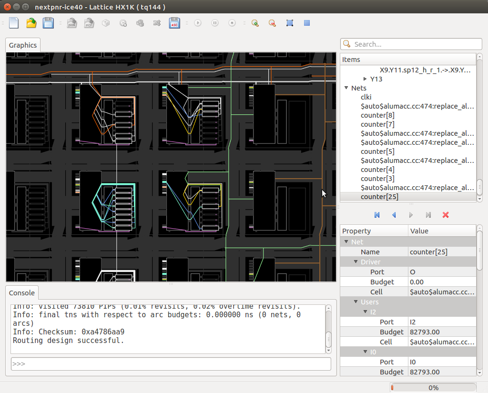

# nextpnr-ecp5: visual reference

nextpnr is the open-source, timing-driven place-and-route tool from YosysHQ. `nextpnr-ecp5` is its Lattice ECP5 build. It uses the Project Trellis device database. It takes the JSON netlist from Yosys plus a pin-constraint (`.lpf`) file, places every cell on a physical site, routes every net, checks timing and writes a textual configuration that `ecppack` turns into a bitstream.

```
Verilog ──yosys synth_ecp5 -json──▶ top.json
                                      │
   nextpnr-ecp5 --25k | --45k | --85k        (device: LFE5U-25F / 45F / 85F; also --um5g-85k etc.)
                --package CABGA381           (package, e.g. CABGA256, CABGA381, CSFBGA285)
                --lpf top.lpf                (pin LOCATE / IOBUF / FREQUENCY constraints)
                --json top.json              (input netlist)
                --textcfg top.config         (output for ecppack)
                --freq 25                    (target clock in MHz, if the LPF has no FREQUENCY)
                --report report.json -l pnr.log
                                      │
                                      ▼
                                 top.config ──ecppack──▶ top.bit
```

Minimal LPF:

```
LOCATE COMP "clk" SITE "G2";
IOBUF  PORT "clk" IO_TYPE=LVCMOS33;
FREQUENCY PORT "clk" 25 MHZ;
LOCATE COMP "led[0]" SITE "B2";
IOBUF  PORT "led[0]" IO_TYPE=LVCMOS33;
```

(Site names depend on the board: take them from the board vendor's LPF.)

---

## Images

### 1. nextpnr Qt GUI (`--gui`) with a routed design



Source: https://i.imgur.com/0spmlBa.png, embedded in the official README at https://github.com/YosysHQ/nextpnr ("Here is a screenshot of nextpnr for iCE40").

**Important:** this official screenshot shows the **iCE40** build (`nextpnr-ice40`, Lattice HX1K, tq144). No ECP5 GUI screenshot from a reputable source could be found (see Gaps). The window layout, toolbar, item tree, property pane and console are shared code (`gui/` in the repo) and look the same in `nextpnr-ecp5 --gui`. Only the floorplan tiles differ: ECP5 shows PLC2 slice tiles, PIO, EBR and DSP rows.

Region by region:

- **Title bar:** `nextpnr-ice40 - Lattice HX1K ( tq144 )`, the architecture, device and package. On ECP5 this would read e.g. `nextpnr-ecp5 - Lattice LFE5U-25F (CABGA381)`.
- **Toolbar (left to right):** new / open JSON / save; then architecture actions, partly greyed out: load JSON, load PCF (on ECP5, *load LPF*, icon `open_lpf.png`, and *open base config*), **pack**, **assign budgets**, **place**, **route**, then **save ASC** (on ECP5, *save config*, i.e. the `--textcfg` output); then play / pause / stop for the running task; then zoom in, zoom out, zoom to fit and zoom to selection. Buttons are enabled in flow order: you cannot route before placing.
- **Graphics pane (centre, dark background):** the floorplan. Black rectangles are logic tiles (on iCE40 the PLB with 8 LUT+FF, drawn as small stacked rectangles; on ECP5 the PLC with 4 slices). The small coloured squares along tile edges are wire stubs. **Coloured polylines are routed nets:** white, orange, cyan, yellow, blue, green, purple and brown each highlight a net or a set of PIPs (programmable interconnect points). Long straight lines crossing the view are span wires (iCE40 `sp4`/`sp12`; ECP5 has x1/x2/x6 and global wires). The highlighted cyan and yellow fans show the fan-in of the selected cells. The mouse cursor at right shows you can click any wire, bel or PIP to select it.
- **Items tree (top right, with Search box):** a browsable hierarchy of *Bels, Wires, Pips, Nets and Cells*. Here a wire `X9.Y11.sp12_h_r_1.->X9.Y...` and the tile row `Y13` are visible above an expanded **Nets** list (`clki`, `counter[8]`, `counter[7]`, ... and Yosys-generated names such as `$auto$alumacc.cc:474:replace_al...`, which come from the `alumacc` pass). `counter[25]` is selected. The search box filters by name.
- **History buttons (under the tree):** first / back / forward / last through the selection history, and a red X to clear the selection.
- **Property / Value pane (bottom right):** details of the selected item. For net `counter[25]`: **Driver** (Port `O`, Budget `0.00`, Cell `$auto$alumacc.cc...`), and **Users** with one entry per sink (`I2`, `I0`), each with Port, **Budget** (`82793.00`, the timing slack budget for that arc, in ps) and Cell. For a cell the pane shows its type, the bel it was placed on and its parameters. For a bel it shows the location and the bound cell.
- **Console (bottom left):** the same log the CLI prints. The last lines read "Info: visited 73810 PIPs (0.01% revisits, 0.02% overtime revisits)", "Info: final tns with respect to arc budgets: 0.000000 ns (0 nets, 0 arcs)", "Info: Checksum: 0xa4786aa9" and **"Routing design successful."** The `>>>` input line is an embedded **Python console**, where you can run e.g. `ctx.cells`, `ctx.nets` or `pack()`/`place()`/`route()`.
- **Status bar progress (bottom right, "0%"):** progress of the current task.

Launch on ECP5:

```sh
nextpnr-ecp5 --25k --package CABGA381 --lpf top.lpf --json top.json --textcfg top.config --gui
```

The GUI requires a build with `-DBUILD_GUI=ON` (Qt + OpenGL). Many packaged builds (OSS CAD Suite, YoWASP) are headless. An agent should never rely on `--gui`.

---

## Reading the reports (text; no screenshots found)

### Utilisation

Printed after packing, and again in the final summary:

```
Info: Device utilisation:
Info:             TRELLIS_IO:     9/  197     4%
Info:                   DCCA:     1/   56     1%
Info:                 DP16KD:     0/   56     0%
Info:             MULT18X18D:     0/   28     0%
Info:                EHXPLLL:     0/    2     0%
Info:             TRELLIS_FF:    26/24288     0%
Info:           TRELLIS_COMB:    58/24288     0%
Info:           TRELLIS_RAMW:     0/ 3036     0%
```

(Shape from recent nextpnr; older versions list `TRELLIS_SLICE` instead of `TRELLIS_COMB`/`TRELLIS_FF`. The numbers are illustrative for a 25k part.)

- `used/available  percent` per primitive type. `TRELLIS_COMB` is LUT4 logic (plus carry), `TRELLIS_FF` the registers, `TRELLIS_IO` the pins, `DCCA` the global clock buffers, `DP16KD` the block RAMs and `MULT18X18D` the DSP multipliers.
- Anything above 100% fails immediately with `ERROR: Unable to place cell ..., no BELs remaining to implement cell type ...`. Above roughly 80-90% `TRELLIS_COMB`, routing gets hard. Consider `--85k`, or reduce logic.

### Timing (Fmax)

```
Info: Max frequency for clock '$glbnet$clk$TRELLIS_IO_IN': 132.45 MHz (PASS at 25.00 MHz)

Info: Critical path report for clock '$glbnet$clk$TRELLIS_IO_IN' (posedge -> posedge):
Info: curr total
Info:  0.5  0.5  Source counter_TRELLIS_FF_Q_5.Q
Info:  0.9  1.4    Net counter[2] budget 19.6 ns (12,14) -> (12,14)
Info:  ...
Info:  0.2  7.5  Setup counter_TRELLIS_FF_Q.DI
Info: 3.6 ns logic, 3.9 ns routing
```

- **`Max frequency for clock 'X': A MHz (PASS|FAIL at T MHz)`**: A is the achieved Fmax and T the target (from the LPF `FREQUENCY` constraint or `--freq`). This is the one line to parse per clock. Clock names are often mangled (e.g. `$glbnet$clk$TRELLIS_IO_IN`), so match on the substring.
- **Critical path table:** `curr` is the delay of this step and `total` the cumulative delay (ns). Rows alternate *Source / Net / Setup* with cell port names and (x,y) tile coordinates. The final line splits logic and routing delay. Mostly-routing means the cells are spread out. Mostly-logic means too many LUT levels: pipeline it.
- Also printed: **slack histogram** and, with multiple clocks, cross-domain paths (`posedge clk1 -> posedge clk2`). Unconstrained clocks show a warning and get the default `--freq`.

---

## Common errors

| Problem | What it looks like | Fix |
|---|---|---|
| **Unconstrained IO** | `ERROR: IO 'led[3]' is unconstrained in LPF (override this error with --lpf-allow-unconstrained)` | Add `LOCATE COMP` + `IOBUF` for every top-level port (bus bits are named `led[3]`). Only use the override for experiments: the pin gets placed at random |
| **Bad site / package** | `ERROR: unknown site 'X99' for IO ...` or no BEL for the site | Check the LPF against the right `--package`, and use the board's official LPF |
| **Device too small** | `ERROR: Unable to place cell '...', no BELs remaining to implement cell type 'TRELLIS_COMB'` | Use a bigger part (`--45k`/`--85k`) or reduce the design |
| **Routing failure** | The router iterates with a growing overuse count, then `ERROR: Failed to route arc ...` / `Router2 failed` / `ERROR: Routing design failed.` | Lower utilisation, try `--seed N`, `--router router1`, or avoid huge fan-out nets. Also check for unmapped clocks: clocks must go through global buffers (DCCA) |
| **Timing failure** | `Max frequency for clock 'clk': 18.70 MHz (FAIL at 25.00 MHz)`. Recent nextpnr treats this as an error and exits non-zero unless `--timing-allow-fail` is given | Pipeline the critical path, lower `--freq`, use a PLL (EHXPLLL) correctly, or try different seeds |
| **Unsupported / unmapped cell from synthesis** | `ERROR: cell type '$mul' is unsupported` (or another `$...` type) | The netlist was not produced by `synth_ecp5`. Re-run synthesis with the ECP5 script |
| **Wrong JSON top** | `ERROR: failed to find top module` / multiple tops | Pass `--top` or synthesise with `-top` |

---

## Tips for an AI agent

1. **Always use `-l pnr.log --report report.json`.** Do not scrape stdout: nextpnr writes most info lines to stderr.
2. **Exit code:** 0 means placed, routed and (unless `--timing-allow-fail`) timing met, and `--textcfg` was written. Non-zero means stop. The first `ERROR:` line in the log is the reason.
3. **`--report` JSON** (machine-readable, written at the end):
   ```json
   {
     "utilization": { "TRELLIS_COMB": {"used": 58, "available": 24288}, "TRELLIS_FF": {"used": 26, "available": 24288}, ... },
     "fmax": { "$glbnet$clk$TRELLIS_IO_IN": {"achieved": 132.45, "constraint": 25.0} },
     "critical_paths": [ { "from": "...", "to": "...", "path": [ {"type": "clk-to-q|routing|logic|setup", "delay": ..., "from": {...}, "to": {...}, "net": "..."} ] } ],
     "detailed_net_timings": [ ... ]   // only with --detailed-timing-report
   }
   ```
   Pass when `fmax[*].achieved >= fmax[*].constraint` for every clock. Utilisation is `used / available`.
4. **Log lines worth regex-ing:** `^ERROR:`, `^Warning:`, `Max frequency for clock '(.+)': ([\d.]+) MHz \((PASS|FAIL) at ([\d.]+) MHz\)`, the `Device utilisation:` block (`^\s*(\w+):\s+(\d+)/\s*(\d+)\s+(\d+)%`), and `Routing design successful` / `Program finished normally`.
5. **Reproducibility:** pin `--seed`. If timing fails by a few percent, sweeping 3-5 seeds is cheap and often enough.
6. **Then pack:** `ecppack --compress top.config top.bit` (optional `--svf top.svf` for JTAG). `ecppack` exits non-zero if the config is malformed.
7. **Do not use `--gui` in automation.** It blocks waiting for a user.

---

## Gaps (images not found)

- **No ECP5 GUI screenshot** (`nextpnr-ecp5 --gui` floorplan) was found from the nextpnr repo, Project Trellis docs or reputable tutorials. The only official GUI image is the iCE40 one above. The source tree only contains ECP5 toolbar icons (`gui/ecp5/resources/open_base.png`, `open_lpf.png`, `save_config.png`), which are not screenshots.
- **No screenshot of the utilisation or timing (Fmax) report.** Both are plain-text log output, shown above as text.
- The Project Trellis docs (prjtrellis.readthedocs.io architecture pages) contain no images.
- Nothing relevant was found on Wikimedia Commons.

---

## Real run on this machine (verified 2026-10-18)

Run with the local OSS CAD Suite (`C:\fpga\oss-cad-suite`; `source /c/fpga/env.sh`), using **nextpnr-0.11.1-63-g44a6c739** and **Yosys 0.70+145**. All artifacts are in [`real-run/`](real-run/). This output replaces any "illustrative" logs above where they differ.

```bash
yosys -q -l yosys.log -p "synth_ecp5 -top blinky -json blinky.json; stat" blinky.v
nextpnr-ecp5 --85k --package CABGA381 --json blinky.json --lpf blinky.lpf \
  --textcfg blinky.config --freq 25 --report report.json -l nextpnr.log
ecppack blinky.config blinky.bit
```

**Facts confirmed by the run:**
- **Output stream:** nextpnr writes its whole log to **stderr**; stdout was 0 bytes. Use `-l file.log` or capture stderr.
- **Exit codes:** the successful run exited **0**. The bad-pin run below exited **125**.
- **Utilisation block** (85k device), written as `Info: Device utilisation:` and then one line per resource:
  ```
  Info:           TRELLIS_IO:       9/    365     2%
  Info:           TRELLIS_FF:      26/  83640     0%
  Info:         TRELLIS_COMB:      33/  83640     0%
  ```
- **Timing line to parse:**
  ```
  Info: Max frequency for clock '$glbnet$clk$TRELLIS_IO_IN': 348.80 MHz (PASS at 25.00 MHz)
  ```
  A regex for it: `Max frequency for clock '([^']+)': ([\d.]+) MHz \((PASS|FAIL) at ([\d.]+) MHz\)`.
- **`--report report.json`** holds `critical_paths[]`. Each step has `type` (clk-to-q / routing / logic), `delay` in ns, the from and to `cell`, `port` and `loc`, and `sources` (the Verilog line). It also has a utilisation section.
- **Real packing error** ([`real-run/nextpnr-bad-pin.log`](real-run/nextpnr-bad-pin.log)), caused by an LPF pin that doesn't exist on the package (25k / CABGA256):
  ```
  ERROR: IO pin 'led[6]$tr_io' constrained to pin 'E17', which does not exist for package 'CABGA256'.
  ERROR: Packing design failed.
  0 warnings, 2 errors
  ```
