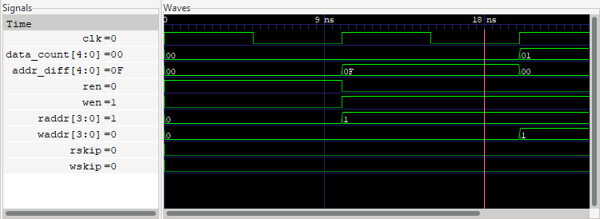
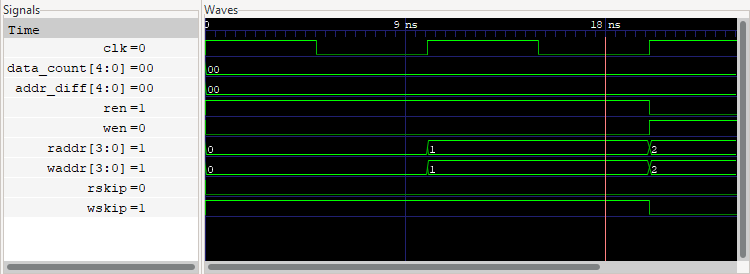

# SymbiYosys (`sby`): short reference

SymbiYosys is the YosysHQ front-end for **formal verification**. It reads a `.sby` job file, uses Yosys to turn the Verilog (with `assert`/`assume`/`cover` properties) into a model, and runs a solver engine (e.g. `smtbmc` with yices/boolector/z3, or `abc pdr`) to prove the assertions or find a counterexample.

It sits **beside** the build flow, not in it. Formal checks run on the same RTL before `synth_ecp5 -json` → `nextpnr-ecp5` → `ecppack` → `.bit`. Nothing it produces goes into the bitstream.

> In this project SymbiYosys only appears in an install check so far. No `.sby` jobs exist yet.

## Minimal `.sby` file

```
[tasks]
bmc
prove

[options]
bmc:   mode bmc
bmc:   depth 20
prove: mode prove

[engines]
smtbmc yices

[script]
read -formal counter.sv
prep -top counter

[files]
counter.sv
```

- **`mode bmc`**: bounded model check. It searches for an assertion failure within `depth` clock cycles. PASS only means "no bug within N steps".
- **`mode prove`**: unbounded proof by k-induction. PASS means the assertions hold for all time. It can fail with an *induction* counterexample that starts from an unreachable state. That means more assertions are needed, not necessarily that there is a real bug.
- **`mode cover`**: finds a trace that reaches each `cover()` statement (a sanity check that the design can do something).
- Run with `sby -f counter.sby` (all tasks) or `sby -f counter.sby prove`. `-f` overwrites the previous output directory.

## How PASS / FAIL appear

Output goes to the terminal and to `<job>_<task>/logfile.txt`. A one-word status goes to `<job>_<task>/status`.

```
SBY 12:00:01 [counter_bmc] engine_0: ##   0:00:00  Checking assertions in step 7..
SBY 12:00:01 [counter_bmc] engine_0: ##   0:00:00  BMC failed!
SBY 12:00:01 [counter_bmc] engine_0: ##   0:00:00  Assert failed in counter: counter.sv:14.9-14.28
SBY 12:00:01 [counter_bmc] engine_0: ##   0:00:00  Writing trace to VCD file: engine_0/trace.vcd
SBY 12:00:01 [counter_bmc] summary: engine_0 (smtbmc yices) returned FAIL
SBY 12:00:01 [counter_bmc] DONE (FAIL, rc=2)
```

(Representative shape. The official FIFO example prints `Assert failed in fifo: a_count_diff`, `Status: failed` and `DONE (FAIL, rc=2)`, then "The following tasks failed: ['nofullskip']".) A passing task ends with `DONE (PASS, rc=0)`.

**Exit codes:** 0 = PASS, 2 = FAIL (counterexample found), other non-zero = ERROR, TIMEOUT or UNKNOWN (bad script, missing solver, timeout). For an agent: check the exit code, then read `<dir>/status`, then grep the log for `Assert failed in` (gives the property name and `file:line`) and `Writing trace to VCD file`.

## Counterexample traces in GTKWave

The failing trace is written to `<job>_<task>/engine_0/trace.vcd` (induction failures: `trace_induct.vcd`; cover mode: `trace0.vcd`, `trace1.vcd` ...). Open it with `gtkwave <dir>/engine_0/trace.vcd [layout.gtkw]`.

### 1. Counterexample for a failing assertion (`fifo_nofullskip`)



Source: https://yosyshq.readthedocs.io/projects/sby/en/latest/_images/gtkwave_noskip.png (page: https://yosyshq.readthedocs.io/projects/sby/en/latest/quickstart.html)

- **Signals pane (left):** the signal names with their value at the cursor: `clk=0`, `data_count[4:0]=00`, `addr_diff[4:0]=0F`, `ren=0`, `wen=1`, `raddr[3:0]=1`, `waddr[3:0]=0`, `rskip=0`, `wskip=0`.
- **Waves pane (right, black background):** the time axis on top (0, 9 ns, 18 ns). One BMC step is one clock cycle. Here there are only about three steps: BMC traces are short and stop at the first failing step.
- **What it shows:** in the first cycle `ren=1` with the FIFO empty. In the next cycle `raddr` goes 0 → 1 while `data_count` stays `00`, so `addr_diff` (waddr − raddr, 4-bit wrap) jumps to `0F`. In the last step `data_count` becomes `01` while `addr_diff` returns to `00`. The two counters disagree, which is exactly the `a_count_diff` assertion failing. The bug: a read on an empty FIFO still advanced the read pointer because the "skip" logic was disabled.
- **The vertical white line** near 18 ns is the cursor and marker. The values in the left pane are the values at that time.

### 2. Cover trace showing correct behaviour (`w_underfill`)



Source: https://yosyshq.readthedocs.io/projects/sby/en/latest/_images/gtkwave_coverskip.png (same page)

- Same layout and signals. Here `ren=1`, `wen=0` at the start and **`wskip=1`**: a read with no data causes the write side to "skip" as well. Both `raddr` and `waddr` advance together (0 → 1 → 2), and `data_count` and `addr_diff` stay `00`. This is the trace `cover(w_underfill)` produced ("Reached cover statement at w_underfill in step 2").
- Reading tip: compare the counterexample (assert mode) with the cover trace (cover mode). The difference between them is the bug.

## Gaps

- No screenshot of an actual **`.sby` file in an editor** or of the **terminal PASS/FAIL output** was found. Both are shown above as text, taken from the official quickstart's described output.
- Only the two GTKWave images in the official quickstart were found. No induction-failure (`trace_induct.vcd`) screenshot was found.
