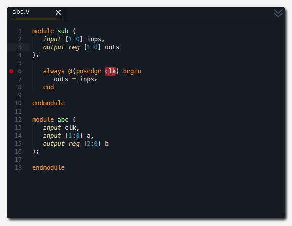

# Verilator (lint-only verifier): visual reference

Verilator is an open-source SystemVerilog **compiler** that turns synthesizable RTL into C++/SystemC models. That makes it a very fast cycle-based simulator. Its front end performs strict elaboration and width/structure analysis, so it is also one of the best free **linters** for Verilog/SystemVerilog.

**Where it fits in our pipeline:** we do **not** simulate with Verilator (Icarus does that, see [`../icarus-verilog/README.md`](../icarus-verilog/README.md)). Verilator runs only in the **verifier role**, as a static lint pass over the generated design:

```bash
verilator_bin --lint-only -Wall design.v
```

It catches bugs that a passing testbench can miss: width truncation, undriven or unused signals, latches, incomplete `case` statements, blocking assignments in sequential logic, multiple drivers, and so on.

Official docs: <https://verilator.org/guide/latest/> (sources in `docs/guide/` of <https://github.com/verilator/verilator>). The full warning list is at <https://verilator.org/guide/latest/warnings.html>.

---

## 1. Our exact pipeline usage

### 1.1 The command

```bash
# Linux/macOS (normal install): the "verilator" Perl wrapper calls verilator_bin
verilator --lint-only -Wall design.v

# Windows, OSS CAD Suite: call the real binary directly and set VERILATOR_ROOT
set VERILATOR_ROOT=C:\path\to\oss-cad-suite\share\verilator      (cmd)
$env:VERILATOR_ROOT = "C:\path\to\oss-cad-suite\share\verilator" (PowerShell)
verilator_bin --lint-only -Wall design.v
```

| Part | Meaning |
|---|---|
| `verilator_bin` | The actual compiled Verilator executable. `verilator` is only a **Perl wrapper script** that locates and runs `verilator_bin` (per the official `VERILATOR_ROOT` docs). On Windows there is normally no Perl, so the wrapper cannot run. Call `verilator_bin(.exe)` directly. |
| `--lint-only` | "Check the files for lint violations only, do not create any other output." There is no `obj_dir/`, no C++ and nothing to clean up. It implies `--timing`, so `#delays` are parsed rather than rejected. |
| `-Wall` | "Enable all code-style warnings, including style warnings that are typically disabled by default" (equivalent to `-Wwarn-lint -Wwarn-style`). Without it you get only the default lint set, which still includes WIDTH, CASEINCOMPLETE, LATCH and others. `-Wall` adds UNUSED*, UNDRIVEN, DECLFILENAME, EOFNEWLINE, BLKSEQ, PINCONNECTEMPTY and more. |
| `design.v` | Only the design, **not** the testbench. TB constructs such as `$display` loops and `initial` blocks generate noise and would fail stricter checks. |

### 1.2 Output format

On a clean design Verilator prints **nothing** and exits **0**.

When there are findings, every diagnostic goes to **stderr**, and the first line of each matches this regular expression, which the official docs guarantee:

```text
%(Error|Warning)(-[A-Z0-9_]+)?: ((\S+):(\d+):((\d+):)? )?.*
```

That is: `%Warning-<CODE>: <file>:<line>:<col>: <message>`. Verilator usually follows it with the offending source line (prefixed by its line number and ` | `) and a `^~~~` caret under the problem. Continuation lines start with whitespace and `...`.

Real messages, quoted verbatim from Verilator's generated docs and from published runs:

```text
%Warning-WIDTHEXPAND: example.v:3:31 Bit extraction of array[4:0] requires 3 bit index, not 2 bits.
```
(docs/gen/ex_WIDTHEXPAND_1_msg.rst)

```text
%Warning-MULTIDRIVEN: example.v:1:21 Signal has multiple driving blocks with different clocking: 'out2'
                      example.v:1:5 ... Location of first driving block
                      example.v:1:5 ... Location of other driving block
```
(docs/gen/ex_MULTIDRIVEN_msg.rst)

```text
%Warning-WIDTH: add.v:12:11: Operator ASSIGNDLY expects 1 bits on the Assign RHS, but Assign RHS's ADD generates 4 bits.
%Warning-UNDRIVEN: add.v:8:16: Signal is not driven: 'c'
%Error: Exiting due to 2 warning(s)
```
(from `verilator --lint-only -Wall add.v`, published at <https://community.aijishu.com/a/1060000000297974>. That run is on an older version, which used plain `WIDTH`. Current versions split it into `WIDTHTRUNC`/`WIDTHEXPAND`.)

The general shape of a full modern diagnostic (an **illustrative example**, not a capture):

```text
%Warning-WIDTHTRUNC: design.v:14:13: Operator ASSIGNDLY expects 4 bits on the Assign RHS, but Assign RHS's ADD generates 5 bits.
                                   : ... note: In instance 'counter'
   14 |       count <= count + 5'd1;
      |             ^~
                     ... For warning description see https://verilator.org/warn/WIDTHTRUNC?v=5.0xx
                     ... Use "/* verilator lint_off WIDTHTRUNC */" and lint_on around source to disable this message.
%Error: Exiting due to 1 warning(s)
```

### 1.3 Parsing lint results

```python
import re, subprocess, os
env = dict(os.environ, VERILATOR_ROOT=r"C:\...\oss-cad-suite\share\verilator")
r = subprocess.run(["verilator_bin", "--lint-only", "-Wall", "design.v"],
                   capture_output=True, text=True, env=env, timeout=60)
DIAG = re.compile(r"^%(Error|Warning)(?:-([A-Z0-9_]+))?: (?:(\S+?):(\d+):(?:(\d+):)? )?(.*)$", re.M)
findings = [dict(sev=s, code=c or None, file=f, line=l and int(l), col=cl and int(cl), msg=m)
            for s, c, f, l, cl, m in DIAG.findall(r.stderr + r.stdout)]
# Drop the summary line, which is not a real finding:
findings = [x for x in findings if not x["msg"].startswith("Exiting due to")]
clean = (r.returncode == 0 and not findings)
```

* Match only lines that **start with `%`**. Lines that start with spaces, digits plus ` |`, or `...` are context for the preceding diagnostic. Attach them to it if you want to show the source snippet.
* The trailing `%Error: Exiting due to N warning(s)` is a **summary, not a finding**. `N` should equal the number of `%Warning` lines. Use it as a cross-check.
* A `%Error` line **without** a code, such as `%Error: design.v:5:1: syntax error, unexpected endmodule`, is a hard parse or elaboration error. The design is broken, so report it as a lint failure of the highest severity.
* `%Error-<CODE>` appears for warnings promoted with `-Werror-<CODE>` and for some always-error checks.
* **Robust alternative:** the docs say tools that need to understand the output "should read the SARIF JSON output created with `--diagnostics-sarif`". On versions that support it, add `--diagnostics-sarif --diagnostics-sarif-output lint.sarif` and parse the JSON instead of scraping text. Check `verilator_bin --version` first, because older OSS CAD Suite snapshots may lack it.

### 1.4 Suggested verdict policy for the verifier

| Class | Codes | Verdict |
|---|---|---|
| **Hard error** | `%Error` with no code, `%Error-*`, `MULTIDRIVEN`, `LATCH` (for intended comb logic), `CASEINCOMPLETE` without default, `WIDTH*`/`WIDTHTRUNC` (truncation), `UNDRIVEN` on an output, `BLKANDNBLK`, `COMBDLY` | Reject, or send back to the generator |
| **Likely bug** | `WIDTHEXPAND`, `UNOPTFLAT` (combinational loop), `CASEOVERLAP`, `SELRANGE`, `PINMISSING`, `IMPLICIT` | Report; reject if strict |
| **Style only** | `DECLFILENAME`, `EOFNEWLINE`, `UNUSEDSIGNAL`/`UNUSEDPARAM`/`UNUSEDGENVAR`, `PINCONNECTEMPTY`, `GENUNNAMED`, `VARHIDDEN`, `BLKSEQ` (in comb TB-ish code) | Report as info; don't fail |

This mapping is our policy, not Verilator's. Verilator itself treats **every** enabled warning as fatal (exit 1) unless you pass `-Wno-fatal`.

---

## 2. Exit codes

| Situation | Exit code | stderr ends with |
|---|---|---|
| No warnings, no errors | `0` | (nothing printed) |
| One or more warnings (default: warnings are fatal) | `1` | `%Error: Exiting due to N warning(s)` |
| Warnings with `-Wno-fatal` | `0` | Warnings are printed, with no "Exiting" line |
| Syntax or elaboration errors | `1` | `%Error: Exiting due to N error(s)` (and possibly warnings too) |
| Bad command line, `VERILATOR_ROOT`/install problem | non-zero | A `%Error: ...` explaining it |

So **exit code 0 means lint-clean** under the warnings you enabled. Use `-Wno-fatal` if you want the exit code to mean "the design parsed" while you grade the warnings yourself (recommended for the verifier). Then decide pass/fail from the parsed findings.

`--quiet` (or `--quiet-exit`) suppresses the "Exiting due to ..." line. Avoid it, since the line is a useful count.

---

## 3. Images

> Only real, published images are included. No real terminal screenshot of `verilator --lint-only` output could be found (see "Gaps"). The text formats above are quoted verbatim from the official docs and from published runs.

### 3.1 Verilator logo (official docs)


Source: Verilator repository, `docs/_static/verilator_logo.png`, <https://raw.githubusercontent.com/verilator/verilator/master/docs/_static/verilator_logo.png> (used on <https://verilator.org/guide/latest/>).

* **Top:** a large blue "V" with a black outline. Inside its upper notch is a light-cyan **triangle with a small circle at its tip**, which is the schematic symbol for an inverter or buffer (a logic gate). Light-cyan "wires" pass through the V on the left and at the upper right.
* **Bottom:** the word **VERILATOR** in heavy black sans-serif capitals.
* This is useful only for recognising official pages and docs. It carries no technical content.

### 3.2 Verilator lint warnings inside an editor (SublimeLinter-contrib-verilator)



Source: README "Screenshot" section of <https://github.com/poucotm/sublimelinter-contrib-verilator>, image <https://raw.githubusercontent.com/poucotm/Links/master/image/SublimeLinter-Contrib-Verilator/vl-cap.gif>. The plugin runs **`verilator_bin`/`verilator_bin.exe` in lint mode** on each edit and turns `%Error`/`%Warning` lines into gutter markers. Its README notes that it calls `verilator_bin` rather than the `verilator` wrapper, the same Windows choice we make.

The animation (580×450, file `abc.v`) progresses as follows. Line numbers are from the frames. Only one message text is legible in the GIF (step 5). The codes named in the other steps are **inferred** from the code being edited and from where the markers sit. They are not read from the screen.

1. **Error marker (red dot, line 6).** Module `sub(input [1:0] inps, output reg [1:0] outs)` contains `always @(posedge clk) begin outs = inps; end`, but **`clk` is not a port or a declared signal**. `clk` is highlighted in red with a red gutter dot. This is a `%Error ... Can't find definition of variable: 'clk'`-type hard error. The design will not elaborate.
2. **The user adds `input clk,` to `sub`.** The red marker disappears. Yellow **warning** gutter dots (gear icons) then appear:
   * **Line 8:** `outs = inps;`, a blocking `=` in a `posedge` block. With `-Wall` this is `BLKSEQ`. The user changes it to `outs <= inps;`.
   * **Lines 14–16 in `abc` (`input clk`, `input [1:0] a`, `output reg [2:0] b`)** have squiggles. These are `UNUSEDSIGNAL` (inputs never read) and `UNDRIVEN` (output `b` never assigned) warnings, because `abc`'s body is still empty.
3. **`wire [0:1]` typed on line 19.** It is flagged at once, because Verilator expects descending `[msb:lsb]` ranges (this is `ASCRANGE` in current versions). The user changes it to `wire [1:0] ar;`.
4. **Instance `sub inst_sub (.clk(clk), .inps(inps), .outs(outs));` (line 21).** `inps`/`outs` are squiggled because those names don't exist in `abc`. The user rewires it to `.inps(a), .outs(ar)`, and the `a` and `clk` warnings go away.
5. **`case (ar)` added inside `always @(posedge clk)`** with only `2'b00 : b <= 3;` and `2'b01 : b <= 1;`. The gutter at **line 24** shows a warning. Hovering shows the panel **"1 warning — verilator: %Warning – Case values incompletely covered (example pattern ...)"**, which is the text of **`CASEINCOMPLETE`** (the panel is cut off at the right edge).
6. **`default : b <= 0;` is added.** All markers clear and the final frame is lint-clean.

What this teaches an agent: the editor shows a translation of the very same `%Warning-CODE: file:line:col: message` lines our verifier parses. Errors (red) block elaboration. Warnings (yellow) are style or bug-risk findings. Fixing the first error often removes several follow-on warnings.

---

## 4. Common flags

| Flag | Use |
|---|---|
| `--lint-only` | Lint only, with no output files. |
| `-Wall` | All lint and style warnings. |
| `-Wno-fatal` | Print warnings but exit 0. Good for "grade it yourself" verifiers. |
| `-Wno-<CODE>` | Disable one warning globally, for example `-Wno-DECLFILENAME -Wno-EOFNEWLINE`. |
| `-Wno-style` / `-Wno-lint` | Disable all style warnings / all lint and style warnings. |
| `-Werror-<CODE>` | Promote one warning to an error, for example `-Werror-WIDTH`. |
| `--top-module <name>` (`--top`) | Choose the top when the file contains several un-instantiated modules (avoids `MULTITOP`). |
| `-I<dir>`, `+incdir+<dir>`, `-y <dir>` | Include and library search paths. |
| `-v <file>` | Read a file as a library, so modules are used only if instantiated. |
| `+define+NAME=val` / `-DNAME=val` | Macros. |
| `--bbox-sys` | Treat unknown `$system` tasks as no-ops (handy if TB-style tasks leak into RTL). |
| `--bbox-unsup` | Black-box some unsupported constructs so the rest still lints. |
| `--no-timing` / `--timing` | `--lint-only` implies `--timing`. With `--no-timing`, delays are ignored and you get `STMTDLY`. |
| `--error-limit <n>` | Stop after n errors (default 50). |
| `--diagnostics-sarif`, `--diagnostics-sarif-output <f>` | Machine-readable JSON diagnostics (newer releases). |
| `--version` | Print the version, which is useful for logging alongside lint results. |
| `-f <file>` | Read arguments from a file. |
| `-sv` / `--language 1800-2017` | Force SystemVerilog parsing for `.v` files. |

Inline waivers in source:

```verilog
// verilator lint_off UNUSEDSIGNAL
wire [7:0] dbg_bus;
// verilator lint_on UNUSEDSIGNAL
```

Waiver/config file (`.vlt`, passed on the command line):

```text
`verilator_config
lint_off -rule DECLFILENAME -file "*/design.v"
```

The official idiom for "intentionally unused" signals (from the UNUSEDSIGNAL docs):

```verilog
wire _unused_ok = 1'b0 && &{1'b0, sig_not_used_a, sig_not_used_yet_b, 1'b0};
```

Names matching `*unused*` are exempt by default (`--unused-regexp`).

---

## 5. Common warnings and errors

| Code / message | Meaning | Typical fix |
|---|---|---|
| `WIDTH`, `WIDTHTRUNC`, `WIDTHEXPAND` ("Operator X expects N bits on the RHS, but RHS's Y generates M bits") | The widths of an assignment, compare or port connection differ. TRUNC means bits are dropped (often a real bug, such as a lost carry). EXPAND means zero-extension. | Size constants (`4'd1`), widen the target, or slice explicitly (`sum[3:0]`). |
| `WIDTHCONCAT` | An unsized constant inside `{}`. | Size it: `{4'b0, x}`. |
| `UNUSEDSIGNAL` ("Signal is not used: 'x'"), `UNUSEDPARAM`, `UNUSEDGENVAR` (older versions: `UNUSED`) | Declared but never read. Style only (`-Wall`). | Remove it, use it, or waive it with the `_unused_ok` idiom. |
| `UNDRIVEN` ("Signal is not driven: 'c'") | Never assigned. For an **output**, this is a real bug. | Drive it. |
| `CASEINCOMPLETE` ("Case values incompletely covered") | Not all patterns are handled. | Add `default:`. |
| `CASEOVERLAP`, `CASEX`, `CASEWITHX` | Duplicate case items, `casex` use, or an `x` in a case item. | Clean up the case. Prefer `casez`/`unique case`. |
| `LATCH` | A combinational `always` does not assign a signal on every path, so a latch is inferred. | Assign defaults at the top of `always @*`/`always_comb`. |
| `NOLATCH` | `always_latch` that is not actually a latch. | Use `always_comb`. |
| `BLKSEQ` | Blocking `=` in a clocked block (`-Wall`). | Use `<=`. |
| `COMBDLY` | Non-blocking `<=` in a combinational block. | Use `=`. |
| `BLKANDNBLK` | The same variable is assigned with both `=` and `<=`. | Pick one. |
| `MULTIDRIVEN` ("Signal has multiple driving blocks with different clocking") | Written from more than one `always`. | Merge into one process. |
| `UNOPTFLAT` | A combinational loop or circular logic. | Break the loop. Often a real bug. |
| `ASCRANGE` | Ascending range such as `[0:7]`. | Use `[7:0]`. |
| `SELRANGE` | A bit-select or part-select out of range. | Fix the index or width. |
| `PINMISSING`, `PINCONNECTEMPTY`, `PINNOTFOUND` | An instance port is left unconnected, connected as `.p()`, or does not exist. | Connect it, or fix the name. `PINNOTFOUND` is an error. |
| `IMPLICIT` | Implicit net from an undeclared identifier. | Declare it. Use `` `default_nettype none ``. |
| `DECLFILENAME` | Module name ≠ file name. **It will fire on every `design.v` whose module isn't called `design`.** | Ignore it in our pipeline (`-Wno-DECLFILENAME`), or name the file after the module. |
| `EOFNEWLINE` | The file doesn't end with a newline (`-Wall`). | Append `\n`. Generated code often triggers this. |
| `MULTITOP` | Several modules are never instantiated. | Pass `--top-module <name>`, or remove dead modules. |
| `GENUNNAMED` | Unnamed generate block. | Label it: `begin : g_loop`. |
| `VARHIDDEN` | A local name shadows an outer one. | Rename it. |
| `SYNCASYNCNET` | The same net is used as both a sync and an async reset. | Pick one reset style. |
| `TIMESCALEMOD` | `` `timescale `` is in some modules but not others. | Add it everywhere or nowhere. |
| `STMTDLY` ("Ignoring delay on this statement due to --no-timing") | Delays in RTL. | Remove `#` from synthesizable code. |
| `%Error: ... syntax error, unexpected ...` | Parse error. | Fix the source. Check the previous line. |
| `%Error: ... Cannot find file containing module: 'X'` + "This may be because there's no search path specified with -I<dir>." | Missing submodule or vendor primitive (for example `MMCME2_BASE`). | Pass the file, use `-y`, or stub/black-box it. |
| `%Error: ... Can't find definition of variable: 'x'` | Undeclared identifier. | Declare it or fix the typo. |
| `%Error-UNSUPPORTED` / `%Error: Unsupported: ...` | A construct Verilator does not implement. | Rewrite it, or use `--bbox-unsup`. |

---

## 6. Windows gotchas (OSS CAD Suite)

* **Call `verilator_bin.exe`, not `verilator`.** In OSS CAD Suite for Windows, `verilator` is the Perl wrapper and there is no Perl interpreter on a typical Windows `PATH`. `verilator_bin(.exe)` is the real compiler.
* **Set `VERILATOR_ROOT`.** When you bypass the wrapper, nothing sets `VERILATOR_ROOT` for you (the wrapper normally exports it). The binary has a built-in default that points at the *build machine's* path, which is wrong on your PC. Point it at the suite's Verilator data directory, normally `<oss-cad-suite>\share\verilator`. Verify that the directory contains `include\verilated.mk` and `include\verilated_std.sv`. Without it, even `--lint-only` can fail, typically when it tries to load `verilated_std.sv` for SystemVerilog `std::` package support.
* **Don't set `VERILATOR_ROOT` to the wrong place for the wrapper.** If you *do* use the Perl wrapper (WSL/Linux), it refuses an inconsistent value with `%Error: verilator: VERILATOR_ROOT is set to inconsistent path. Suggest leaving it unset.` On Linux and macOS packages, leave it unset.
* **DLLs on PATH.** `verilator_bin.exe` depends on the suite's runtime DLLs (MinGW/UCRT libraries in `<suite>\bin` or `<suite>\lib`). Run the suite's `environment.bat` first, or prepend those directories to `PATH` in the subprocess environment. A missing DLL shows up as an immediate silent exit with code `0xC0000135` / `-1073741515` (STATUS_DLL_NOT_FOUND), not as a Verilator message.
* **Paths with spaces.** Our repo path is `C:\Users\zubai\yc 2.0 hackathon\`. Pass arguments as a list, and/or `cd` into the job directory and lint `design.v` by relative name. Verilator then also prints short relative file names in messages, which are easier to map back.
* **Backslashes in messages.** If you pass absolute Windows paths, diagnostics contain `C:\...\design.v:12:5:`. The colon after the drive letter breaks naive `split(":")` parsing. Use the anchored regex from 1.3 (`\S+?` is non-greedy, followed by `:\d+:`), or pass relative paths.
* **CRLF** source files are accepted. Files without a final newline trigger `EOFNEWLINE` under `-Wall`.
* **Version drift.** OSS CAD Suite nightlies ship recent Verilator 5.x, while Linux distro packages may ship 4.x. Warning names changed between them (`UNUSED` split into `UNUSEDSIGNAL`/`UNUSEDPARAM`/`UNUSEDGENVAR`, `WIDTH` split into `WIDTHTRUNC`/`WIDTHEXPAND`, `ASCRANGE`/`LITENDIAN` renamed). Log `verilator_bin --version` with each verdict and match codes by prefix (`WIDTH*`, `UNUSED*`).

---

## 7. Tips for an AI agent driving Verilator

1. **Lint the design alone.** Don't add the testbench. If the design has several modules, pass `--top-module <top>` to avoid `MULTITOP`.
2. **Use `-Wno-fatal` plus your own grading** (section 1.4). This keeps "the design failed to parse" (any `%Error` without a code) separate from "the design has warnings".
3. **Suppress pipeline-induced noise:** `-Wno-DECLFILENAME` (our file is always `design.v`) and optionally `-Wno-EOFNEWLINE`. Never blanket `-Wno-lint`.
4. **Feed back structured findings** such as `{code, line, col, msg, source_line}` to the generator, ordered with errors first. Include the Verilator caret snippet, because it pinpoints the column.
5. **Prioritise `WIDTHTRUNC`/`WIDTH`, `UNDRIVEN` on outputs, `LATCH`, `CASEINCOMPLETE`, `MULTIDRIVEN` and `UNOPTFLAT`.** These correlate with real functional bugs, which the Icarus testbench may not cover.
6. **Don't "fix" warnings by adding `lint_off` pragmas** to generated code, unless a human approved a specific waiver. That hides bugs. The official docs make the same point about `-Wno-fatal` and global disables.
7. **Count check:** the number of parsed `%Warning` lines should equal `N` in `Exiting due to N warning(s)`. A mismatch means the parser missed a line format.
8. **Timeout** the process (for example 60 s). Lint is normally sub-second, so a hang means an environment problem.
9. **Remember that Verilator is stricter than Icarus.** Code that simulates fine in Icarus can produce lint errors (for example unsupported constructs, or timing in RTL), and Icarus accepts some things Verilator rejects. Run both, and report them as separate signals.
10. **Prefer SARIF** (`--diagnostics-sarif-output lint.sarif`) when the installed version supports it. It avoids text-scraping edge cases such as Windows drive-letter colons, wrapped lines and localized paths.

---

## 8. Gaps (images not found)

No real, published image could be found for the following, so none are included:

* **A terminal screenshot of `verilator --lint-only -Wall` output** (`%Warning-UNUSEDSIGNAL`, `%Warning-WIDTH...`, the caret snippet, and `%Error: Exiting due to N warning(s)`). The search covered the official docs, the GitHub README (only badges, the logo and marketing graphics), Wikimedia Commons (no Verilator files beyond the logo used on Wikipedia), ChipVerify, Project F and blog posts. They show this output only as **text**, which is quoted in section 1.2.
* **A screenshot of Verilator on Windows / OSS CAD Suite** (`verilator_bin`, `VERILATOR_ROOT`).
* **A Verilator lint-flow diagram.** The repository's only figure, `docs/guide/figures/fig_gantt_min.png`, is a multithreading profiling Gantt chart that is unrelated to lint, so it was not downloaded. The Veripool "usage" graphic was downloaded and then **deleted**, because it is only a wall of company logos with no technical content.

The flow, in text:

```text
design.v --> verilator_bin --lint-only -Wall [-Wno-fatal] [-Wno-DECLFILENAME]
              |-- exit 0, no output             --> LINT_CLEAN
              |-- %Warning-CODE: f:l:c: msg ... --> findings (graded by our policy)
              `-- %Error: f:l:c: msg            --> LINT_ERROR (does not elaborate)
```
