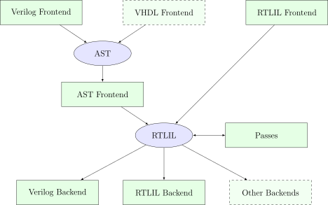
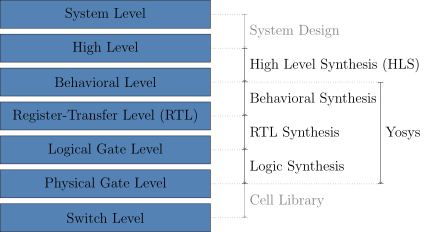
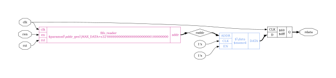
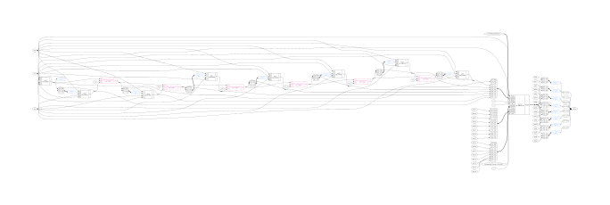

# Yosys: visual reference (ECP5 flow)

Yosys is the synthesis step of the open-source Lattice ECP5 flow. It reads Verilog, turns it into its internal netlist format (RTLIL), optimises it and maps it onto ECP5 primitives. `synth_ecp5` then writes a JSON netlist for nextpnr.

```
Verilog (.v/.sv)
   │  yosys -p "read_verilog top.v; synth_ecp5 -top top -json top.json"
   ▼
top.json  (netlist of LUT4 / TRELLIS_FF / CCU2C / DP16KD / MULT18X18D ... cells)
   │  nextpnr-ecp5 --25k|--45k|--85k --package CABGA381 --lpf top.lpf \
   │               --json top.json --textcfg top.config --freq 25
   ▼
top.config (textual bitstream config)
   │  ecppack top.config top.bit
   ▼
top.bit  →  board (openFPGALoader / ecpprog / ujprog)
```

Yosys only produces the netlist. It knows nothing about pins, placement or timing closure; those belong to nextpnr (see `../nextpnr-ecp5/README.md`).

Typical invocation for an agent:

```sh
yosys -l synth.log -p "read_verilog -sv src/top.v; synth_ecp5 -top top -json build/top.json; tee -o build/stat.txt stat"
echo "exit=$?"     # 0 = success, non-zero = an ERROR was raised
```

---

## Images

All images come from the official Yosys documentation (YosysHQ, ISC licence). They are SVGs, so they render at any zoom. The schematics were produced by the `show` command (Graphviz `dot`) on the docs' `fifo.v` example. Note that the docs' worked example targets **iCE40** (`synth_ice40`), so the mapped cells carry `SB_*` names; on ECP5 the same stages produce `LUT4`, `TRELLIS_FF`, `CCU2C` and `DP16KD` instead.

### 1. Yosys simplified data flow



Source: https://yosyshq.readthedocs.io/projects/yosys/en/latest/_images/overview_flow.svg (page: https://yosyshq.readthedocs.io/projects/yosys/en/latest/yosys_internals/flow/overview.html, Fig. 54)

Region by region:

- **Top row (frontends, green boxes):** "Verilog Frontend", "VHDL Frontend" (dashed border, meaning optional or external, e.g. through the GHDL plugin) and "RTLIL Frontend". These are `read_verilog`, `ghdl` and `read_rtlil`.
- **AST ellipse (lavender):** Verilog and VHDL are first parsed into an abstract syntax tree. Ellipses are data structures and rectangles are program modules, as the figure caption says.
- **AST Frontend box:** converts the AST into RTLIL. Most "unsupported construct" errors come from here or from the parser above it.
- **RTLIL ellipse (centre):** the single in-memory netlist. The RTLIL frontend feeds it directly, with no AST step.
- **Passes box (right, double-headed arrow):** every command (`proc`, `opt`, `techmap`, `abc`, `synth_ecp5` ...) reads and rewrites RTLIL in place. That is why the arrow points both ways.
- **Bottom row (backends):** "Verilog Backend" (`write_verilog`), "RTLIL Backend" (`write_rtlil`) and dashed "Other Backends". `write_json`, which `synth_ecp5 -json` calls for nextpnr, is one of the "other" backends.

### 2. Where Yosys sits in the levels of abstraction



Source: https://yosyshq.readthedocs.io/projects/yosys/en/latest/_images/levels_of_abstraction.svg (page: https://yosyshq.readthedocs.io/projects/yosys/en/latest/introduction.html, Fig. 1)

- **Left column (blue bars, top to bottom):** System Level, High Level, Behavioral Level, Register-Transfer Level (RTL), Logical Gate Level, Physical Gate Level, Switch Level.
- **Middle column (arrows between levels):** System Design (grey), High Level Synthesis (HLS), Behavioral Synthesis, RTL Synthesis, Logic Synthesis, Cell Library (grey).
- **Right bracket "Yosys":** spans Behavioral Level down to Physical Gate Level. Yosys covers behavioural, RTL and logic synthesis. It does not do HLS (C to RTL) or transistor/cell-library work. For an FPGA, the "physical gate level" means device primitives (LUT4, FF, carry, BRAM).

### 3. `show` schematic of a small module (`addr_gen` after `hierarchy`)


Source: https://yosyshq.readthedocs.io/projects/yosys/en/latest/_images/addr_gen_show.svg (page: https://yosyshq.readthedocs.io/projects/yosys/en/latest/getting_started/scripting_intro.html, Fig. 18, produced by `show addr_gen`)

How to read a Yosys `show` diagram, using this one:

- **Octagons = module ports:** `rst`, `clk`, `en` (inputs) and `addr` (the output, which also feeds back internally).
- **Ellipses = constants:** `255` and `1`.
- **Rectangles with port columns = cells:** `$2 $eq` (inputs A, B, output Y) compares `addr` with 255. `$3 $add` adds 1 to `addr`. The `$`-prefixed names are auto-generated cell IDs and the second line is the cell type.
- **Rounded boxes "PROC $1 fifo.v:12.2-20.6" and "PROC $4 fifo.v:8.9-8.9":** unconverted `always` and `initial` processes, with source file and line:column ranges. They disappear once `proc` runs. If PROC boxes are still there at the end, `proc` was not run.
- **Small rounded slice boxes ("0 -> 31:8 / 7:0 - 7:0", "7:0 - 7:0"):** bit-slicing and concatenation. Here the 8-bit `addr` is zero-extended to 32 bits ("0 -> 31:8") to compare with the 32-bit constant.
- **Line thickness:** thick lines are multi-bit buses and thin lines are single bits. Diamond-ended thick lines mark bus splitting and joining points.
- **Caption "addr_gen"** at the bottom is the module name.

### 4. `show` of the `rdata` path after `proc` (hierarchical, before flattening)



Source: https://yosyshq.readthedocs.io/projects/yosys/en/latest/_images/rdata_proc.svg (page: https://yosyshq.readthedocs.io/projects/yosys/en/latest/getting_started/example_synth.html, Fig. 5)

- **Left: inputs `clk`, `ren`, `rst`** go into a **magenta submodule instance** `fifo_reader` of type `$paramod\addr_gen\MAX_DATA=s32'...100000000`. Magenta cells are module instances. The `$paramod` name records the parameter override (MAX_DATA = 256) baked into the specialised copy.
- **Diamond `raddr`:** a named internal wire.
- **Blue cell `$\data $memrd`:** a memory read port (ADDR, CLK, EN, DATA) on the memory `data`. Its CLK and EN are tied to `1'x` (undefined) because, at this stage, the read is asynchronous and the register is still separate.
- **Black `$60 $dff` (CLK, D, Q):** the output register feeding the `rdata` output port. Later passes (`memory_dff`) fold this flip-flop into the memory read port, so the memory can map to block RAM.

### 5. `show` of the same path after LUT mapping (dense, after `map_luts`)



Source: https://yosyshq.readthedocs.io/projects/yosys/en/latest/_images/rdata_map_luts.svg (page: https://yosyshq.readthedocs.io/projects/yosys/en/latest/getting_started/example_synth.html, Fig. 16)

At normal zoom this is a wide mesh of wires. Zoomed in, it shows:

- **Left third:** the address counter is now a chain of **`SB_DFFER` flip-flops** (`$618`, `$619`, `$620` ...; pins C, D, E, R are clock, data, enable and reset) and **magenta `SB_CARRY` cells** (`$451.slice[1].carry`, pins CI/I0/I1/CO) forming the ripple-carry incrementer. **Blue `$lut` cells** (`$120`, `$3264`, `$3300` ...) are generic LUTs that `map_cells` has not yet turned into device LUTs. Inputs `rst` and `ren` fan out to every flip-flop.
- **Right third:** a single **`data.0.0 SB_RAM40_4K`** block RAM (ports MASK, RADDR, RCLK, RCLKE, RE, WADDR, WCLK, WCLKE, WDATA, WE, RDATA). The 256-entry memory was inferred as a BRAM rather than flip-flops. Its RDATA bus is sliced ("8:8 - 2:2", "0:0 - 1:1" ...) into small `$lut` cells (`$3204` to `$3210`) and the slices are rejoined into the 8-bit `rdata` output.
- **ECP5 equivalents:** `SB_DFFER` becomes `TRELLIS_FF`, `SB_CARRY` becomes `CCU2C`, `SB_RAM40_4K` becomes `DP16KD`, and `$lut` becomes `LUT4` after `synth_ecp5`.
- **Agent tip:** do not `show` a whole synthesised design. Graphviz output becomes unreadable above a few dozen cells. Use `show -format svg -prefix out <selection>` on a small selection, or rely on `stat`.

---

## Reading the `stat` report (text, no screenshot found)

`stat` (or `tee -o stat.txt stat`, or `stat -json` in recent Yosys) prints a per-module and top-level cell count. After `synth_ecp5` it looks like this (illustrative shape; numbers vary):

```
=== top ===

   Number of wires:                 42
   Number of wire bits:            187
   Number of public wires:           6
   Number of public wire bits:      40
   Number of cells:                 71
     CCU2C                          13
     LUT4                           29
     TRELLIS_FF                     26
     TRELLIS_IO                      ...   (only if IO buffers are inserted)
```

What to look at:

- **`LUT4`**: logic. One ECP5 slice holds 2 LUT4 + 2 FF. The 25k part (LFE5U-25F) has about 24k LUT4, the 45k about 44k and the 85k about 84k.
- **`TRELLIS_FF`**: registers. Unexpectedly zero means logic was optimised away, which usually means an output is unused or undriven.
- **`CCU2C`**: 2-bit carry chains (adders, counters, comparators).
- **`DP16KD`**: 18 Kbit block RAMs. **`MULT18X18D` / `ALU54B`**: DSP blocks.
- **`$...` cells still present** (e.g. `$mul`, `$mem`, `$dff`): something was not mapped to a device primitive, which nextpnr will reject.
- These are pre-place-and-route estimates. The authoritative utilisation comes from nextpnr's "Device utilisation" block.

## Common errors and how they look

| Problem | What you see in the log | Fix |
|---|---|---|
| Syntax / unsupported construct | `ERROR: ... syntax error, unexpected ...` with `file.v:LINE`; SystemVerilog features need `read_verilog -sv` | Add `-sv`, or rewrite the construct (classes, dynamic arrays, most interfaces and `#delay` timing are not synthesisable) |
| Missing module | `ERROR: Module `\foo' referenced in module `\top' in cell `\u0' is not part of the design.` | Read the file that defines `foo`, or check the spelling |
| Wrong top | `ERROR: Module `\top' not found!` or the wrong module is kept | Pass `-top <name>` to `synth_ecp5` |
| Multiple drivers | `Warning: multiple conflicting drivers for top.\x` (from `check`) | Drive each signal from one `always` block |
| Latch inferred | `Latch inferred for signal ...` (from `proc_dlatch`) | Assign every signal on every path of an `always @*` |
| Design optimised away | `stat` shows almost no cells | Make sure outputs are connected to ports. Use `(* keep *)` only for debugging |

Run `check -assert` after synthesis to turn warnings such as multiple drivers into a hard error (non-zero exit).

## Tips for an AI agent

- **Always write a log:** `yosys -l synth.log ...` (`-q` suppresses console noise but keeps the log). Lines starting with `ERROR:` are fatal, and yosys exits non-zero. `Warning:` lines are worth collecting and de-duplicating.
- **Exit code first:** 0 means a netlist was written. Any non-zero code means stop and report the first `ERROR:` line with its `file:line`.
- **Parse `stat` from a file** (`tee -o stat.txt stat`) or use `stat -json` when available. Extract the `LUT4`, `TRELLIS_FF`, `CCU2C`, `DP16KD` and `MULT18X18D` counts and warn if any `$`-prefixed cell types remain.
- **Grep for latches and multiple drivers.** They synthesise "successfully" but are almost always bugs.
- **Check that the JSON exists** and is non-empty before invoking nextpnr.
- **Schematics:** `show -format svg -prefix build/sch <module>` writes `build/sch.svg` without opening a viewer. Keep selections small.

## Gaps (images not found)

- No real screenshot of a Yosys **terminal synthesis log** or of the **`stat` report** was found in the official docs or reputable tutorials. Both are plain text, and the formats are described above instead.
- The official `show` examples target iCE40. No ECP5-mapped (`TRELLIS_FF`/`LUT4`/`CCU2C`) schematic image was found.
- Nothing relevant was found on Wikimedia Commons.

---

## Real `stat` output from this machine (Yosys 0.70+145, verified 2026-10-18)

This is from `synth_ecp5` of an 8-LED blinky with a 26-bit counter. The full log is in [`../nextpnr-ecp5/real-run/yosys.log`](../nextpnr-ecp5/real-run/yosys.log).

```
=== blinky ===
       40 cells
       13   CCU2C        <- ECP5 carry-chain cells (2 adder bits each)
        1   LUT4
       26   TRELLIS_FF   <- one flip-flop per counter bit
```

`yosys -q` silences the terminal, but `-l yosys.log` still records everything. Exit code is 0 on success.
